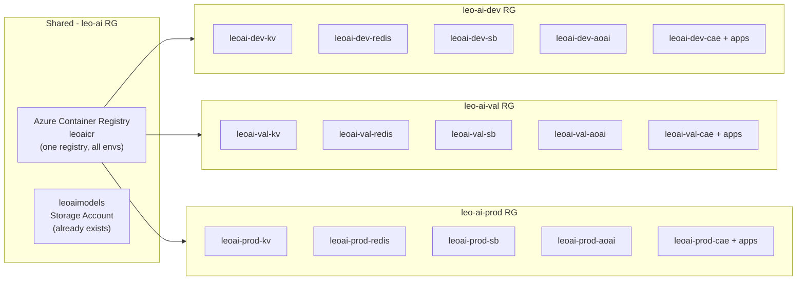
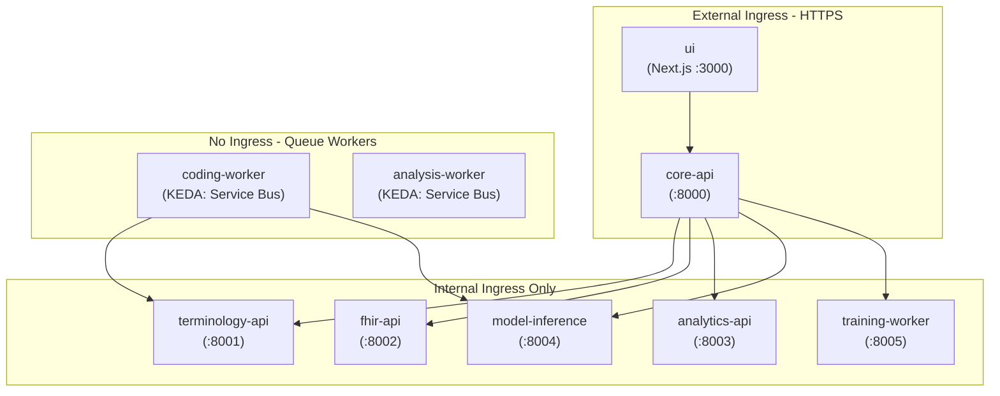
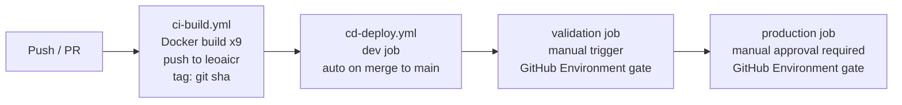

# Azure Infrastructure Build-Out

## Current State

- **Resource group**: `leo-ai` in `uksouth` (subscription `Main SaaS Subscription`) — repurposed as the **shared/platform** RG
- **Already provisioned**: `leoaimodels` Storage Account (NER model artifacts) + EventGrid topic — referenced, not recreated
- **All 6 required Azure providers**: already registered
- **7 of 9 Dockerfiles** exist in `infra/dockerfiles/` — `Dockerfile.model-inference` and `Dockerfile.training-worker` are missing
- **No IaC, no CI/CD** exists yet — clean slate

## Environment Strategy

Three fully isolated environments, each with its own resource group. Separate subscriptions are supported by passing `-SubscriptionId` to the deploy script — no structural changes needed.




**ACR is shared** across environments — images are environment-agnostic, only image tags differ (`sha-abc123` promoted through envs). If subscriptions are separated, ACR stays in a dedicated platform subscription and Container Apps are granted `AcrPull` cross-subscription via Managed Identity.

### Per-Environment Sizing


| Resource                    | dev                        | validation                | production                                |
| --------------------------- | -------------------------- | ------------------------- | ----------------------------------------- |
| Redis (Azure Managed Redis) | Balanced B1 (1 GB, HA off) | Balanced B3 (3 GB, HA on) | Balanced B6 (6 GB, HA on, zone-redundant) |
| Service Bus                 | Standard                   | Standard                  | Premium (VNet isolation)                  |
| Container Apps min replicas | 0                          | 1                         | 2                                         |
| Azure OpenAI                | `gpt-4o` shared capacity   | `gpt-4o` shared capacity  | `gpt-4o` provisioned throughput           |


## File Structure

```
infra/
├── bicep/
│   ├── main.bicep                        # Orchestrator — calls all modules, takes `environment` param
│   ├── parameters/
│   │   ├── dev.bicepparam                # Dev values (small SKUs, HA off)
│   │   ├── validation.bicepparam         # Validation values (prod-like SKUs)
│   │   └── production.bicepparam         # Prod values (premium SKUs, zone redundancy)
│   └── modules/
│       ├── acr.bicep                     # Container Registry (shared, deployed once)
│       ├── keyvault.bicep                # Key Vault
│       ├── redis.bicep                   # Azure Managed Redis (Microsoft.Cache/redisEnterprise)
│       ├── servicebus.bicep              # Service Bus + coding-jobs + analysis-jobs queues
│       ├── openai.bicep                  # Azure OpenAI + gpt-4o deployment
│       └── container-apps.bicep          # Log Analytics + CAE + all 9 apps
├── scripts/
│   └── deploy.ps1                        # Wraps az deployment group create
└── dockerfiles/
    ├── (7 existing files unchanged)
    ├── Dockerfile.model-inference         # NEW
    └── Dockerfile.training-worker         # NEW
.github/
└── workflows/
    ├── ci-build.yml                       # Build + push on any push; tags image with git sha
    └── cd-deploy.yml                      # Environment-gated deploy (dev → val → prod)
```

### deploy.ps1 interface

```powershell
# Same-subscription, separate RGs (minimum viable):
.\deploy.ps1 -Environment dev
.\deploy.ps1 -Environment validation
.\deploy.ps1 -Environment production

# Separate subscriptions (just add -SubscriptionId):
.\deploy.ps1 -Environment production -SubscriptionId "xxxxxxxx-xxxx-xxxx-xxxx-xxxxxxxxxxxx"
```

The script calls `az account set` if `-SubscriptionId` is provided, then runs:

```powershell
az deployment group create `
  --resource-group "leo-ai-$Environment" `
  --template-file infra/bicep/main.bicep `
  --parameters infra/bicep/parameters/$Environment.bicepparam
```

### Bicep environment parameter

All resource names in `main.bicep` use an `environment` parameter to self-namespace:

```bicep
param environment string  // 'dev' | 'val' | 'prod'
var prefix = 'leoai-${environment}'
// yields: leoai-dev-kv, leoai-val-kv, leoai-prod-kv, etc.
```

## Container Apps Topology (per environment)




- **External ingress**: `ui`, `core-api`
- **Internal ingress**: all backend APIs
- **No ingress**: `coding-worker`, `analysis-worker` — KEDA scales 0→N on Service Bus queue depth
- **Managed Identity** (User-Assigned, one per environment) — `AcrPull`, `Key Vault Secrets User`, `Storage Blob Data Contributor`, `Azure Service Bus Data Owner`

## CI/CD Flow




- `**ci-build.yml**`: builds all 9 images on every push, tags with git sha, pushes to shared `leoaicr`; uses OIDC federated credential (no stored secrets)
- `**cd-deploy.yml**`: three jobs (`dev`, `validation`, `production`); `dev` auto-triggers on merge to `main`; `validation` and `production` use GitHub Environment protection rules requiring manual approval
- Image promotion: the same sha-tagged image flows through all three environments — no rebuilds between envs

## Key Design Decisions

- **Azure Managed Redis** (`Microsoft.Cache/redisEnterprise`) — Azure Cache for Redis creation blocked April 1 2026
- **Shared ACR** in the existing `leo-ai` platform RG — avoids duplicating image storage; cross-subscription pull supported via Managed Identity RBAC
- **Per-environment Key Vault** — each environment holds its own secrets; dev Neo4j Aura credentials are separate from prod
- **KEDA Service Bus scaler** on workers — scale-to-zero in dev, min 1 in val/prod
- `**leoaimodels` Storage Account** referenced by resource ID (not recreated)
- Neo4j Aura + AWS Bedrock remain external — credentials stored per-environment in Key Vault

## Secrets & Environment Variable Strategy

Every variable from `.env.example` falls into one of three categories. Nothing requires manual wiring in the portal — all of it is scripted.

### Category 1 — Secrets (Key Vault per environment)

These are pushed by `migrate-secrets.ps1` and injected into Container Apps via Key Vault secret references (managed identity, no plaintext in Bicep):


| Secret name in KV          | Source var                       | Notes                                          |
| -------------------------- | -------------------------------- | ---------------------------------------------- |
| `neo4j-patient-uri`        | `NEO4J_URI`                      | Per-environment Aura URI                       |
| `neo4j-patient-password`   | `NEO4J_PASSWORD`                 |                                                |
| `neo4j-knowledge-uri`      | `KNOWLEDGE_GRAPH_NEO4J_URI`      | Per-environment Aura URI                       |
| `neo4j-knowledge-password` | `KNOWLEDGE_GRAPH_NEO4J_PASSWORD` |                                                |
| `redis-url`                | `REDIS_URL`                      | Azure Managed Redis URL incl. access key       |
| `aws-access-key-id`        | `AWS_ACCESS_KEY_ID`              |                                                |
| `aws-secret-access-key`    | `AWS_SECRET_ACCESS_KEY`          |                                                |
| `azure-openai-api-key`     | `AZURE_OPENAI_API_KEY`           | Output from `openai.bicep`, auto-written to KV |
| `azure-ad-client-id`       | `AZURE_AD_CLIENT_ID`             | App Registration client ID                     |


Service Bus and Storage Account use **Managed Identity** — no connection strings needed; those variables are removed entirely.

### Category 2 — Plain config (set directly on Container Apps in Bicep, vary by environment)

These go into `parameters/dev.bicepparam`, `validation.bicepparam`, `production.bicepparam` and are injected as plain env vars at deploy time. No secrets, safe to store in version control:


| Variable                         | dev                          | validation              | production              |
| -------------------------------- | ---------------------------- | ----------------------- | ----------------------- |
| `NEO4J_USER`                     | `neo4j`                      | `neo4j`                 | `neo4j`                 |
| `KNOWLEDGE_GRAPH_NEO4J_USERNAME` | `neo4j`                      | `neo4j`                 | `neo4j`                 |
| `AZURE_AD_TENANT_ID`             | (shared)                     | (shared)                | (shared)                |
| `AWS_BEDROCK_MODEL`              | ARN                          | ARN                     | ARN                     |
| `AWS_DEFAULT_REGION`             | `eu-west-2`                  | `eu-west-2`             | `eu-west-2`             |
| `AZURE_OPENAI_BIG_MODEL`         | `gpt-4o`                     | `gpt-4o`                | `gpt-4o`                |
| `AZURE_OPENAI_API_VERSION`       | `2024-02-15-preview`         | `2024-02-15-preview`    | `2024-02-15-preview`    |
| `CODING_EXTRACTOR_BACKEND`       | `llm`                        | `llm`                   | `llm`                   |
| `CODING_EXTRACTOR_STRICT`        | `false`                      | `false`                 | `true`                  |
| `MODEL_STORE_CONTAINER`          | `ner-models`                 | `ner-models`            | `ner-models`            |
| `MODEL_STORE_MODEL_NAME`         | `medspacy_clinical_ner`      | `medspacy_clinical_ner` | `medspacy_clinical_ner` |
| `HITL_LOW_CONFIDENCE_THRESHOLD`  | `0.5`                        | `0.5`                   | `0.5`                   |
| `HITL_PEER_REVIEW_RATE`          | `0.10`                       | `0.10`                  | `0.10`                  |
| `MODEL_MIN_PRECISION`            | `0.80`                       | `0.80`                  | `0.80`                  |
| `SB_MAX_LOCK_RENEWAL_SECONDS`    | `14400`                      | `14400`                 | `14400`                 |
| ... other thresholds             | from `.env.example` defaults | same                    | same                    |


### Category 3 — Auto-computed in Bicep (inter-service URLs, no manual config)

Within a Container Apps Environment, apps address each other by name over the internal network. Bicep constructs these from the app names — you never touch them manually:


| Variable                      | Value (all envs)                            | How set                                   |
| ----------------------------- | ------------------------------------------- | ----------------------------------------- |
| `TERMINOLOGY_API_URL`         | `http://terminology-api`                    | Bicep output from app name                |
| `FHIR_API_URL`                | `http://fhir-api`                           | Bicep output from app name                |
| `ANALYTICS_API_URL`           | `http://analytics-api`                      | Bicep output from app name                |
| `CODING_MODEL_ENDPOINT`       | `http://model-inference`                    | Bicep output from app name                |
| `AZURE_SERVICE_BUS_NAMESPACE` | `leoai-{env}-sb.servicebus.windows.net`     | Bicep output — replaces connection string |
| `AZURE_STORAGE_ACCOUNT_URL`   | `https://leoaimodels.blob.core.windows.net` | Bicep output — replaces connection string |
| `AZURE_OPENAI_ENDPOINT`       | output from `openai.bicep`                  | Bicep output                              |


### migrate-secrets.ps1 workflow

```
infra/scripts/migrate-secrets.ps1
  -Environment  dev | val | prod
  -SourceFile   path\to\secrets\.env   (default: secrets\.env)
  -WhatIf       dry-run, shows what would be written
```

The script:

1. Parses `SourceFile` into a key-value map
2. For each secret in the table above, reads the value (or prompts interactively if blank)
3. Writes to `leoai-{env}-kv` via `az keyvault secret set`
4. Reports a success/skip/error summary — never prints secret values to the console
5. Idempotent — re-running only overwrites if the value has changed

The Azure OpenAI API key and Service Bus/Storage connection details are **auto-populated from Bicep outputs** — `migrate-secrets.ps1` does not need to handle those; `deploy.ps1` writes them into KV immediately after the Bicep deployment completes.

## Execution Order

1. Deploy ACR into shared `leo-ai` RG (one-time): `.\deploy.ps1 -Environment shared`
2. Run `.\deploy.ps1 -Environment dev` — provisions all dev services in `leo-ai-dev`; Bicep auto-writes OpenAI endpoint + Service Bus hostname into `leoai-dev-kv`
3. Run `.\infra\scripts\migrate-secrets.ps1 -Environment dev` — reads `secrets\.env`, writes Neo4j URIs/passwords + AWS creds + AD client ID to `leoai-dev-kv`
4. Create two missing Dockerfiles (`model-inference`, `training-worker`)
5. Create GitHub Actions workflows + GitHub Environments with protection rules
6. First manual `docker build + push` to seed ACR; dev Container Apps start and pull all config from KV
7. Repeat steps 2–3 for `validation` and `production` when ready (each environment has its own `.env`-equivalent values)

