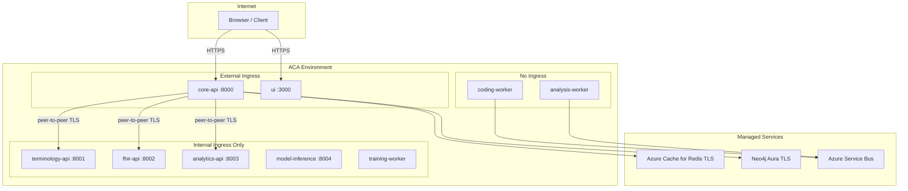
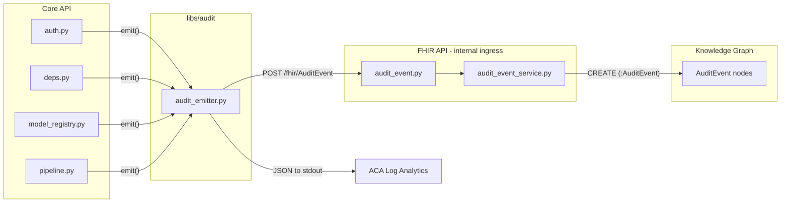

# Close All Security Gaps and Test (ACA Deployment)

## Deployment Context

Target: **Azure Container Apps (ACA)**. This changes the risk profile significantly.




### What ACA resolves or mitigates

- **Network segmentation**: Internal ingress eliminates external attack surface for FHIR-S-001, ANLAPI-S-001, TERM-S-001, COD-I-002. Compensating control only (compromised container can still reach).
- **TLS termination**: Envoy proxy with `allowInsecure: false` forces HTTPS. Session cookie always over HTTPS in practice.
- **Redis/Neo4j TLS**: Azure Cache for Redis and Neo4j Aura enforce TLS. Verify `rediss://` and `neo4j+s://` URI schemes.
- **GAP-004 reclassified**: terminology-api on internal ingress eliminates direct external attack. Still implement auth as defence-in-depth.
- **GAP-007 partially mitigated**: Internal ingress + peer-to-peer TLS encrypts inter-service traffic. Shared secret becomes defence-in-depth, not primary control.

### What ACA does NOT resolve (still critical)

- **GAP-001**: ACA Envoy does not strip `X-User-Email`. CHAIN-001 fully exploitable.
- **GAP-003**: Model registry on external core-api ingress. CHAIN-002 fully exploitable.
- **GAP-002**: ACA does not validate app-level OAuth tokens.
- **GAP-008**: De-identification is purely application-level.
- **GAP-012**: ACA Log Analytics provides log durability but not structured security audit trail.

### ACA-specific changes

- **AUTH-D-001 upgraded to Medium**: ACA horizontal scaling makes in-memory session fallback actively dangerous. Remove fallback entirely; return 503 if Redis unavailable.
- **AUTH-I-001 reclassified to Medium**: ACA TLS termination means cookie always HTTPS in practice, but `secure=False` code fix still needed.
- Three new ACA-specific threats to add to threat model: ACA-S-001 (managed identity scope), ACA-C-001 (peer-to-peer TLS config), ACA-D-001 (scale-to-zero session state).

---

## Implementation Order (ACA-revised priorities)

### Phase 1 — P0: Production Blockers

**GAP-001 — Remove X-User-Email header identity spoofing**

ACA impact: **None**. Envoy passes custom headers through unchanged.

Files:

- `[services/api/app/deps.py](services/api/app/deps.py)` — rewrite `get_caller_scope_from_request` to derive identity exclusively from `leo_session` cookie. Remove `x_user_email` header and `email` query param.
- `[libs/auth/org_scope.py](libs/auth/org_scope.py)` — the base `get_caller_scope` function (line 196) still accepts `X-User-Email` and `?email=`. Since core-api overrides it via `dependency_overrides` (main.py line 72), this function is only reachable on internal services behind ACA internal ingress. Add a docstring warning that it must only be used behind internal ingress + service auth (GAP-007).

```python
# New deps.py get_caller_scope_from_request:
def get_caller_scope_from_request(
    leo_session: Annotated[str | None, Cookie(alias=COOKIE_NAME)] = None,
) -> CallerScope:
    if not leo_session:
        raise HTTPException(status_code=401, detail="Not authenticated")
    data = load_session(leo_session)
    if not data:
        raise HTTPException(status_code=401, detail="Session expired")
    caller_email = (data.get("email") or "").strip().lower()
    if not caller_email:
        raise HTTPException(status_code=401, detail="No email in session")
    client = PatientGraphClient()
    try:
        return resolve_caller_scope(client, caller_email)
    finally:
        client.close()
```

**GAP-003 — Auth-gate model registry endpoints**

ACA impact: **None**. Model registry is on the externally-exposed core-api router.

File: `[services/api/app/routers/model_registry.py](services/api/app/routers/model_registry.py)`

Add `CallerScope = Depends(get_caller_scope)` to all 14 route handlers. Add `_require_admin(scope)` guard to destructive operations: `register`, `upload`, `promote`, `reject`, `rollback`, `start_canary`, `record_canary_result`, `run_canary_gold`.

---

### Phase 2 — P1: High-Severity Code Fixes

**GAP-002 — JWT signature verification**

ACA impact: **None** (Easy Auth is an alternative but not adopted for this iteration).

File: `[services/api/app/routers/auth.py](services/api/app/routers/auth.py)`

Replace raw base64 decode (lines 118-136, 138-149) with JWKS-based verification using `python-jose[cryptography]` (already in `requirements.txt`). Fetch Azure AD v2.0 JWKS from `https://login.microsoftonline.com/{tenant}/discovery/v2.0/keys`, cache keyset with TTL, verify both `id_token` and `access_token` signatures. Extract claims from verified payload.

**GAP-008 — NER-based de-identification enhancement**

ACA impact: **None**. Purely application-level.

File: `[libs/utils/deidentify.py](libs/utils/deidentify.py)`

Add `deidentify_text_with_ner(text, nlp=None)` function:

1. Run regex-based `deidentify_text()` first (existing).
2. Load spaCy `en_core_web_sm` model (lazy, cached) and run NER for `PERSON` entities.
3. Replace any `PERSON` entity not already substituted with `[PERSON]`.
4. Return `DeidentifyResult` with cleaned text and `residual_phi_warning` flag.

Update callers: `[services/coding_worker/app/pipeline/llm_extractor.py](services/coding_worker/app/pipeline/llm_extractor.py)` and `[services/api/app/services/label_verifier.py](services/api/app/services/label_verifier.py)`.

**GAP-012 — Durable security audit log (FHIR R4B AuditEvent)**

ACA impact: **Partially mitigated** — ACA Log Analytics provides log durability. App must emit structured JSON security events. FHIR AuditEvent provides the structured schema and queryable persistence.




New files:

- `**libs/audit/__init__.py**` and `**libs/audit/audit_emitter.py**` — fire-and-forget HTTP POST to FHIR API `/fhir/AuditEvent`. Also emits structured JSON to `logging` (captured by ACA Log Analytics). Builds FHIR R4B AuditEvent with: `type` (DCM codes), `recorded` (ISO timestamp), `outcome` (0/4/8/12), `agent` (email, role), `source` (service name), `entity` (patient ID, model version, etc.). Helper functions: `emit_auth_event()`, `emit_access_event()`, `emit_model_event()`, `emit_pipeline_event()`. Uses background thread so audit never blocks the request path.
- `**services/fhir_api/app/routers/audit_event.py**` — `POST /fhir/AuditEvent` (service-auth gated), `GET /fhir/AuditEvent` (search by date, agent, type), `GET /fhir/AuditEvent/{id}`.
- `**services/fhir_api/app/services/audit_event_service.py**` — persist as Neo4j node in Knowledge Graph (label: `AuditEvent`, indexed on `recorded`).

Instrumentation points:

- `[services/api/app/routers/auth.py](services/api/app/routers/auth.py)` — login success/failure, logout
- `[services/api/app/deps.py](services/api/app/deps.py)` — authorization failure (401)
- `[services/api/app/routers/model_registry.py](services/api/app/routers/model_registry.py)` — register, upload, promote, reject, rollback
- `[services/api/app/routers/pipeline.py](services/api/app/routers/pipeline.py)` — pipeline run start
- `[services/api/app/routers/patients.py](services/api/app/routers/patients.py)` — patient data access

**GAP-005 — Configurable cookie secure flag**

ACA impact: **Partially mitigated** — ACA TLS termination means cookies always HTTPS in practice. Code fix still required as defence-in-depth.

File: `[services/api/app/routers/auth.py](services/api/app/routers/auth.py)` line 177

```python
COOKIE_SECURE = os.getenv("COOKIE_SECURE", "true").lower() in ("true", "1", "yes")
```

**GAP-011 + AUTH-D-001 — Session hardening**

ACA impact: **AUTH-D-001 upgraded to Medium** — horizontal scaling makes in-memory fallback dangerous.

File: `[services/api/app/services/session_store.py](services/api/app/services/session_store.py)`

- Change `SESSION_TTL` from 7 days to 12 hours (configurable via `SESSION_TTL_HOURS` env var).
- Add `SESSION_ABSOLUTE_LIFETIME` of 24 hours.
- **Remove in-memory session fallback entirely.** If Redis is unavailable, raise `HTTPException(503, "Session store unavailable")` instead of silently degrading. ACA replicas must share session state.
- Add `rotate_session(old_id)` — creates new session ID, copies data, deletes old, returns new ID.
- Add `created_at` to session data; reject sessions older than absolute lifetime.
- Call `rotate_session` on each `/auth/session` hit (sliding window) in `[services/api/app/routers/auth.py](services/api/app/routers/auth.py)`.

---

### Phase 3 — P2: Defence-in-Depth

**GAP-004 — Auth-gate terminology write endpoints**

ACA impact: **Significantly mitigated** — terminology-api on internal ingress. Auth is defence-in-depth against compromised container.

File: `[services/api/app/routers/terminology.py](services/api/app/routers/terminology.py)`

Add `CallerScope = Depends(get_caller_scope)` to all endpoints (state-changing and read-only).

**Games router**: Add `CallerScope` to `submit_score` in `[services/api/app/routers/games.py](services/api/app/routers/games.py)`.

**GAP-007 — Inter-service authentication (shared secret)**

ACA impact: **Significantly mitigated** — internal ingress + peer-to-peer TLS as primary control. Shared secret is defence-in-depth.

- New file: `[libs/auth/service_auth.py](libs/auth/service_auth.py)` — `verify_service_token()` dependency and `get_service_auth_header()` helper. Reads `SERVICE_AUTH_SECRET` env var.
- Add middleware to `[services/terminology_api/app/main.py](services/terminology_api/app/main.py)`, `[services/fhir_api/app/main.py](services/fhir_api/app/main.py)`, `[services/analytics_api/app/main.py](services/analytics_api/app/main.py)` — check `Authorization: Bearer {SERVICE_AUTH_SECRET}` on non-health endpoints.
- Update callers: `[services/coding_worker/app/pipeline/pipeline_service.py](services/coding_worker/app/pipeline/pipeline_service.py)`, `[services/api/app/routers/auth.py](services/api/app/routers/auth.py)` (`_fetch_org_context`), `[services/api/app/routers/proxy.py](services/api/app/routers/proxy.py)`.

**GAP-010 — OAuth state CSRF protection**

File: `[services/api/app/routers/auth.py](services/api/app/routers/auth.py)` — In `/login`: generate nonce, store in short-lived cookie, embed `nonce|next_url` in OAuth `state`. In `/callback`: validate nonce against cookie.

**GAP-009 — CSRF protection**

- `[services/api/app/main.py](services/api/app/main.py)` — middleware requiring `X-Requested-With: XMLHttpRequest` on `POST/PUT/PATCH/DELETE` (except `/auth/callback`).
- `[services/ui/src/lib/api/client.ts](services/ui/src/lib/api/client.ts)` — add header to `requestHeaders` in `apiFetch`.

**GAP-006 — Rate limiting**

- `[requirements.txt](requirements.txt)` — add `slowapi>=0.1`
- `[services/api/app/main.py](services/api/app/main.py)` — `SlowAPI` middleware, default `100/minute` per IP.

**GAP-013 — Configurable CORS origins**

- `[services/api/app/main.py](services/api/app/main.py)` — `ALLOWED_ORIGINS` env var (comma-separated), default `http://localhost:3000,http://127.0.0.1:3000`.
- `[services/terminology_api/app/main.py](services/terminology_api/app/main.py)`, `[services/fhir_api/app/main.py](services/fhir_api/app/main.py)`, `[services/analytics_api/app/main.py](services/analytics_api/app/main.py)` — same pattern. For internal-only services, CORS is less critical but still good practice.

**GAP-014 — Configurable local org list**

File: `[libs/utils/deidentify.py](libs/utils/deidentify.py)` — read `DEID_LOCAL_ORGS` env var (pipe-separated), fall back to hardcoded defaults.

**Message validation** — Add Pydantic schemas for message bus payloads in `[services/coding_worker/app/services/job_handler.py](services/coding_worker/app/services/job_handler.py)` and `[services/analysis_worker/app/services/job_handler.py](services/analysis_worker/app/services/job_handler.py)`.

---

### Phase 4 — Threat Model Update

Update `[design-controls/DC-TM-SEC-001-threat-model.yaml](design-controls/DC-TM-SEC-001-threat-model.yaml)`:

**4a. Trust Zone Diagram**

Add a `trust_zones` section with a mermaid diagram and structured YAML inventory. This makes ACA segmentation claims auditable and maps every data flow to the trust boundary it crosses.

```mermaid
flowchart TB
    subgraph tz0 [Trust Zone 0 - Internet]
        Browser["Browser"]
        Attacker["External Attacker"]
    end

    subgraph tz1 [Trust Zone 1 - Azure ACA External Ingress]
        CoreApi["core-api :8000\nFastAPI + OAuth"]
        UI["ui :3000\nNext.js"]
    end

    subgraph tz2 [Trust Zone 2 - Azure ACA Internal Ingress]
        TermApi["terminology-api :8001"]
        FhirApi["fhir-api :8002"]
        AnalyticsApi["analytics-api :8003"]
        ModelInf["model-inference :8004"]
        TrainWorker["training-worker"]
    end

    subgraph tz3 [Trust Zone 3 - Azure ACA No Ingress]
        CodingWorker["coding-worker"]
        AnalysisWorker["analysis-worker"]
    end

    subgraph tz4 [Trust Zone 4 - Azure Managed Services]
        Redis["Azure Cache for Redis\nTLS :6380"]
        ServiceBus["Azure Service Bus\nAMQP+TLS"]
        BlobStorage["Azure Blob Storage\nHTTPS"]
        AzureOpenAI["Azure OpenAI\nHTTPS"]
    end

    subgraph tz5 [Trust Zone 5 - Neo4j Aura]
        PatientGraph["Patient Graph\nbolt+s://"]
        KnowledgeGraph["Knowledge Graph\nbolt+s://"]
    end

    subgraph tz6 [Trust Zone 6 - AWS]
        Bedrock["AWS Bedrock\nHTTPS"]
    end

    subgraph tz7 [Trust Zone 7 - Microsoft Entra ID]
        AzureAD["Entra ID / Azure AD\nOAuth 2.0 + OIDC"]
    end

    Browser -->|"HTTPS TZ0->TZ1"| CoreApi
    Browser -->|"HTTPS TZ0->TZ1"| UI
    Attacker -.->|"HTTPS TZ0->TZ1"| CoreApi

    CoreApi -->|"peer-TLS TZ1->TZ2"| TermApi
    CoreApi -->|"peer-TLS TZ1->TZ2"| FhirApi
    CoreApi -->|"peer-TLS TZ1->TZ2"| AnalyticsApi
    CoreApi -->|"peer-TLS TZ1->TZ2"| ModelInf

    CoreApi -->|"TLS TZ1->TZ4"| Redis
    CoreApi -->|"TLS TZ1->TZ5"| PatientGraph
    CoreApi -->|"TLS TZ1->TZ5"| KnowledgeGraph
    CoreApi -->|"HTTPS TZ1->TZ7"| AzureAD

    CodingWorker -->|"AMQP+TLS TZ3->TZ4"| ServiceBus
    CodingWorker -->|"peer-TLS TZ3->TZ2"| TermApi
    CodingWorker -->|"TLS TZ3->TZ5"| PatientGraph
    CodingWorker -->|"HTTPS TZ3->TZ6"| Bedrock
    CodingWorker -->|"HTTPS TZ3->TZ4"| AzureOpenAI

    AnalysisWorker -->|"AMQP+TLS TZ3->TZ4"| ServiceBus
    AnalysisWorker -->|"TLS TZ3->TZ5"| PatientGraph
    AnalysisWorker -->|"HTTPS TZ3->TZ4"| AzureOpenAI

    FhirApi -->|"TLS TZ2->TZ5"| PatientGraph
    FhirApi -->|"TLS TZ2->TZ5"| KnowledgeGraph
    AnalyticsApi -->|"TLS TZ2->TZ5"| PatientGraph
    TermApi -->|"TLS TZ2->TZ5"| KnowledgeGraph
    TrainWorker -->|"HTTPS TZ2->TZ4"| BlobStorage
    ModelInf -->|"HTTPS TZ2->TZ4"| BlobStorage
```




The YAML inventory in the threat model will include for each service:

- `trust_zone` (0-7)
- `cloud_provider` (Azure ACA, Neo4j Aura, AWS, Microsoft Entra ID)
- `ingress_type` (external, internal, none)
- `protocols` (HTTPS, peer-TLS, AMQP+TLS, bolt+s)
- `auth_mechanism` (session cookie, service auth secret, managed identity, none)
- `data_classification` (clinical/PII, operational, public)
- Boundary crossings with controls at each crossing point

**4b. ACA-specific threats**

Add three new threats:

- **ACA-S-001**: Managed identity scope over-provisioning. Recommendation: per-service user-assigned managed identities with least-privilege RBAC.
- **ACA-C-001**: Peer-to-peer TLS not enabled by default. Mitigation: `peerTrafficConfiguration.encryption.enabled: true`.
- **ACA-D-001**: Scale-to-zero cold start wipes in-memory state. Mitigation: `minReplicas: 1` on core-api and ui.

**4c. Reclassifications**

- AUTH-D-001: Low -> Medium (ACA horizontal scaling makes in-memory fallback dangerous)
- AUTH-I-001: High -> Medium (ACA TLS termination mitigates in practice)
- GAP-004: High -> Medium (internal ingress eliminates external attack vector)
- GAP-007: High -> Medium (ACA internal ingress + peer-to-peer TLS as compensating control)

**4d. Housekeeping**

- Mark resolved TODO:VERIFY items with ACA evidence.
- Update gap remediation status to reflect code fixes applied.

---

### Phase 5 — Testing

1. **Existing tests** — `pytest tests/` from root. Key: `test_coding_pipeline.py`, `test_fhir_api.py`, `test_model_registry.py`, `test_terminology_api.py`.
2. **New security tests** — `tests/test_security_gaps.py`:
  - `get_caller_scope_from_request` rejects without session cookie
  - `get_caller_scope_from_request` ignores `X-User-Email` header
  - Model registry endpoints return 401 without auth
  - Terminology write endpoints return 401 without auth
  - CSRF middleware rejects POST without `X-Requested-With`
  - OAuth state nonce validation
  - Session rotation and TTL enforcement
  - Session store raises 503 when Redis unavailable (no in-memory fallback)
  - Rate limiter returns 429
3. **UI tests** — `npm test` in `services/ui/`
4. **Manual smoke test** — start app with `scripts/start_primary_care.ps1`, verify login flow, patient list, pipeline run

---

### New Environment Variables Summary

All new env vars with their defaults (for `.env.example` and ACA container app config):

- `COOKIE_SECURE` = `true` (set `false` for local dev only)
- `SESSION_TTL_HOURS` = `12`
- `SERVICE_AUTH_SECRET` = (generate with `openssl rand -hex 32`)
- `ALLOWED_ORIGINS` = `https://your-production-domain.com` (comma-separated)
- `DEID_LOCAL_ORGS` = (pipe-separated org names, falls back to hardcoded defaults)
- `FHIR_API_URL` = `http://fhir-api:8002` (internal ACA hostname)

Existing vars to verify for ACA:

- `REDIS_URL` must use `rediss://` scheme
- `NEO4J_URI` must use `neo4j+s://` or `bolt+s://` scheme

