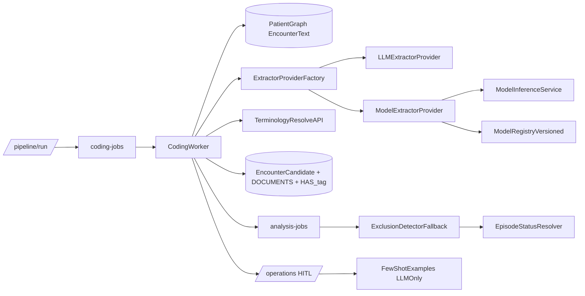

# Model-Agnostic Coding Extractor Plan

## What You Missed In The Original Plan

- Current worker is still hard-wired to LLM extraction in `[C:/Users/RobertSmith/Documents/GitHub/Primary-care-audit/services/coding_worker/app/pipeline/pipeline_service.py](C:/Users/RobertSmith/Documents/GitHub/Primary-care-audit/services/coding_worker/app/pipeline/pipeline_service.py)` via `self.extractor = LLMExtractor(...)`, so runtime backend switching does not exist yet.
- Existing “model inference” path in `[C:/Users/RobertSmith/Documents/GitHub/Primary-care-audit/services/api/app/services/inference_service.py](C:/Users/RobertSmith/Documents/GitHub/Primary-care-audit/services/api/app/services/inference_service.py)` is not wired into the coding worker and returns a different schema than coding writeback expects.
- No explicit contract versioning for extraction DTO (needed to avoid silent breakage between `llm|model` outputs).
- No backend health/readiness gate before job processing (needed for reliable fallback/fail-fast behavior).
- No queue poison-message / repeated-failure guardrails in the migration plan (important with model startup/runtime errors).
- No shadow-comparison mechanism (LLM vs model diff sampling) before cutover.
- No acceptance thresholds for cutover (precision/recall, coding coverage, latency, cost).
- No explicit placement strategy for model runtime scaling. Recommendation: support both, default to service-hosted model inference so extractor replicas can scale independently from coding workers.

## Recommended Target Architecture

## Implementation Plan

### 1) Introduce Extractor Contract + Factory

- Add `ExtractorProvider` protocol + canonical DTO in coding worker, with fields:
  - `text`, `span_start`, `span_end`, `semantic_tag`, `assertion`, `confidence`, `normalized`, `relations?`, `source_meta`.
- Implement providers:
  - `LLMExtractorProvider` wrapping current logic from `[C:/Users/RobertSmith/Documents/GitHub/Primary-care-audit/services/coding_worker/app/pipeline/llm_extractor.py](C:/Users/RobertSmith/Documents/GitHub/Primary-care-audit/services/coding_worker/app/pipeline/llm_extractor.py)`.
  - `ModelExtractorProvider` with two modes: in-process load and remote inference call.
- Add factory/registry in coding worker (no inline branching in `pipeline_service`).

### 2) Runtime Backend Selection + Safe Fallback

- Add envs:
  - `CODING_EXTRACTOR_BACKEND=llm|model|auto`
  - `CODING_EXTRACTOR_STRICT=true|false`
  - `CODING_MODEL_PROVIDER=inproc|service`
  - `CODING_MODEL_ENDPOINT` (for service mode)
  - `CODING_MODEL_TIMEOUT_MS`, `CODING_MODEL_MAX_RETRIES`
- Behavior:
  - `strict=true`: fail-fast if configured backend unavailable.
  - `strict=false`: fallback chain (`model -> llm`) with explicit progress/log events.
- Keep lock-renew and retry behavior unchanged in `[C:/Users/RobertSmith/Documents/GitHub/Primary-care-audit/libs/message_bus/azure_adapter.py](C:/Users/RobertSmith/Documents/GitHub/Primary-care-audit/libs/message_bus/azure_adapter.py)`.

### 3) Refactor CodingPipeline To Be Backend-Agnostic

- Replace direct `LLMExtractor` dependency in `[C:/Users/RobertSmith/Documents/GitHub/Primary-care-audit/services/coding_worker/app/pipeline/pipeline_service.py](C:/Users/RobertSmith/Documents/GitHub/Primary-care-audit/services/coding_worker/app/pipeline/pipeline_service.py)` with `ExtractorProvider`.
- Preserve queue payload contract (`patient_id`, `encounter_id`, `mode`, `run_id`, metadata only).
- Keep current Neo4j fetch pattern and write path unchanged, including:
  - `UPSERT_CANDIDATE` / `CREATE_REVIEW_TASK` in `[C:/Users/RobertSmith/Documents/GitHub/Primary-care-audit/libs/cypher/candidate_queries.py](C:/Users/RobertSmith/Documents/GitHub/Primary-care-audit/libs/cypher/candidate_queries.py)`
  - `write_documents_from_sentences_payload()` in `[C:/Users/RobertSmith/Documents/GitHub/Primary-care-audit/libs/cypher/documents_queries.py](C:/Users/RobertSmith/Documents/GitHub/Primary-care-audit/libs/cypher/documents_queries.py)`
- Add `source/model_name/model_version/contract_version` stamp into candidate payload and relationship metadata.

### 4) Scale Model Backend Independently

- Integrate model provider via service endpoint first (recommended default): worker calls inference service with encounter text fetched from Neo4j.
- Keep optional in-process mode for local/dev and resilience.
- Add health-check and warmup check before provider selection to avoid runtime cold-failure storms.

### 5) Observability + Operational Guardrails

- Add structured progress events per encounter: `fetched`, `extracted`, `resolved`, `persisted`, `fallback_used`, `failed`.
- Emit per-encounter metrics: `entity_count`, `coded_count`, `reject_count`, `extract_latency_ms`, `resolve_latency_ms`, `persist_latency_ms`, `backend_used`.
- Add failure taxonomy in logs/metrics: `backend_unavailable`, `timeout`, `schema_mismatch`, `resolver_error`, `persist_error`.
- Add consecutive-failure threshold alerting for model backend.

### 6) Tests (Missing Today)

- New worker orchestration tests for `[C:/Users/RobertSmith/Documents/GitHub/Primary-care-audit/services/coding_worker/app/services/job_handler.py](C:/Users/RobertSmith/Documents/GitHub/Primary-care-audit/services/coding_worker/app/services/job_handler.py)`: mode routing, analysis trigger, retry propagation.
- Extractor contract tests: both providers produce identical DTO schema.
- Fallback tests: model unavailable/timeouts -> llm path when non-strict; fail-fast when strict.
- Idempotency tests: re-run same encounter does not duplicate effective links/tasks.
- Integration test: queue message -> fetch text -> extract -> resolve -> upsert -> analysis trigger.

### 7) Rollout Strategy

- Phase A: dark-launch `CODING_EXTRACTOR_BACKEND=auto`, primary `llm`, shadow model output (not persisted) on sampled encounters.
- Phase B: dual-run compare report (entity overlap, coding concordance, latency/cost).
- Phase C: canary cutover to `model` for limited org/patient cohort.
- Phase D: full cutover with rollback switch to `llm` via env-only change.

### 8) Add Exclusion Detector Fail-Safe (New)

- Purpose: resolve post-2WW outcomes only when coded anchor path fails to find diagnosis or explicit exclusion.
- Placement: call from episode/status resolution path after coded-anchor checks fail.
- Inputs:
  - `patient_id`
  - referral anchor date
  - referral site/context
  - configurable window (default 100 days)
- Stages:
  - Encounter fetch in referral window from raw `Encounter.text`
  - Rule triage: skip/admin/lab-dump filter, letter detection, cancer relevance gate
  - LLM 2-model classification for gated encounters only
  - Disagreement policy: **no winner**; mark `conflicting_review` for HITL
  - Patient-level aggregate outcome: `cancer_excluded|cancer_confirmed|pending_letter|still_investigating|inconclusive|conflicting`
- Data contract:
  - `EncounterOutcome`
  - `PendingLetter`
  - `ExclusionResult`
- Persist:
  - episode status/provenance fields
  - per-encounter audit trail with model outputs and detection method (`rule|llm_consensus|llm_single`)

### 9) HITL Refactor By Stage (New)

- Centralize HITL queues and review UIs in `/operations` for:
  - low-confidence coding candidates
  - cross-model disagreements
  - exclusion detector conflicts
  - mandatory 10% peer-review sample across approved outputs
- Add per-stage policy config:
  - confidence thresholds
  - disagreement routing rules
  - peer-review sampling rate
- Ensure each review action writes auditable provenance and feeds stage-specific metrics.

### 10) Learning Loop Scope Cleanup (New)

- Keep few-shot injection only for stages that call LLMs:
  - encounter classification
  - exclusion detector LLM classification
  - any remaining LLM adjudication steps
- Remove few-shot loop from deterministic/model-only stages.
- Separate feedback stores:
  - `few_shot_examples` (LLM prompts)
  - `model_training_labels` (spaCy retraining corpus)

### 11) spaCy Model/Pipeline Update Lifecycle (New)

- Add model registry metadata:
  - `model_name`, `model_version`, `training_dataset_version`, `schema_version`, `deid_version`
- Training/release flow:
  - dataset freeze -> validation -> train -> offline eval -> canary deploy -> promote/rollback
- Runtime controls:
  - active model version via env/config
  - hot-switch rollback to prior known-good version
- Persist model provenance on all writes (`:DOCUMENTS`, candidate metadata, review decisions).

### 12) Parallelization + Cross-Plan Contract (New)

- This plan can run in parallel with `ner_training_set_refactor_bffc2bb3` if boundaries are respected:
  - Cutover plan owns runtime extraction orchestration and writeback
  - Training plan owns dataset generation/de-id/quality/manifest
- Runtime must not assume direct ingestion of raw training JSON.
- Add a compatibility gate before model activation:
  - read dataset `manifest.json`
  - verify `schema_version`, label mapping version, de-id version
  - verify model artifact metadata references the same dataset version
- Add explicit adapter boundary:
  - training artifacts -> model training input adapter
  - model artifact -> runtime extractor provider DTO

### 13) Conflict Prevention Rules (New)

- Do not couple `CodingPipeline` to training-file locations under `exports/`.
- Do not reuse LLM few-shot storage as model-training label store.
- Do not activate a new model unless:
  - offline validation thresholds pass
  - canary cohort KPIs pass
  - rollback target is pre-registered and healthy

## Files Likely To Change

- `[C:/Users/RobertSmith/Documents/GitHub/Primary-care-audit/services/coding_worker/app/pipeline/pipeline_service.py](C:/Users/RobertSmith/Documents/GitHub/Primary-care-audit/services/coding_worker/app/pipeline/pipeline_service.py)`
- `[C:/Users/RobertSmith/Documents/GitHub/Primary-care-audit/services/coding_worker/app/pipeline/llm_extractor.py](C:/Users/RobertSmith/Documents/GitHub/Primary-care-audit/services/coding_worker/app/pipeline/llm_extractor.py)`
- `[C:/Users/RobertSmith/Documents/GitHub/Primary-care-audit/services/coding_worker/app/services/job_handler.py](C:/Users/RobertSmith/Documents/GitHub/Primary-care-audit/services/coding_worker/app/services/job_handler.py)`
- `[C:/Users/RobertSmith/Documents/GitHub/Primary-care-audit/services/api/app/services/inference_service.py](C:/Users/RobertSmith/Documents/GitHub/Primary-care-audit/services/api/app/services/inference_service.py)`
- `[C:/Users/RobertSmith/Documents/GitHub/Primary-care-audit/libs/cypher/documents_queries.py](C:/Users/RobertSmith/Documents/GitHub/Primary-care-audit/libs/cypher/documents_queries.py)`
- `[C:/Users/RobertSmith/Documents/GitHub/Primary-care-audit/services/analysis_worker/app/analyzers/episode_builder.py](C:/Users/RobertSmith/Documents/GitHub/Primary-care-audit/services/analysis_worker/app/analyzers/episode_builder.py)`
- New exclusion detector module under `[C:/Users/RobertSmith/Documents/GitHub/Primary-care-audit/services/analysis_worker/app/analyzers](C:/Users/RobertSmith/Documents/GitHub/Primary-care-audit/services/analysis_worker/app/analyzers)`
- HITL routes/components under `[C:/Users/RobertSmith/Documents/GitHub/Primary-care-audit/services/api/app/routers](C:/Users/RobertSmith/Documents/GitHub/Primary-care-audit/services/api/app/routers)` and `[C:/Users/RobertSmith/Documents/GitHub/Primary-care-audit/services/ui/src](C:/Users/RobertSmith/Documents/GitHub/Primary-care-audit/services/ui/src)`
- `[C:/Users/RobertSmith/Documents/GitHub/Primary-care-audit/.env.example](C:/Users/RobertSmith/Documents/GitHub/Primary-care-audit/.env.example)`
- New tests under `[C:/Users/RobertSmith/Documents/GitHub/Primary-care-audit/tests](C:/Users/RobertSmith/Documents/GitHub/Primary-care-audit/tests)`
- Model registry/manifest reader components under coding worker or shared libs (new)

