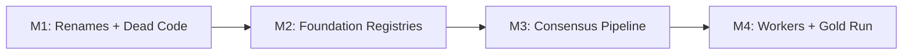
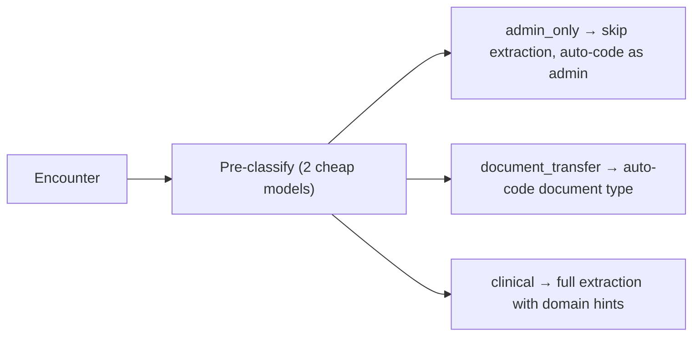

# Gold Patient End-to-End Pipeline (Revised)

## Milestone Structure

4 independent milestones, each committed separately. Each can be merged without the others.




---

## M1 — Renames + Dead Code (Low Risk, Do First)

Get the domain model right before building on it. One PR, no behavior change.

### Renames


| What           | Old               | New                                            |
| -------------- | ----------------- | ---------------------------------------------- |
| Node label     | `CSSAlert`        | `SafetyNetAlert`                               |
| Relationship   | `HAS_CSS_ALERT`   | `HAS_SAFETY_NET_ALERT`                         |
| Module         | `css_detector.py` | `safety_net_detector.py`                       |
| UI route       | `/css`            | `/safety-netting`                              |
| Node label     | `CancerEpisode`   | `EpisodeOfCare`                                |
| Relationship   | `HAS_EPISODE`     | `HAS_EPISODE_OF_CARE`                          |
| Property       | `cancer_type`     | `condition_type`                               |
| New properties | —                 | `domain` ("oncology"), `specialty` ("urology") |


Scope: ~90 files (Python + TypeScript). Neo4j migration script to relabel existing data.

Note: `css_detector.py` already uses `_SAFETY_NETTING_PATTERNS` internally — the rename aligns code with its own terminology.

### Dead code


| File                                                   | Action                            | Lines  |
| ------------------------------------------------------ | --------------------------------- | ------ |
| `scripts/prototype_clinical_coder.py`                  | Remove iterations 1-3             | ~1,280 |
| `services/coding_worker/app/pipeline/llm_extractor.py` | Mark for consolidation in M2      | —      |
| `services/api/app/services/training_creator.py`        | Verify if still needed, deprecate | 570    |
| `scripts/prototype_clinical_coder_v2.py`               | Verify if superseded, deprecate   | 429    |


### Tests

- Verify existing tests pass after renames (update test files)
- Run existing pipeline on 1 patient to confirm no regression

**Commit after M1.**

---

## M2 — Foundation Registries (Pure Refactoring)

No behavior change. Validate by running existing pipeline through new abstractions.

### M2a. Prompt Registry — `libs/prompts/`

```
libs/prompts/
  __init__.py
  registry.py              # get(name, version) -> str
  extraction_v1.py         # moved from llm_extractor.py (~260 lines)
  disambiguation_v1.py     # moved from disambiguator.py
  episode_classify_v1.py   # moved from episode_builder.py
  encounter_classify_v1.py # NEW: pre-classification prompt (for M3)
```

Consumers import from registry. The duplicate in `coding_worker/llm_extractor.py` is eliminated.

### M2b. Cypher Query Registry — `libs/cypher/`

Start with what M3/M4 need:

```
libs/cypher/
  __init__.py
  cleanup_queries.py     # All reset/delete queries (DOCUMENTS, semantic, candidates, episodes, alerts)
  candidate_queries.py   # EncounterCandidate/ReviewTask CRUD
  documents_queries.py   # DOCUMENTS link CRUD
  schema_constraints.py  # Indexes + constraints (including missing EncounterCandidate indexes)
```

`neo4j_schema.py` re-exports from `libs/cypher/` for backward compatibility. Other modules migrated incrementally as touched.

### M2c. LLM Provider Factory — `libs/llm_client/factory.py`

**Design decision (addressing review concern #3):** The factory returns a **sync** client with `.converse()`. This matches the V3 pipeline's sync architecture. The coding worker (async) wraps sync calls with `asyncio.to_thread()`.

```python
class LLMClient:
    def converse(
        self,
        system: str,
        messages: list[dict],
        max_tokens: int = 2048,
        temperature: float = 0.0,
    ) -> LLMResponse:
        """Sync call. Returns unified response regardless of provider."""
        ...

@dataclass
class LLMResponse:
    text: str
    input_tokens: int
    output_tokens: int
    cached_input_tokens: int
    stop_reason: str
```

Internally:

- `provider="aws"` → uses `boto3` Bedrock `converse()` + existing `bedrock_retry.py`
- `provider="azure"` → uses `openai.AzureOpenAI` (sync client, not LangChain)

Why not LangChain? The extraction pipeline needs raw JSON text responses, not LangChain message objects. LangChain adds overhead and another abstraction layer. The factory is ~100 lines and does exactly what we need.

**Validation:** Switch `llm_extractor.py` and `disambiguator.py` to use the factory. Run existing pipeline on 1 patient. Output should be identical.

### Tests

- Unit tests for factory (mock providers, verify response normalization)
- Unit tests for prompt registry (get by name/version, version not found)
- Integration: run existing pipeline through new abstractions, compare output

**Commit after M2.**

---

## M3 — Consensus Pipeline (Highest Risk, Highest Value)

### M3a. Encounter Pre-Classification

This is the smart step you suggested. Before extracting entities, classify each encounter cheaply. Two small models, short response, massively informative.

**Why this helps:**

Currently the pipeline sends every encounter through LLM extraction — including admin bookings, SMS confirmations, record shares, and safety-netting templates. Post-processing then strips them. That's wasted LLM calls.

Pre-classification moves the decision **before** extraction:




**Classification schema:**

```json
{
  "content_type": "clinical",
  "domains": ["oncology", "urology"],
  "encounter_purpose": ["referral", "investigation_request"],
  "key_clinical_signals": ["fast track referral", "suspected urological cancer"],
  "expected_semantic_tags": ["disorder", "procedure"],
  "clinical_significance": "high"
}
```

The `content_type` is the gate:

- `admin_only` → No extraction. Auto-approve with `extraction_method: "pre_classified_admin"`. Cost: 0 extraction calls.
- `document_transfer` → Apply existing document-type rules from `_DOCUMENT_RULES`. Cost: 0 extraction calls.
- `clinical` → Full extraction, but with `domains` and `expected_semantic_tags` as hints to the extraction prompt.

The `domains` field maps to your NCDA domain config (`libs/domain_config/registry.py`). If an encounter is classified as `["oncology"]`, the extraction prompt can emphasize cancer-relevant entities. If `["metabolic"]`, emphasize diabetes/thyroid/etc.

**2-model consensus for classification:** Run Haiku + GPT-5-mini (cheapest models). If both agree on `content_type`, high confidence. If they disagree, default to `clinical` (safe fallback — extract everything).

**Patient encounter index:** After classifying all encounters for a patient, build an index:

```json
{
  "patient_id": "p1",
  "encounter_count": 247,
  "admin_count": 89,
  "document_transfer_count": 23,
  "clinical_count": 135,
  "domain_summary": {
    "oncology": 12,
    "metabolic": 34,
    "respiratory": 8,
    "musculoskeletal": 15,
    "other": 66
  },
  "cancer_relevant_encounter_ids": ["enc-42", "enc-87", ...]
}
```

This gives you a patient overview before any extraction runs. You know which encounters matter, which are noise, and what domains to expect.

**Cost estimate for pre-classification:**

Assuming 200 encounters per patient, 50 patients = 10,000 encounters. Each classification is ~500 input tokens (encounter text) + ~100 output tokens.


| Model                    | Cost per 1M input | Cost per 1M output | Per encounter | 10K encounters |
| ------------------------ | ----------------- | ------------------ | ------------- | -------------- |
| Haiku (AWS small)        | $1.00             | $5.00              | $0.001        | $10            |
| GPT-5-mini (Azure small) | $0.25             | $2.00              | $0.0003       | $3             |
| **Total 2-model**        |                   |                    | **$0.0013**   | **$13**        |


$13 to classify 10,000 encounters. Trivial.

**Estimated savings:** If 40-50% of encounters are admin/document, that's 5,000 encounters that skip extraction entirely. At ~$0.01 per extraction call (Haiku, 5 sentences), that saves ~$50 per model. With 3-model consensus, saves ~$150.

### M3b. Multi-Model Extraction with Post-Resolution Alignment

**Addressing review concern #5 (entity alignment):** Text-level alignment (overlap > 0.8) fails when models use different surface forms ("T2DM" vs "type 2 diabetes mellitus"). Instead, align **after SNOMED resolution**:

1. Run 3 models independently: extract entities, resolve each to SNOMED
2. Align by `(sentence_id, snomed_concept_id)` — if two models extract different text but resolve to the same SNOMED concept, they agree
3. For entities that don't resolve (no SNOMED match), fall back to text overlap + semantic_tag match

This is more robust because SNOMED normalization absorbs surface form variation.

**Cost estimate for 3-model extraction:**

For 135 clinical encounters per patient (after pre-classification filters 40%), ~10 sentences each, batch size 5 = 2 calls per encounter:


| Model             | Per encounter (2 calls) | 135 encounters | 50 patients |
| ----------------- | ----------------------- | -------------- | ----------- |
| Haiku             | $0.02                   | $2.70          | $135        |
| Sonnet            | $0.06                   | $8.10          | $405        |
| GPT-5-mini        | $0.005                  | $0.68          | $34         |
| **Total 3-model** | **$0.085**              | **$11.48**     | **$574**    |


Plus disambiguation (panel of 2 judges per ambiguous term, ~30% of terms): ~$100-200.

**Total estimated cost for 50 gold patients: ~$800-900** (vs ~$135 for single-model Haiku). The pre-classification saves ~$150 by filtering admin encounters.

### M3c. Confidence Scoring + Auto-Approve

**Addressing review concern #6 (min is too conservative):** Use **10th percentile** instead of minimum:

```python
entity_scores = [t["consensus_confidence"] for t in terms]
encounter_confidence = sorted(entity_scores)[max(0, len(entity_scores) // 10)]
```

This means 1 uncertain entity out of 15 doesn't sink the whole encounter. But 2-3 uncertain entities out of 15 does.

**Composite per-entity confidence:**

```python
entity_confidence = (
    0.35 * extraction_agreement         # 3-model SNOMED-level consensus
  + 0.30 * coding_margin                # resolver top-1 vs top-2 gap
  + 0.20 * disambiguation_panel_agreement  # 2-judge consensus
  + 0.15 * read_code_corroboration      # 1.0 if inline read code matches
)
```

**Auto-approve wiring (addressing review concern #8):**

`_persist()` needs a real conditional branch, not "light wiring":

```python
def _persist(self, candidate, semantic_links, ...):
    if candidate["approval_status"] == "approved":
        # Auto-approved path
        with self.patient_graph.session() as session:
            upsert_candidate(candidate, session)
            # Write DOCUMENTS immediately
            for link in semantic_links:
                self.graph_writer.upsert_documents_link(link, session=session)
            # Create audit Approval (no ReviewTask)
            append_approval(
                candidate_id=candidate["candidate_id"],
                task_id=...,  # create a system task
                action="approve",
                reviewer="consensus_auto",
                reason=f"consensus_confidence={score:.2f}",
                ...
            )
    else:
        # Manual review path (current behavior)
        with self.patient_graph.session() as session:
            upsert_candidate(candidate, session)
            create_review_task(...)
```

Both paths need transaction wrapping. If DOCUMENTS write succeeds but Approval fails, we have an inconsistent state. Use `session.begin_transaction()`.

### M3d. Validate on 5 patients

Before scaling to 50, run on 5 patients:

- Check confidence distribution: what % auto-approved vs needs-review?
- Manually verify 20 auto-approved encounters: are they actually correct?
- Manually verify 10 "needs review" encounters: are the flagged entities genuinely uncertain?
- Tune thresholds based on findings

### Tests for M3

- Unit: entity alignment (same concept different text, different concepts same text, etc.)
- Unit: confidence scoring formula (edge cases: 0 candidates, 1 candidate, all models disagree)
- Unit: pre-classification parsing (admin patterns, document patterns, clinical)
- Integration: full pipeline on test fixtures with known expected output

**Commit after M3.**

---

## M4 — Worker Activation + 50 Gold Patients

### M4a. Coding worker consensus mode

**Addressing review concern #2 (sync/async):** The shared libs (prompt registry, LLM factory, entity alignment) are all **sync**. The coding worker wraps them:

```python
# In coding worker (async context)
result = await asyncio.to_thread(
    extractor.extract_batch, encounter_text, sentences
)
```

This is clean: shared libs stay sync (testable, simple), async workers use `to_thread()`.

Add `mode: "consensus"` support to the coding worker's message handler.

### M4b. API publishes to coding-jobs queue

**Addressing review concern #7 (UI breaking change):** The API continues to return SSE streams. Internally it publishes to the queue and then subscribes to the Redis progress channel. The UI sees no change — same SSE endpoint, same event format. The difference is the work happens in the worker, not in-process.

```python
@router.get("/pipeline/stream")
async def stream_pipeline(...):
    run_id = str(uuid4())
    await publish_coding_job(patient_id, run_id=run_id, mode="consensus")
    # Subscribe to Redis channel and forward events as SSE
    async for event in redis_subscribe(f"pipeline:{run_id}"):
        yield event
```

The coding worker already publishes progress to Redis. The API becomes a thin relay.

### M4c. Orchestration script + 50 gold patients

`**scripts/clean_patients.py**`: Uses `libs/cypher/cleanup_queries.py` directly (addressing review nit about PYTHONPATH — the script uses `libs/` which is already on the path via `sys.path.append` pattern used elsewhere).

`**scripts/run_gold_patients.py**`: Publishes to message bus, monitors via Redis, reports results.

Run 50 patients. This validates:

- Message bus routing (in-memory or Azure)
- Worker consumption and processing
- Consensus extraction + scoring
- Auto-approve + DOCUMENTS writing
- Analysis worker chain (anchors -> EpisodeOfCare -> SafetyNetAlert -> KPIs)
- Redis progress streaming
- The full production architecture

**Commit after M4.**

---

## Files to Create/Modify

### M1 — Renames + Dead Code


| File                                  | Action                                       |
| ------------------------------------- | -------------------------------------------- |
| ~90 files (Python + TS)               | Rename CSS/CSSAlert/CancerEpisode references |
| `scripts/migrate_graph_labels.py`     | Create — Neo4j migration                     |
| `scripts/prototype_clinical_coder.py` | Remove dead iterations                       |


### M2 — Foundation Registries


| File                                            | Action                               |
| ----------------------------------------------- | ------------------------------------ |
| `libs/prompts/registry.py`                      | Create                               |
| `libs/prompts/extraction_v1.py`                 | Create (moved from llm_extractor.py) |
| `libs/prompts/disambiguation_v1.py`             | Create (moved from disambiguator.py) |
| `libs/prompts/encounter_classify_v1.py`         | Create (new for M3)                  |
| `libs/cypher/cleanup_queries.py`                | Create                               |
| `libs/cypher/candidate_queries.py`              | Create                               |
| `libs/cypher/documents_queries.py`              | Create                               |
| `libs/cypher/schema_constraints.py`             | Create                               |
| `libs/llm_client/factory.py`                    | Create                               |
| `services/api/app/services/v3/llm_extractor.py` | Modify (use factory + registry)      |
| `services/api/app/services/v3/disambiguator.py` | Modify (use factory + registry)      |


### M3 — Consensus Pipeline


| File                                                    | Action                                         |
| ------------------------------------------------------- | ---------------------------------------------- |
| `services/api/app/services/v3/encounter_classifier.py`  | Create                                         |
| `services/api/app/services/v3/entity_alignment.py`      | Create                                         |
| `services/api/app/services/v3/pipeline_service.py`      | Modify (pre-classify, consensus, auto-approve) |
| `services/api/app/services/v3/post_processing_rules.py` | Modify (confidence threshold)                  |
| `services/api/app/models/neo4j_schema.py`               | Modify (missing indexes)                       |


### M4 — Workers + Orchestration


| File                                                      | Action                                 |
| --------------------------------------------------------- | -------------------------------------- |
| `services/coding_worker/app/pipeline/pipeline_service.py` | Modify (consensus mode)                |
| `services/api/app/routers/pipeline.py`                    | Modify (publish to queue, relay Redis) |
| `services/api/app/routers/patients.py`                    | Modify (publish analysis after sync)   |
| `scripts/clean_patients.py`                               | Create                                 |
| `scripts/run_gold_patients.py`                            | Create                                 |


---

## Cost Summary


| Phase                                           | Cost (50 patients) |
| ----------------------------------------------- | ------------------ |
| Pre-classification (M3a)                        | ~$13               |
| 3-model extraction on clinical encounters (M3b) | ~$574              |
| Disambiguation panel (M3b)                      | ~$150              |
| **Total**                                       | **~$740**          |
| vs single-model (current)                       | ~$135              |


Pre-classification saves ~$150 by filtering admin encounters. The 5.5x cost increase buys measured confidence instead of guessed confidence.