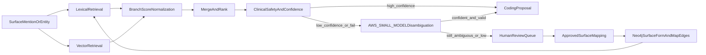

# Hybrid Clinical Coder Plan

## Objective

Upgrade the current prototype into a clinically safer hybrid matcher that:

- retrieves candidates using lexical + vector search,
- preserves context modifiers separately from concept matching,
- applies constrained `AWS_SMALL_MODEL` disambiguation for low-confidence matches,
- flags low-confidence failures for review,
- and learns from approved surface-form mappings in Neo4j.

## Current Baseline (What we keep)

- Existing prototype: `[C:/Users/RobertSmith/Documents/GitHub/Primary-care-audit/scripts/prototype_clinical_coder.py](C:/Users/RobertSmith/Documents/GitHub/Primary-care-audit/scripts/prototype_clinical_coder.py)`
- Existing SNOMED graph/indexes and inferred relations in loaders:
  - `[C:/Users/RobertSmith/Documents/GitHub/Primary-care-audit/services/terminology/scripts/loaders/schema.py](C:/Users/RobertSmith/Documents/GitHub/Primary-care-audit/services/terminology/scripts/loaders/schema.py)`
  - `[C:/Users/RobertSmith/Documents/GitHub/Primary-care-audit/services/terminology/scripts/loaders/snomed_attribute_projection.py](C:/Users/RobertSmith/Documents/GitHub/Primary-care-audit/services/terminology/scripts/loaders/snomed_attribute_projection.py)`
- Existing Read->SNOMED import utility:
  - `[C:/Users/RobertSmith/Documents/GitHub/Primary-care-audit/scripts/import_read_to_snomed_source_map.py](C:/Users/RobertSmith/Documents/GitHub/Primary-care-audit/scripts/import_read_to_snomed_source_map.py)`

## Target Architecture

## Workstreams

- **1) Add vector-capable schema and retrieval hooks**
  - Extend schema creation in `[C:/Users/RobertSmith/Documents/GitHub/Primary-care-audit/services/terminology/scripts/loaders/schema.py](C:/Users/RobertSmith/Documents/GitHub/Primary-care-audit/services/terminology/scripts/loaders/schema.py)`:
    - add vector property index for `Term` embeddings (and optional `SurfaceForm` embeddings later).
    - keep existing `term_fulltext` for lexical branch.
  - Introduce a small shared query module (new file under `scripts/` or `services/terminology/nlp/`) with:
    - lexical query,
    - vector query,
    - score normalization per branch,
    - merged top-k output.
- **2) Build embedding backfill job for Neo4j `Term` nodes**
  - New script: `scripts/backfill_term_embeddings.py`.
  - Responsibilities:
    - load model from env (`VECTOR_MODEL`, `VECTOR_DIMENSION`) from `[C:/Users/RobertSmith/Documents/GitHub/Primary-care-audit/secrets/.env](C:/Users/RobertSmith/Documents/GitHub/Primary-care-audit/secrets/.env)`,
    - batch embed `Term.surface_form` (or `normalized_form`),
    - write embeddings to Neo4j in batches,
    - include `--dry-run`, `--limit`, `--batch-size`, `--resume` semantics.
  - Safety:
    - idempotent updates,
    - no PHI source text; only terminology terms.
- **3) Refactor prototype into true hybrid retrieval**
  - Update `[C:/Users/RobertSmith/Documents/GitHub/Primary-care-audit/scripts/prototype_clinical_coder.py](C:/Users/RobertSmith/Documents/GitHub/Primary-care-audit/scripts/prototype_clinical_coder.py)`:
    - keep Lucene-safe full-text handling (already started),
    - add vector branch,
    - normalize branch scores (`score / max_branch_score`),
    - weighted merge (`w_lexical`, `w_vector`) configurable via CLI,
    - rerank with current clinical priors.
  - Preserve these outputs unchanged in structure:
    - `clinical_status`, `negation`, `uncertainty`, `temporal`, `attributes`.
- **4) Add confidence gating and failure buckets**
  - Add explicit confidence bands in prototype output/report:
    - `high`, `medium`, `low`, `no_candidate`.
  - Add reasons for low confidence:
    - weak score margin,
    - semantic mismatch,
    - sparse context evidence,
    - lexical/vector disagreement.
  - Export review-ready file for failures:
    - `...prototype_low_confidence.jsonl`.
- **5) Add learning loop write-back model in Neo4j**
  - Extend importer (or add new script) to persist approved surface terms:
    - `(:SurfaceForm {form, normalized, source, status})`
    - `(:SurfaceForm)-[:MAPS_TO {confidence, method, approved_by, approved_at, provenance}]->(:Concept)`
  - Keep append-only style provenance fields (regulatory traceability).
  - Do not overwrite context modifiers on concept nodes.
- **6) Add constrained LLM fallback before HITL**
  - Use `AWS_SMALL_MODEL` from env for only `low`/`no_candidate` cases.
  - LLM input is bounded:
    - mention text + sentence text,
    - preserved modifiers from deterministic pipeline,
    - top-k candidate list from hybrid retrieval only.
  - LLM output must be strict JSON and candidate-constrained:
    - `selected_concept_id` (must be in candidate list or `NONE`),
    - `confidence`,
    - `reason`.
  - Acceptance gates:
    - reject outputs with concept IDs outside candidate list,
    - reject below confidence threshold,
    - reject when modifier contradiction rules trigger.
  - Escalate rejected/uncertain cases to HITL.
- **7) Evaluation harness for the provided training file**
  - Input file: `[C:/Users/RobertSmith/Documents/GitHub/Primary-care-audit/services/terminology/data/training/surface_forms_4202301609.jsonl](C:/Users/RobertSmith/Documents/GitHub/Primary-care-audit/services/terminology/data/training/surface_forms_4202301609.jsonl)`
  - Since there is no gold SNOMED code in rows, report proxy metrics:
    - candidate coverage,
    - confidence distribution,
    - LLM fallback usage rate and acceptance rate,
    - HITL escalation rate after LLM,
    - read-code corroboration hit rate (when code appears in sentence),
    - semantic-tag agreement as weak signal.
  - Produce before/after comparison:
    - lexical-only baseline vs hybrid,
    - hybrid-only vs hybrid+LLM fallback.

## Implementation Sequence

1. Schema/index updates (vector index + keep fulltext).
2. Embedding backfill script for `Term` nodes; run dry-run then limited run.
3. Hybrid retrieval refactor in prototype (lexical + vector merge).
4. Confidence gating + failure export.
5. Constrained `AWS_SMALL_MODEL` fallback for low-confidence buckets.
6. Surface-form feedback write-back script/model.
7. Run evaluation on `surface_forms_4202301609.jsonl`; summarize baseline vs hybrid and LLM impact.

## Key Guardrails

- Modifier safety: never infer/overwrite negation, uncertainty, temporality from embeddings.
- LLM safety: LLM cannot invent new concept IDs; it must choose from provided candidates or return `NONE`.
- Traversal bounds: 0-1 hop features in ranking; no deep semantic traversal in prototype stage.
- Explainability: output per-candidate component scores and rationale fields.
- Idempotency: all Neo4j writes via `MERGE` and auditable provenance properties.

## Deliverables

- Updated hybrid coder prototype script.
- Embedding backfill utility.
- Constrained LLM fallback module (`AWS_SMALL_MODEL`) with audit output.
- Optional surface-form write-back utility.
- JSON report comparing lexical-only and hybrid outcomes.
- JSON report section for LLM fallback acceptance and HITL deflection.
- Clear runbook commands for dry-run and apply modes.

