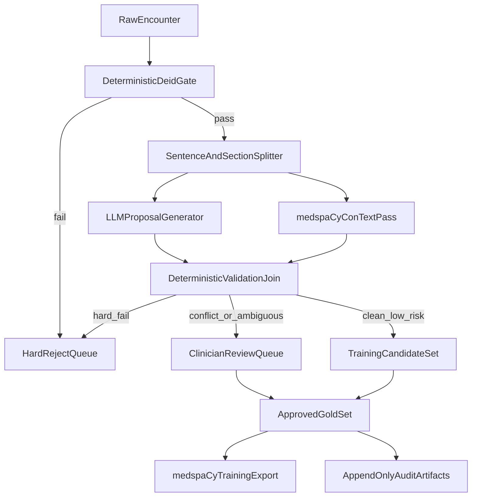

# MedSpacy Training Pipeline Rebuild Plan

## Objective

Build a regulated, reproducible pipeline that converts raw encounters into training-ready medspaCy artifacts (entities + context + section boundaries first, relations second), with deterministic acceptance gates and auditable human adjudication.

## Current Baseline and Gaps

- Existing extraction logic is highly rule-coupled in `[C:\Users\RobertSmith\Documents\GitHub\Primary-care-audit\scripts\extract_surface_forms.py](C:\Users\RobertSmith\Documents\GitHub\Primary-care-audit\scripts\extract_surface_forms.py)` (large heuristic surface area, many hard-coded patterns, brittle semantics).
- Existing LLM validator/fixer in `[C:\Users\RobertSmith\Documents\GitHub\Primary-care-audit\scripts\validate_surface_forms_llm.py](C:\Users\RobertSmith\Documents\GitHub\Primary-care-audit\scripts\validate_surface_forms_llm.py)` still permits model-driven corrections unless tightly gated.
- Neo4j retrieval/coding prototype exists in `[C:\Users\RobertSmith\Documents\GitHub\Primary-care-audit\scripts\prototype_clinical_coder_v2.py](C:\Users\RobertSmith\Documents\GitHub\Primary-care-audit\scripts\prototype_clinical_coder_v2.py)`, but not yet integrated into an append-only, approval-first dataset assembly flow.
- medspaCy ConText already supports target context attributes (`is_negated`, `is_uncertain`, `is_historical`, `is_hypothetical`, `is_family`) in `[C:\Users\RobertSmith\Documents\GitHub\medspacy\medspacy\context\context.py](C:\Users\RobertSmith\Documents\GitHub\medspacy\medspacy\context\context.py)`, which should become the canonical context layer.

## Target Architecture (Deterministic Gates + Constrained LLM Proposals)

## Data Contract (Encounter JSON and Audit Contract)

- Define one canonical encounter-level schema with:
  - encounter metadata (`patient_id`, `encounter_id`, date, source hash)
  - de-identified text
  - sentence list with stable IDs and offsets
  - extracted term objects with offsets, context flags, experiencer, coding candidates
  - provenance (`method`, `rule_version`, `model_id`, `prompt_version`, confidence)
- Define append-only audit event schema per mutation:
  - `original_row_hash`, `transformed_row_hash`, `who_or_what_changed`, `timestamp`, `reason`, `approval_status`, `version_bundle`
- Split validation outcomes into explicit `hard_fail` vs `warning` classes and preserve as immutable artifacts.

## Phase 0 — Foundations and Controls

- Freeze v1 annotation schema (entities/context/sections) and terminology policy (SNOMED UK target; Read/CTV3 provenance only).
- Implement deterministic de-id specification and test harness with reject-on-fail behavior.
- Define version bundle object (rules version, model version, prompt version, terminology snapshot, code commit).
- Acceptance criteria:
  - zero accepted rows with PHI pattern leak
  - deterministic replay gives identical hashes for same input/version bundle
  - every transformed row has complete audit metadata

## Phase 1 — Candidate Generation Pipeline (No Autonomous Overwrite)

- Build encounter processor that runs:
  - deterministic preprocessing + sentence/section segmentation
  - constrained LLM proposal extraction (JSON-only, evidence spans required)
  - medspaCy ConText canonicalization for context flags
  - Neo4j candidate coding retrieval and deterministic concept checks
- Acceptance criteria:
  - entity precision >= 0.95 on reviewed set
  - negation/context accuracy >= 0.95
  - temporality/family >= 0.90
  - all accepted rows pass hard gates and carry full provenance

## Phase 2 — Human-in-the-Loop Adjudication and Gold Consolidation

- Implement risk-ranked review queue (disagreement, ambiguity, high clinical impact first).
- Enforce immutable decision events: approve/edit/reject/escalate with reason and reviewer identity.
- Run dual-review subset for agreement measurement.
- Acceptance criteria:
  - kappa >= 0.8 on adjudicated subset
  - unresolved ambiguity < 5%
  - no gold inclusion without explicit approval event

## Phase 3 — Training Packaging, Regression Controls, and Scale-Out

- Export approved gold data to medspaCy training-ready artifacts (Phase 1: entity/context/section; Phase 2: relation-ready extension).
- Add semantic drift checks (label distribution deltas, context rate deltas, canary cohort replay).
- Scale rollout by gates: 1 patient -> 5 patients -> 5k–20k encounters while maintaining <24h candidate turnaround.
- Acceptance criteria:
  - no gate regressions across wave promotions
  - reproducible manifests and immutable release evidence per wave

## File/Module Plan (Implementation Targets)

- Keep raw encounter ingress logic, but refactor from ad-hoc script style in `[C:\Users\RobertSmith\Documents\GitHub\Primary-care-audit\scripts\extract_encounters.py](C:\Users\RobertSmith\Documents\GitHub\Primary-care-audit\scripts\extract_encounters.py)` into reusable, testable pipeline modules.
- Replace monolithic heuristic extraction in `[C:\Users\RobertSmith\Documents\GitHub\Primary-care-audit\scripts\extract_surface_forms.py](C:\Users\RobertSmith\Documents\GitHub\Primary-care-audit\scripts\extract_surface_forms.py)` with staged components: preprocess, propose, context, validate, route.
- Re-scope `[C:\Users\RobertSmith\Documents\GitHub\Primary-care-audit\scripts\validate_surface_forms_llm.py](C:\Users\RobertSmith\Documents\GitHub\Primary-care-audit\scripts\validate_surface_forms_llm.py)` to validator/advisor role only (no autonomous final-state edits).
- Integrate Neo4j coding retrieval from `[C:\Users\RobertSmith\Documents\GitHub\Primary-care-audit\scripts\prototype_clinical_coder_v2.py](C:\Users\RobertSmith\Documents\GitHub\Primary-care-audit\scripts\prototype_clinical_coder_v2.py)` into the candidate validation stage.
- Add medspaCy context/rule config package aligned to `[C:\Users\RobertSmith\Documents\GitHub\medspacy\medspacy\context\context.py](C:\Users\RobertSmith\Documents\GitHub\medspacy\medspacy\context\context.py)` and custom UK GP rule JSON.

## Validation and Governance Framework (to implement with CI gates)

- Hard fail examples:
  - PHI leak pattern after de-id
  - missing audit metadata or version bundle
  - invalid SNOMED target concept
  - context contradiction unresolved (e.g., affirmed and negated same concept)
- Warning examples (route to review):
  - LLM vs ConText disagreement
  - low-margin concept mapping
  - ambiguous temporality or experiencer
- Promotion rule:
  - only approved rows enter gold training set
  - all changes append-only; no destructive mutation of prior states

## Pilot and Scale Plan

- Pilot 1 patient end-to-end to validate de-id, determinism, and audit chain.
- Expand to 5 patients to calibrate review throughput and ambiguity prioritization.
- Wave-based scaling to 5k–20k encounters with canary replay and drift thresholds at each promotion gate.

