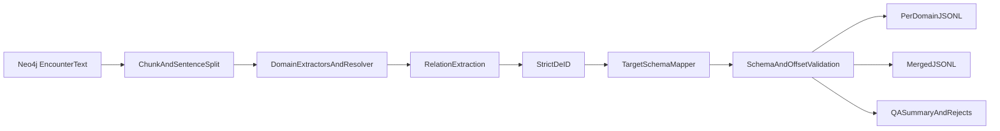

# NER Training Set Generation Plan

## Scope Confirmed

- Build training data from raw `Encounter.text` only.
- Do **not** use existing `:DOCUMENTS` or `:HAS_<semantic_tag>` links as source truth.
- Output as:
  - per-domain JSONL files
  - one merged JSONL
- Enforce full target schema now (entities + relations + metadata), with strict de-identification.
- Include `exports/ner/training/exclusion_domain_v1.jsonl` as a silver seed source when clinically valid and de-id-safe.

## Implementation Steps

- Build a canonical schema transformer layer that maps extracted mentions into your target schema fields (`document_id`, `text`, `entities`, `relations`, `metadata`) with deterministic IDs and validated label enums.
- Rework extraction input path to query Neo4j raw encounters only (by `Encounter.text` + dates/source metadata) and sentence-split locally.
- Replace current permissive matching with domain-aware extraction gates (surface-form + contextual checks + assertion checks) to reduce false positives (especially body-part-only cancer mislabels).
- Add relation extraction pass (`negates`, `temporal_of`, `associated_finding`, `location_of`, etc.) from in-sentence dependency/pattern rules, then optional LLM adjudication only for ambiguous relation candidates.
- Add strict de-id pipeline before write-out (PHI redaction + identifier hashing + date handling policy) and emit de-id audit counters.
- Write outputs as:
  - `exports/ner/all_domains/domain_<domain>.jsonl`
  - `exports/ner/all_domains/domain_entities_merged.jsonl`
  - `exports/ner/all_domains/summary.json` + `exports/ner/all_domains/qa_report.json`
- Add schema validation + quality gates:
  - JSON Schema validation
  - offset integrity checks (`text[start:end] == entity.text`)
  - label/domain consistency checks
  - rejection file for invalid/low-confidence rows
- Add rerunnable checkpointing and deterministic chunk processing so interrupted runs can resume safely.
- Emit a versioned dataset manifest (`dataset_version`, `schema_version`, `deid_version`, `domains`, `record_counts`, `quality_metrics`) to make downstream model builds deterministic and auditable.
- Add training adapters so the full-schema output can be consumed by the model build pipeline without lossy manual conversion.
- Add seed-ingestion stage for `exports/ner/training/exclusion_domain_v1.jsonl`:
  - validate schema + offsets + enum values
  - validate de-id claims and PHI leak checks
  - run exclusion-domain clinical sanity checks
  - dedupe/merge with mined corpus using stable dedupe keys
  - retain provenance in metadata (`source_origin=seed_exclusion_v1|mined_raw`)

## Parallel Execution Contract (With Extractor Cutover Plan)

- This plan owns:
  - canonical training data generation from raw `Encounter.text`
  - de-id enforcement
  - schema quality
  - dataset version publication
- It does **not** own runtime worker wiring.
- Handoff artifact for cutover plan:
  - `exports/ner/all_domains/domain_entities_merged.jsonl` (full schema)
  - `exports/ner/all_domains/manifest.json`
  - `exports/ner/all_domains/qa_report.json`
  - `exports/ner/all_domains/training_adapters/`* (spaCy-compatible exports)
  - seed merge audit block in `manifest.json` (seed_rows_in/kept/deduped/rejected + reason counts)
- Compatibility promise:
  - stable label enum mapping
  - deterministic IDs
  - strict offset validity
  - reproducible dataset versioning

## Runtime Importability Requirements

- Full-schema JSONL must be convertible to model training inputs used in runtime cutover:
  - spaCy entity format / DocBin
  - optional KB/linking tables
- Add an automated validation step proving:
  - adapter conversion succeeds
  - model training script can run from adapter output
  - resulting model artifact is version-stamped with source dataset version

## Key Files To Change

- [C:\Users\RobertSmith\Documents\GitHub\Primary-care-audit\scripts\mine_all_domains.py](C:\Users\RobertSmith\Documents\GitHub\Primary-care-audit\scripts\mine_all_domains.py)
- [C:\Users\RobertSmith\Documents\GitHub\Primary-care-audit\libs\ner\domain_loader.py](C:\Users\RobertSmith\Documents\GitHub\Primary-care-audit\libs\ner\domain_loader.py)
- [C:\Users\RobertSmith\Documents\GitHub\Primary-care-audit\scripts\qa_all_domains_ner.py](C:\Users\RobertSmith\Documents\GitHub\Primary-care-audit\scripts\qa_all_domains_ner.py)
- Add new schema/de-id utilities under `libs/ner/` (schema mapper, relation builder, de-id validator).

## Data Flow

## Acceptance Criteria

- 100% records conform to target JSON schema.
- 0 direct identifiers in output text/metadata (per de-id checks).
- No body-part-only malignant mapping without malignancy context.
- Per-domain and merged files generated deterministically from raw text source.
- QA report includes rejection reasons, domain precision flags, and de-id evidence counts.
- `manifest.json` is produced with dataset/version metadata for reproducible model builds.
- Adapter outputs are generated and validated as importable by model training pipeline without manual transformation.
- Seed integration is auditable with explicit include/dedupe/reject counts and reason categories.

