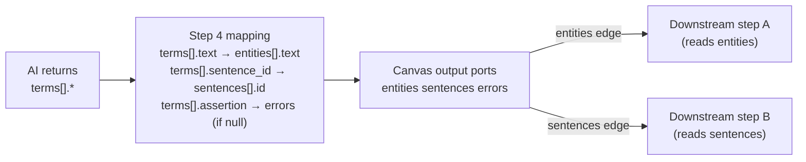

# Pipeline Output Mapping Fix

## Problem Summary

The screenshots show three connected issues:

1. **Step 4 "Prompt & model"** — `buildDefaultRows()` auto-populates `statePath` with the AI's own array key (`terms[].sentence_id`), so the user never maps to the mandatory pipeline state outputs (`entities`, `sentences`, `errors`).
2. **Canvas** — because `statePath` values all start with `terms`, `getPortsFromFieldMappings` derives a single port called `terms` instead of `entities`, `sentences`, `errors`.
3. **No guidance** — `SchemaAlignmentPanel` doesn't know the subgraph's mandatory write keys, so it can't tell the user what to map to. The "ADDS TO PIPELINE STATE" chips shown in Step 2 (Data flow) have no connection to Step 4's mapping UI.

## Data flow (how it should work)




## Files to change

- `[services/ui/src/components/pathway/wiring/useFieldMappings.ts](services/ui/src/components/pathway/wiring/useFieldMappings.ts)` — fix `buildDefaultRows`
- `[services/ui/src/app/admin/pathways/[id]/page.tsx](services/ui/src/app/admin/pathways/[id]/page.tsx)` — `SchemaAlignmentPanel` signature + "CALL IT IN THE PIPELINE" control
- `[services/ui/src/components/pathway/config/subgraphs.ts](services/ui/src/components/pathway/config/subgraphs.ts)` — no change required (already correct)

## Change 1 — `useFieldMappings.ts`: `buildDefaultRows` default statePath

Currently:

```typescript
statePath: `${topKey}[].${f.name}`,   // mirrors AI key — wrong
```

Change to:

```typescript
statePath: "",   // blank — force explicit mapping
```

This immediately fixes the canvas (it will show no output ports until the user maps, guiding them to do it properly). The `missingRequired` validation in `SchemaAlignmentPanel` already fires an error for empty required fields.

## Change 2 — `SchemaAlignmentPanel`: accept `subgraphId` prop

The call site (line 1447 of `page.tsx`) must also pass `subgraphId`:

```tsx
<SchemaAlignmentPanel
  subgraphId={config.subgraphId}      // ← add this
  promptConfigId={config.promptConfigId}
  fieldMappings={...}
  onFieldMappingsChange={...}
  prevStepFieldMappings={prevStepFieldMappings}
/>
```

## Change 3 — `SchemaAlignmentPanel`: Mandatory output coverage summary

Above the field rows, add a "MAPS TO" summary strip using `SUBGRAPH_IO[subgraphId].writes`. For each write key, count how many `fieldMappings` rows have `statePath` starting with that key and show a coverage pill:

- `entities` — 5 / 8 fields mapped (warning if 0)
- `sentences` — 0 mapped (chip red/warning)
- `errors` — 0 mapped (grey — optional)

This answers the user's question "which mandatory outputs do I map the AI fields to?" without removing freeform control.

## Change 4 — "CALL IT IN THE PIPELINE" column: split key + sub-field control

Replace the single `TextField` (statePath free-text) with a two-part inline control:

```
[ entities ▼ ]  [ ].  [ text_________________ ]   ✕
```

- Left **Select** dropdown — options = `SUBGRAPH_IO[subgraphId].writes` keys + `"— custom —"`. When "custom" is selected, the whole thing becomes one free-text field (backwards compat).
- Right **TextField** — the sub-field name (e.g. `text`, `lookup_term`).
- On change, both parts are combined: `statePath = "${selectedKey}[].${subField}"` (or flat `statePath = selectedKey` for non-array keys like `errors`).
- If the selected key is in `inferDataType` → `"object[]"`, use `key[].subField` format. If it's `"string"` or `"boolean"`, just use `key` directly (no sub-field needed, hide the right TextField).

The existing `updateRow(id, { statePath })` API is unchanged — this is purely a UI change.

## Change 5 — Validation: warn if statePath doesn't match any write key

If a `statePath` is non-empty but its top-level key (the part before `[].`) is not in `SUBGRAPH_IO[subgraphId].writes`, show a warning indicator on that row ("⚠ Not a recognised output — this port won't be reachable by later steps"). This catches users who type `terms[].text` by accident.

## Canvas behaviour after the fix

Once mapping is saved with correct `statePath` values (e.g. `entities[].text`, `sentences[].id`, `errors`), `getPortsFromFieldMappings` will derive ports `entities`, `sentences`, `errors`. These appear as labelled output handles on the `ActionNode`. Each handle can be independently dragged to connect to a different downstream step. No changes are required to canvas or edge rendering — that logic already works correctly.