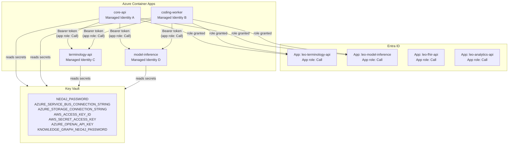

# Service-to-Service Auth and Key Vault Migration

## Starting Point

- No `azure-identity` or `azure-keyvault-secrets` packages anywhere in the codebase
- No Azure IaC — only Dockerfiles in `infra/dockerfiles/`
- `azure-storage-blob` and `azure-servicebus` use raw connection strings, not Managed Identity
- No app registrations for internal services in Entra
- 7 secrets currently live in plain `.env` files

## Architecture




## What Needs Entra Admin Access (run once via `az` CLI)

The following steps need your Entra admin account. I will generate the exact `az` CLI commands for each step.

**Step A — Register each internal service as an Entra app with a `Call` app role:**
Services that need registration: `leo-terminology-api`, `leo-model-inference`, `leo-fhir-api`, `leo-analytics-api`

**Step B — Enable system-assigned Managed Identity on each Container App** (after ACA deployment)

**Step C — Grant each identity the `Call` app role** on the services it calls:

- `core-api` identity → `Call` on `leo-terminology-api`, `leo-model-inference`, `leo-fhir-api`, `leo-analytics-api`
- `coding-worker` identity → `Call` on `leo-terminology-api`, `leo-model-inference`
- `training-worker` identity → no HTTP calls to other services (no grant needed)

**Step D — Create Key Vault and grant each identity `Key Vault Secrets User` RBAC role**

**Step E — Load secrets into Key Vault** (one-time, using the 7 variables listed below)

## Secrets to Migrate to Key Vault

All 7 to become Key Vault secrets; `.env` retains only the non-secret config:


| Key Vault secret name                 | Current env var                       |
| ------------------------------------- | ------------------------------------- |
| `neo4j-password`                      | `NEO4J_PASSWORD`                      |
| `knowledge-graph-neo4j-password`      | `KNOWLEDGE_GRAPH_NEO4J_PASSWORD`      |
| `azure-service-bus-connection-string` | `AZURE_SERVICE_BUS_CONNECTION_STRING` |
| `azure-storage-connection-string`     | `AZURE_STORAGE_CONNECTION_STRING`     |
| `aws-access-key-id`                   | `AWS_ACCESS_KEY_ID`                   |
| `aws-secret-access-key`               | `AWS_SECRET_ACCESS_KEY`               |
| `azure-openai-api-key`                | `AZURE_OPENAI_API_KEY`                |


The only `.env` variable kept for Key Vault itself: `AZURE_KEYVAULT_URL=https://leo-kv.vault.azure.net/`

## Code Changes

### New package dependencies (all `requirements.txt` files)

```
azure-identity>=1.19.0
azure-keyvault-secrets>=4.8.0
```

`azure-storage-blob` and `azure-servicebus` already support `DefaultAzureCredential` — only the constructor call changes.

### New file: `libs/azure/credentials.py`

Single `DefaultAzureCredential()` instance shared across the process. Works automatically with Managed Identity in ACA and `az login` locally — no code branches.

```python
from azure.identity import DefaultAzureCredential
_credential = None
def get_credential() -> DefaultAzureCredential:
    global _credential
    if _credential is None:
        _credential = DefaultAzureCredential()
    return _credential
```

### New file: `libs/keyvault/loader.py`

Reads all 7 secrets from Key Vault at startup and injects them into `os.environ`. Services call `load_keyvault_secrets()` as the very first thing in `main.py` before any other imports that need credentials.

```python
from azure.keyvault.secrets import SecretClient
from libs.azure.credentials import get_credential

SECRET_MAP = {
    "NEO4J_PASSWORD": "neo4j-password",
    "KNOWLEDGE_GRAPH_NEO4J_PASSWORD": "knowledge-graph-neo4j-password",
    ...
}

def load_keyvault_secrets():
    url = os.environ["AZURE_KEYVAULT_URL"]
    client = SecretClient(vault_url=url, credential=get_credential())
    for env_var, kv_name in SECRET_MAP.items():
        os.environ[env_var] = client.get_secret(kv_name).value
```

### Update `libs/model_store/store.py`

Replace `BlobServiceClient.from_connection_string(conn_str)` with:

```python
from libs.azure.credentials import get_credential
BlobServiceClient(account_url=f"https://{account_name}.blob.core.windows.net", credential=get_credential())
```

`AZURE_STORAGE_ACCOUNT_NAME` becomes the only env var needed (non-secret).

### Update `libs/message_bus/azure_adapter.py`

Replace `ServiceBusClient.from_connection_string(conn_str)` with:

```python
from libs.azure.credentials import get_credential
ServiceBusClient(fully_qualified_namespace=f"{namespace}.servicebus.windows.net", credential=get_credential())
```

`AZURE_SERVICE_BUS_NAMESPACE` becomes the only env var needed (non-secret).

### New file: `libs/service_auth/token_provider.py`

Acquires a Bearer token for a target service, used by callers (`coding_worker`, `core-api`) before making HTTP calls:

```python
from libs.azure.credentials import get_credential

def get_service_token(app_id_uri: str) -> str:
    token = get_credential().get_token(f"{app_id_uri}/.default")
    return token.token
```

### New file: `libs/service_auth/validator.py`

FastAPI middleware for internal services (`terminology_api`, `model_inference`, `fhir_api`, `analytics_api`) to validate incoming Bearer tokens using Entra's JWKS. Rejects requests with no token or tokens missing the required `Call` app role claim.

```python
from jose import jwt  # python-jose already installed
import httpx

async def validate_service_token(request: Request):
    token = request.headers.get("Authorization", "").removeprefix("Bearer ")
    # Verify against https://login.microsoftonline.com/{tenant}/discovery/v2.0/keys
    # Check aud == this service's app ID, roles contains "Call"
    ...
```

### Update caller sites

`services/coding_worker/app/pipeline/pipeline_service.py` — `_resolve_via_api()`:

```python
from libs.service_auth.token_provider import get_service_token
headers = {"Authorization": f"Bearer {get_service_token(TERMINOLOGY_API_APP_ID)}"}
resp = await client.post(f"{TERMINOLOGY_API_URL}/terminology/resolve", json=..., headers=headers)
```

`services/api/app/routers/model_registry.py` — `_signal_reload()`:

```python
headers = {"Authorization": f"Bearer {get_service_token(MODEL_INFERENCE_APP_ID)}"}
httpx.post(f"{endpoint}/reload", headers=headers)
```

New non-secret env vars needed:

- `TERMINOLOGY_API_APP_ID` — Entra app ID of `leo-terminology-api`
- `MODEL_INFERENCE_APP_ID` — Entra app ID of `leo-model-inference`
- `FHIR_API_APP_ID`, `ANALYTICS_API_APP_ID`

### New file: `infra/bicep/main.bicep`

Defines: Key Vault resource, RBAC role assignments (Key Vault Secrets User) for each managed identity, Container Apps environment scaffold.

App registration creation is done via `az` CLI commands (Bicep cannot create app registrations).

## Local Development Workflow

1. Developer runs `az login` with their personal or service-principal account
2. That account is granted `Key Vault Secrets User` on the **dev** Key Vault
3. `DefaultAzureCredential` automatically picks up the Azure CLI session — no env var changes
4. Service-to-service calls locally use the same `get_service_token()` path — the token comes from the developer's identity (which must also have the `Call` app role granted in dev)
5. No secrets ever touch `.env` files

## Files to Create / Modify

### New files

- `[libs/azure/credentials.py](libs/azure/credentials.py)`
- `[libs/keyvault/loader.py](libs/keyvault/loader.py)`
- `[libs/service_auth/token_provider.py](libs/service_auth/token_provider.py)`
- `[libs/service_auth/validator.py](libs/service_auth/validator.py)`
- `[infra/bicep/main.bicep](infra/bicep/main.bicep)`
- `scripts/entra_setup.sh` — `az` CLI commands for app registrations, role assignments (run once by Entra admin)

### Modified files

- `requirements.txt` (root + all service requirements) — add `azure-identity>=1.19.0`, `azure-keyvault-secrets>=4.8.0`, `python-jose[cryptography]`
- `[libs/model_store/store.py](libs/model_store/store.py)` — swap to `DefaultAzureCredential`
- `[libs/message_bus/azure_adapter.py](libs/message_bus/azure_adapter.py)` — swap to `DefaultAzureCredential`
- `[services/coding_worker/app/pipeline/pipeline_service.py](services/coding_worker/app/pipeline/pipeline_service.py)` — add service token to terminology and model inference calls
- `[services/api/app/routers/model_registry.py](services/api/app/routers/model_registry.py)` — add service token to reload call
- All service `main.py` files — call `load_keyvault_secrets()` at startup
- All service `.env.example` files — remove the 7 secrets, add `AZURE_KEYVAULT_URL` and the new non-secret app ID vars

