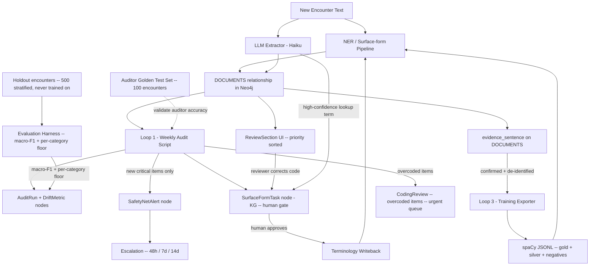

# Productionising the Three Learning Loops

## Version history


| Version | Date       | Reviewer roles                                                                         | Changes                                                                    |
| ------- | ---------- | -------------------------------------------------------------------------------------- | -------------------------------------------------------------------------- |
| 1.0     | 2026-04-02 | Initial draft                                                                          | Original plan                                                              |
| 2.0     | 2026-04-03 | CTO + Clinical Safety Officer + AI Lead                                                | 21 issues identified and resolved (see Appendix A)                         |
| 3.0     | 2026-04-03 | 8-stakeholder stress test (CTO, CSO, AI, DPO, End Users, QA/RA, Infra/DevOps, Finance) | 38 issues identified -- 3 CRITICAL, 18 HIGH, 16 MEDIUM, 1 LOW (Appendix B) |
| 3.1     | 2026-04-03 | Pre-Sprint + Sprint 0 execution                                                          | UN-049/050, DI-072-079, DO-070-077, R-047-053, VT-070-079 created; Sprint 0 scripts created (not yet executed against production) |
| 3.2     | 2026-04-03 | Sprint 1 + 1b execution                                                                  | Schema constraints, LoopConfig seed, deidentify_with_span (11 tests passing), DOCUMENTS schema, SurfaceFormTask source, audit script flags + immutability + Neo4j writer, audit-jobs queue, Stream B two-reviewer gate (CSO-001 fix), audit quality API skeleton |
| 3.3     | 2026-04-03 | Sprint 2 + 3 + 4 execution + pipeline_validation source fix                              | All 15 tasks complete: Stream A/B/C, revocation cascade, impact tracking, priority queue, QualitySection.tsx, audit_quality.py real queries, escalation (48h/7d/14d), cost cap, Bicep job, NER exporter + PII gate, corpus stats, CorpusCard, backfill script; source="audit_gap" bug fixed to "pipeline_validation" in surface_form_validation.py |


---

## Plain-language summary

Think of the system like a student who marks their own homework, fixes spelling mistakes in a dictionary, and collects good examples to study from. We are building three things:

1. **Loop 1 -- "Did we get it right?"** Run a check every week on recent patient records. If the computer missed important clinical codes, raise an alert and show a trend chart so the team can see if quality is getting worse.
2. **Loop 2 -- "Update the dictionary."** When a reviewer fixes a wrong code, or the system spots a new phrase, suggest adding it to the lookup table. A human reviewer must approve every new dictionary entry before it goes live.
3. **Loop 3 -- "Build the study guide."** Save every confirmed correct coding as a clean, anonymised example sentence so we can train a proper clinical NER model later. Keep a separate test set that never gets used for training, so we can measure whether training actually helped.

---

## How the three loops connect




---

## Design principles

### No unsupervised clinical changes

Every path that can alter how a patient record is coded must have a human
gate before it takes effect. The system suggests; a qualified person
approves. This applies to surface form writebacks, coding corrections,
and training data selection. The only fully automated action is *raising
an alert* -- never *changing a code*.

### Two-reviewer confirmation for reusable mappings (v3.0 -- fixes CSO-001)

A single reviewer can fix a single record (one CodingReview). But creating
a reusable surface form mapping -- which affects every future patient with
that phrase -- requires a second reviewer to confirm. The first reviewer's
correction is applied to the individual record immediately. The reusable
mapping waits in a `SurfaceFormTask` queue until a second person approves it.

---

## Pre-requisites -- must complete before Sprint 0

### DPIA and lawful basis (fixes DPO-001)

Loop 3 repurposes clinical text (special-category health data under Article 9
UK GDPR) for a new purpose: AI model training. Before any data collection begins:

1. **Identify the lawful basis** under Article 6(1) -- likely (f) legitimate interest
  or (e) public task, depending on the controller's status.
2. **Identify the Article 9(2) condition** -- likely (j) research with appropriate
  safeguards, or (h) health purposes.
3. **Complete a DPIA** documenting: the processing purpose, data flows (including
  which AWS Bedrock region processes encounter text -- must be eu-west-2 London),
   de-identification controls, retention schedule, and rights fulfilment mechanism.
4. **Confirm a Data Processing Agreement (DPA)** with AWS covers the Bedrock
  processing. If Bedrock is not available in eu-west-2, document the transfer
   mechanism (Standard Contractual Clauses) and add to the DPIA.
5. **Document the output**: reference the DPIA in this plan's regulatory notes.

**Owner:** Information Governance lead.
**Timeline:** Complete before Sprint 0 begins.

### Design control artefacts (fixes QA-001)

The `vt-enforcement` workspace rule states: "do not write code until the gap
is resolved." No code can be written until DI/DO/Risk/VT YAML files exist.

Create the following artefacts with at least draft content:


| #   | DI scope                                                                  | Risk                                                   | VT                                                                     |
| --- | ------------------------------------------------------------------------- | ------------------------------------------------------ | ---------------------------------------------------------------------- |
| 1   | Loop 1: automated audit execution (running auditor, writing results)      | Coding quality regression goes undetected              | Auditor precision >= 0.80, recall >= 0.85                              |
| 2   | Loop 1: drift detection and alerting (dedup, acknowledgement, escalation) | Alert fatigue causes genuine regression to be ignored  | Alert dedup + escalation fires correctly                               |
| 3   | Loop 1: overcoded item remediation (CodingReview creation)                | False clinical record persists (overcoded diagnosis)   | Overcoded items appear in urgent queue within 1 run                    |
| 4   | Loop 2: surface form task creation (Streams A, B, C)                      | Incorrect surface form propagates to future encounters | Two-reviewer gate enforced; no MAPS_TO without second approval         |
| 5   | Loop 2: surface form revocation and cascade                               | Revoked mapping leaves historical records incorrect    | Affected encounters flagged for re-review on revoke                    |
| 6   | Loop 3: de-identified evidence collection                                 | PII leaks into training corpus                         | `detect_phi()` returns empty on 500-record sample                      |
| 7   | Loop 3: holdout set integrity                                             | Training/test contamination inflates metrics           | Holdout encounters never appear in export JSONL                        |
| 8   | Loop 3: training data export and PII gate                                 | Patient data included in export files                  | No encounter_id/patient_id in output; PII gate aborts on any detection |


Also create corresponding DO files and update both traceability matrices.

**Owner:** Quality lead or design authority.
**Timeline:** Complete before Sprint 0 begins. Estimated effort: 1-2 days.

---

## Part 1 -- Loop 1: Coding Quality Audit

### What it does

Every week, the audit script runs on the last 7 days of new encounters. It uses Claude Sonnet (via AWS Bedrock, eu-west-2 region) to check whether the NER pipeline coded everything correctly. It saves the results and shows whether quality is going up or down over time.

### Step 0: Validate the auditor itself

**Before Loop 1 goes into production, we must measure how accurate the auditor is.** We are using an LLM to check an NER pipeline -- the auditor can make mistakes too. False positives (flagging correct codes as missing) cause alert fatigue. False negatives (missing real gaps) give false confidence.

**Validation procedure:**

1. Select 100 encounters spanning a mix of clinical domains (respiratory, cardiovascular, oncology, mental health, musculoskeletal, dermatology).
2. Have a clinician manually label what codes should and should not be present.
3. Run the auditor on these 100 encounters.
4. Measure auditor precision and recall -- both overall AND per domain.
5. Record the baseline: `auditor_precision`, `auditor_recall`, `auditor_f1`, `auditor_model_version`, `validation_date`.
6. Store as `AuditRun` with `triggered_by: "validation"`.
7. Re-run this validation whenever the underlying LLM model version changes (see "Model version change gate" below).

**Acceptance thresholds (fixes CSO-002):**


| Scope                                                            | Precision | Recall  | Rationale                                                                  |
| ---------------------------------------------------------------- | --------- | ------- | -------------------------------------------------------------------------- |
| Overall                                                          | >= 0.80   | >= 0.85 | Below this, more noise than signal                                         |
| Safety-critical categories (cancer, safeguarding, mental health) | >= 0.80   | >= 0.90 | A 15% miss rate for cancer is not acceptable; 10% is the maximum tolerable |


If any safety-critical category is below its recall threshold, do not deploy Loop 1 until the audit prompt is tuned for that category.

**Model version change gate (fixes AI-005):** When `auditor_model_version` changes from the previous run, automatically re-run the 100-encounter golden test set and compare precision/recall. If either drops below threshold, create a `SafetyNetAlert` with `alert_type: "auditor_regression"` and pause Loop 1 until reviewed.

### New Neo4j nodes (Patient Graph)

Add to `libs/cypher/schema_constraints.py` in `PATIENT_SCHEMA_CONSTRAINTS`:

```cypher
CREATE CONSTRAINT audit_run_id IF NOT EXISTS
  FOR (a:AuditRun) REQUIRE a.run_id IS UNIQUE;
CREATE INDEX audit_run_status IF NOT EXISTS
  FOR (a:AuditRun) ON (a.status);
CREATE CONSTRAINT drift_metric_id IF NOT EXISTS
  FOR (d:DriftMetric) REQUIRE d.metric_id IS UNIQUE;
CREATE CONSTRAINT loop_config_id IF NOT EXISTS
  FOR (c:LoopConfig) REQUIRE c.loop_id IS UNIQUE;
```

`**AuditRun` properties:**


| Property                | Type     | Notes                                                          |
| ----------------------- | -------- | -------------------------------------------------------------- |
| `run_id`                | string   | Deterministic: `audit-YYYY-WNN` for scheduled, UUID for manual |
| `triggered_by`          | string   | `"schedule"`, `"manual"`, or `"validation"`                    |
| `since_date`            | string   | ISO date                                                       |
| `until_date`            | string   | ISO date                                                       |
| `status`                | string   | `"running"`, `"complete"`, `"failed"`                          |
| `encounter_count`       | int      | Total encounters audited                                       |
| `pct_clean`             | float    | Percentage with assessment = "clean"                           |
| `critical_count`        | int      | Count of critical-severity findings                            |
| `auditor_model_version` | string   | Exact model ID from Bedrock, e.g. `"claude-sonnet-4-20250514"` |
| `started_at`            | datetime |                                                                |
| `completed_at`          | datetime |                                                                |
| `cost_usd`              | float    | Estimated LLM cost for this run                                |


**Immutability guard (fixes QA-002):** Once `status = "complete"`, the node must NOT be overwritten. The MERGE logic checks: if the existing node has `status: "complete"`, create a new run with a suffixed `run_id` (e.g. `audit-2026-W14-retry-1`) and log the reason. Only `"running"` or `"failed"` nodes can be overwritten on retry.

`**DriftMetric` properties:**


| Property                | Type     | Notes                                                      |
| ----------------------- | -------- | ---------------------------------------------------------- |
| `metric_id`             | string   | `{run_id}-{week_start}`                                    |
| `run_id`                | string   | FK to AuditRun                                             |
| `metric_type`           | string   | `"audit"` or `"training_eval"` (fixes CTO-004)             |
| `week_start`            | string   | ISO date                                                   |
| `pct_clean`             | float    |                                                            |
| `pct_clean_by_domain`   | string   | JSON: `{"respiratory": 92.1, "cardiovascular": 88.5, ...}` |
| `critical_count`        | int      |                                                            |
| `high_count`            | int      |                                                            |
| `overcoded_count`       | int      | Items coded that should not be                             |
| `parse_error_count`     | int      |                                                            |
| `top_missing_terms`     | string   | JSON list                                                  |
| `top_overcoded_terms`   | string   | JSON list                                                  |
| `auditor_model_version` | string   | Copied from AuditRun for easy querying                     |
| `model_version_changed` | boolean  | True when auditor version differs from previous run        |
| `recorded_at`           | datetime |                                                            |


Relationship: `(:AuditRun)-[:HAS_METRIC]->(:DriftMetric)`

`**LoopConfig` node (fixes CTO-001):**

A single node per loop, stored in Neo4j for runtime toggling without redeployment.


| Property     | Type     | Notes                                                       |
| ------------ | -------- | ----------------------------------------------------------- |
| `loop_id`    | string   | `"loop1_audit"`, `"loop2_surface_form"`, `"loop3_evidence"` |
| `enabled`    | boolean  | Kill switch                                                 |
| `updated_by` | string   | Who last changed it                                         |
| `updated_at` | datetime |                                                             |


**Emergency Cypher (for on-call engineers when the API is down):**

```cypher
MATCH (c:LoopConfig {loop_id: "loop1_audit"})
SET c.enabled = false, c.updated_by = "oncall_manual", c.updated_at = datetime()
```

### New backend: Audit API

New file: `services/api/app/routers/audit_quality.py`
Router prefix: `/operations/quality`


| Method  | Path                                                | What it does                                                        |
| ------- | --------------------------------------------------- | ------------------------------------------------------------------- |
| `POST`  | `/operations/quality/runs`                          | Trigger a new audit run (enqueues to `audit-jobs` queue)            |
| `GET`   | `/operations/quality/runs`                          | List past `AuditRun` nodes (paginated)                              |
| `GET`   | `/operations/quality/runs/latest`                   | Latest run + its `DriftMetric`                                      |
| `GET`   | `/operations/quality/runs/{run_id}`                 | Single run detail                                                   |
| `GET`   | `/operations/quality/drift`                         | Last N weeks of `DriftMetric` (filtered by `metric_type = "audit"`) |
| `GET`   | `/operations/quality/alerts`                        | `SafetyNetAlert` nodes with `alert_type = "coding_quality_drift"`   |
| `PATCH` | `/operations/quality/alerts/{alert_id}/acknowledge` | Set `acknowledged_by`, `acknowledged_at`                            |
| `GET`   | `/operations/quality/config`                        | Current LoopConfig nodes                                            |
| `PATCH` | `/operations/quality/config/{loop_id}`              | Toggle enabled on/off (kill switch)                                 |


**Queue isolation (fixes CTO-002 from v2.0):** The trigger endpoint publishes to a dedicated `audit-jobs` Azure Service Bus queue, NOT to `pipeline-jobs`. The audit is a long-running job and must never delay real-time patient pipeline processing.

**Queue provisioning (fixes INF-002):** Add `audit-jobs` to `scripts/setup_service_bus.py` alongside the existing `pipeline-jobs` queue. For local development, the `InMemoryQueueAdapter` already supports multiple queue names. No new infrastructure pattern needed.

### Modify audit script -- incremental mode + Neo4j writer

`scripts/investigations/audit_encounter_coding.py` needs these additions:

1. `**--since-days N` flag** (default: 7) -- computes `since_date = today - N days` at runtime. No hardcoded date in YAML. Also accepts `--since YYYY-MM-DD` for manual runs.
2. **Deterministic `run_id`** -- For scheduled runs: `audit-{YYYY}-W{WW}` (ISO week). For manual runs: UUID. If a completed run exists for this `run_id`, create a suffixed retry instead of overwriting (immutability guard).
3. `**_write_audit_results_to_neo4j(db, neo_client, run_id)**` -- called in Phase 4:
  - Checks immutability guard before writing.
  - Records `auditor_model_version` from the LLM client.
  - Records `cost_usd` (estimated from token counts).
  - Records `pct_clean_by_domain` breakdown (group audit results by clinical domain).
  - Sets `metric_type: "audit"` on the `DriftMetric`.
4. **Alert deduplication + sample size guard (fixes CTO-002):** Only creates a `SafetyNetAlert` when:
  - `encounter_count >= 100` (below this, percentage swings are statistical noise), AND
  - `critical_count > 0` AND the critical terms are NEW (not in previous week's `top_missing_terms`), OR
  - `pct_clean` drops more than 3 points week-on-week.
  - Alert properties include `acknowledged_by` (null initially), `acknowledged_at`, and `escalation_level` (0 initially).
5. **Alert escalation (fixes CSO-003):** A background check (run as part of the weekly audit, or as a separate cron) processes unacknowledged alerts:
  - **48 hours**: Re-raise with `escalation_level = 1` (appears more prominently in UI).
  - **7 days**: Send email notification to the clinical safety lead (configurable recipient in LoopConfig).
  - **14 days**: Automatically set `LoopConfig.enabled = false` for Loop 1 and create a new `SafetyNetAlert` with `alert_type: "escalation_auto_pause"`.
6. **Overcoded item remediation (fixes CSO-004):** When the audit finds overcoded items:
  - Create a `CodingReview` node with `review_type: "overcoded"` and `priority: "urgent"`.
  - These appear in a **separate "Urgent" section** at the top of the review UI, not mixed into the general queue.
  - **48-hour review SLA**: overcoded items unreviewed after 48h trigger an alert.
7. **Model version annotation:** When `auditor_model_version` changes from the previous run, set `model_version_changed: true` on the `DriftMetric`. If a golden test set exists, automatically re-validate (see "Model version change gate" above).

### Scheduling

A new **Azure Container Apps Job** runs weekly:

```yaml
# infra/jobs/audit-quality-job.yaml (new file)
schedule: "0 2 * * 1"   # 02:00 UTC every Monday (outside business hours -- fixes INF-001)
command: ["python", "scripts/investigations/audit_encounter_coding.py",
          "--yes", "--workers", "5", "--tier", "big",
          "--since-days", "7"]
```

**Runtime estimate (fixes INF-001):** ~1000 encounters at ~2-3 seconds per LLM call with 5 workers = ~10-15 minutes. At 5x scale (5000 encounters/week): ~50-75 minutes. Neo4j reads use indexed encounter date properties. Query timeout set to 30 seconds.

**Persistent storage (fixes CTO-005):** Mount an Azure Files volume for the SQLite checkpoint database so crash-restarts resume from the last completed encounter instead of restarting.

**Secrets (fixes INF-005):** Follow existing Container Apps pattern: Key Vault references in the job YAML for `NEO4J_URI`, `NEO4J_PASSWORD`, `AWS_ACCESS_KEY_ID`, `AWS_SECRET_ACCESS_KEY`, `AWS_DEFAULT_REGION`.

**Cost estimates (fixes FIN-001):**


| Component                        | Per week (1 practice) | Per week (50 practices) |
| -------------------------------- | --------------------- | ----------------------- |
| LLM (Sonnet via Bedrock)         | $10-30                | $500-1,500              |
| Compute (Container Apps Job)     | ~$1                   | ~$50                    |
| Human reviewer time (see Part 5) | GBP 80-320 (2-8 hrs)  | GBP 4,000-16,000        |


Human reviewer cost is the dominant cost. See Part 5 for review volume management.

### New frontend: Quality tab

Add a **"Quality"** tab to `OperationsWorkspace` alongside Run / Review / Train / Deploy.

New file: `services/ui/src/components/operations/QualitySection.tsx`

**Health-literacy labels (fixes EU-003):** All user-facing labels use plain English:


| Developer term   | UI label                                                                    |
| ---------------- | --------------------------------------------------------------------------- |
| `pct_clean`      | "Coding accuracy (%)"                                                       |
| Drift chart      | "Accuracy trend"                                                            |
| `critical_count` | "Urgent items needing review"                                               |
| Loop 1 / 2 / 3   | "Weekly quality check" / "Dictionary learning" / "Training data collection" |
| DriftMetric      | (not shown to users)                                                        |


**Components:**

- Loads `GET /api/operations/quality/drift` -- returns last 12 weeks of metrics
- Renders a **Recharts `LineChart`** with three lines: coding accuracy, urgent items, overcoded items
- **Model version annotations**: vertical dashed line on weeks where `model_version_changed = true` with tooltip: "The checker was updated -- this may not be a real quality change"
- **Domain breakdown**: tooltip on coding accuracy line shows per-domain percentages
- Below the chart: a table of the last 5 `AuditRun` rows with status chips
- A **"Run quality check now"** button that calls `POST /api/operations/quality/runs`
- **Notification badge (fixes EU-002):** Red badge on the "Quality" tab when unacknowledged alerts exist. This is the most important UI change -- without it, alerts go unseen.
- **Alert panel**: shows unacknowledged alerts with "Acknowledge" button + escalation level indicator
- **Loop toggle switches**: three switches with one-sentence explanations
- **Cost tracker**: shows cumulative LLM cost for the last 4 weeks
- **Optional email digest (fixes EU-002):** Weekly summary email of new alerts and unreviewed items. Configurable recipient in LoopConfig. Not required for v1 but strongly recommended.

---

## Part 2 -- Loop 2: Surface Form Learning

### Design principle: all three streams end at a human gate

The v1.0 plan had Stream C auto-approving surface forms. The v2.0 plan fixed this. The v3.0 review found a subtler problem: **Stream B creates a live surface form mapping before the second reviewer confirms it** (CSO-001).

**The fix (v3.0):** When a reviewer resolves a `CodingReview` with a different concept:

1. The individual `CodingReview` record is resolved immediately (fixing that one patient's record).
2. The reusable `MAPS_TO` relationship is **NOT created** yet.
3. Instead, a `SurfaceFormTask` is created with `status: "pending"`.
4. Only when a second reviewer approves the `SurfaceFormTask` does the `MAPS_TO` relationship get created (via the existing terminology writeback endpoint).

This means the existing code in `resolve_coding_review` (lines 1323-1337 of `training.py`) must be changed: the `UPSERT_SURFACE_FORM_MAPPING` call is moved behind a conditional -- it only fires when the resolved concept matches the original concept (i.e. confirming the existing mapping, not changing it). When the concept is different, only a `SurfaceFormTask` is created.

### Three input streams explained

The lookup dictionary (surface forms) grows from three places:

**Stream A -- Audit gaps (batch, after each audit run)**
New script: `scripts/feed_audit_gaps_to_surface_forms.py`
Reads `surface_form_gaps.json` from the audit output. For each gap where the resolver found a match at score > 0.75, creates a pending `SurfaceFormTask` in the knowledge graph. This is already surfaced in `ReviewSection` automatically.

**Stream B -- Reviewer corrections (real-time, two-reviewer gate)**
When a reviewer resolves a `CodingReview` via `POST /training/coding-review/{review_id}/resolve` and the `resolved_concept_id` is different from `snomed_concept_id`:

```python
if body.resolved_concept_id != original_concept_id:
    # Fix this ONE record immediately
    session.run(RESOLVE_CODING_REVIEW, ...)

    # Do NOT create MAPS_TO yet -- queue for second reviewer
    _create_surface_form_task(
        entity_text=entity_text,
        current_concept=original_concept_id,
        suggested_concept=body.resolved_concept_id,
        confidence=0.9,
        source="reviewer_correction",
    )
    # The MAPS_TO is created ONLY when a second reviewer
    # approves via POST /training/surface-form-tasks/{id}/resolve
else:
    # Confirming existing mapping -- safe to upsert directly
    coding_client.run(UPSERT_SURFACE_FORM_MAPPING, ...)
```

**Stream C -- LLM lookup terms (human-gated suggestion)**
In `services/coding_worker/app/pipeline/llm_extractor.py` after `extract_batch`, for each resolved term where the resolver returns score >= 0.90 and that surface form does not already exist: create a `SurfaceFormTask` with `source: "llm_auto_detected"` and `status: "pending"`. A reviewer approves or rejects it.

**Rate limiting + auto-pause (fixes EU-001):** Stream C is capped at 20 new `SurfaceFormTask` creations per day. Additionally, if total unresolved items across all streams exceeds 50, Stream C auto-pauses until the queue drains below 30.

### Review queue priority (fixes EU-001, CSO-004)

The review queue is priority-sorted:


| Priority   | Source                          | Rationale                             |
| ---------- | ------------------------------- | ------------------------------------- |
| 1 (urgent) | Overcoded items from audit      | False clinical records; 48h SLA       |
| 2 (high)   | Audit gaps (Stream A)           | Systemic coding failures              |
| 3 (normal) | Reviewer corrections (Stream B) | Individual fixes needing confirmation |
| 4 (low)    | LLM auto-detected (Stream C)    | Opportunistic dictionary growth       |


**Weekly review volume estimate:** Stream A: ~10-20 items per audit run. Stream B: ~5-10 per week (depends on reviewer activity). Stream C: up to 20/day but auto-pauses at queue depth 50. Overcoded: ~2-5 per run. Total: ~30-60 items/week. At 5 minutes per item, this is 2.5-5 hours/week of reviewer time.

### SurfaceFormTask source tracking

The `SurfaceFormTask` node needs a `source` property. Add to the UPSERT query in `surface_form_task_queries.py`:

```cypher
t.source = $source
```

Valid sources: `"audit_gap"`, `"reviewer_correction"`, `"llm_auto_detected"`.

### Impact tracking

After a surface form is approved and written back, track how often it fires:

- Add `first_used_at` and `use_count` properties to the `SurfaceForm` node (or `MAPS_TO` relationship).
- The QualitySection shows: "Dictionary improvements this month: X new terms approved, Y additional codings in new encounters."

### Rollback capability (fixes CTO-003)

If a surface form writeback turns out to be wrong:

1. `**DELETE /training/surface-forms/{normalized}/revoke**` -- removes the `MAPS_TO` relationship, sets `SurfaceFormTask.status = "revoked"`, logs the revocation.
2. **Cascade to affected encounters**: query all encounters coded after `first_used_at` where a `DOCUMENTS` relationship uses the revoked concept with `source = "provisional"`. Create a `CodingReview` node for each affected encounter with `review_type: "revocation_cascade"` so a reviewer can correct or confirm each one.
3. **"Recently approved terms" view (fixes EU-004)**: add to the Quality or Review section showing: term, approved_by, approved_date, use_count, and a "Revoke" button. Reviewers can trace from "this term causes problems" to "revoke it and fix affected records" in one flow.

### No new endpoints needed

`SurfaceFormTask` creation, listing, and resolution already exist:

- `GET /training/surface-form-tasks` -- already loads in `ReviewSection`
- `POST /training/surface-form-tasks/{task_id}/resolve` -- already wired in `ReviewSection`
- `PATCH /training/surface-forms/{normalized}/approve` -- terminology writeback already exists

One new endpoint: `DELETE /training/surface-forms/{normalized}/revoke` (see rollback above).

### Frontend -- source badge

Add a `source` badge to surface-form `ReviewCard` rows so reviewers can see where the task came from ("audit gap", "reviewer correction", or "auto-detected").

In `services/ui/src/components/operations/ReviewSection.tsx` in `surfaceFormTaskToItem`, add `reason: item.source ?? ""` to the `ReviewItem`. `ReviewCard` already renders `reason` as a chip.

---

## Part 3 -- Loop 3: NER Training Evidence Package

### The problem

Right now the `DOCUMENTS` relationship stores `evidence = "maintenance of PICC line"` -- just the matched text span. To build NER training data we need the **full de-identified sentence** and the **character offsets** of the span inside it.

### New DOCUMENTS properties

In `libs/cypher/documents_queries.py`, add to the `SET` block in `_WRITE_DOCUMENTS_QUERY`:

```cypher
r.evidence_sentence  = $evidence_sentence,
r.evidence_start     = $evidence_start,
r.evidence_end       = $evidence_end,
r.sentence_index     = $sentence_index,
r.holdout            = $holdout
```

The `holdout` flag marks encounters reserved for evaluation (never exported for training).

### New helper in deidentify.py

In `libs/utils/deidentify.py`, add:

```python
def deidentify_with_span(
    sentence: str,
    span_text: str,
) -> tuple[str, int, int]:
    """Return (de-identified sentence, span start, span end).

    De-identifies the sentence first, then re-finds the span by
    case-insensitive string search. Safe because entity text (clinical
    terms) is never PII.

    When the span cannot be found after de-identification (e.g. the span
    text overlapped with a PII token), returns (-1, -1) as sentinel
    values. Callers MUST skip records with start == -1 to avoid
    corrupting training data.
    """
    deident = deidentify_text(sentence, ner=True)
    idx = deident.lower().find(span_text.lower())
    if idx == -1:
        return deident, -1, -1
    return deident, idx, idx + len(span_text)
```

### De-identification acceptance threshold

**Acceptance criterion (VT):** Zero PII tokens found when running `detect_phi()` against 100% of stored `evidence_sentence` values in a random sample of 500 records. If any PII is detected, the pipeline is halted, the de-identification module is updated, and the affected records are re-processed.

Verified by a scheduled check (monthly) and as part of every training export run.

### Modify write_documents_from_sentences_payload

In `libs/cypher/documents_queries.py` in `write_documents_from_sentences_payload`, each `sentence` dict already has `sentence["text"]`. For each `term` in the sentence:

1. Call `deidentify_with_span(sentence["text"], term["text"])`
2. If `start == -1`, set `evidence_sentence = deident`, `evidence_start = None`, `evidence_end = None` (record is stored but excluded from training export)
3. Otherwise pass all three values into the Cypher query parameters
4. Set `sentence_index` from the sentence's position in the payload
5. Set `holdout = false` (default; holdout encounters are flagged separately)

### Source lifecycle for training quality


| Source value    | Meaning                               | Training tier          |
| --------------- | ------------------------------------- | ---------------------- |
| `provisional`   | Auto-coded, not reviewed              | Excluded               |
| `reviewed`      | Single human reviewer confirmed       | Silver                 |
| `confirmed`     | Second reviewer or clinician approved | Gold                   |
| `audit_flagged` | Audit identified as incorrect         | Excluded (pending fix) |


### Training strategy (fixes AI-003)

- **v1: Train on gold only.** Gold labels have two-reviewer confirmation and the lowest error rate. Silver labels include single-reviewer data with unknown error rate.
- **Minimum volume before first training run:** 5,000 entity annotations across gold labels. Below this, the model will not generalise.
- **v2 (future):** Once gold volume exceeds 10,000 entities, consider adding silver labels with reduced sample weight (0.5x) for semi-supervised augmentation.

### Held-out evaluation set (fixes AI-001)

**Critical for measuring whether training actually helps.**

1. Select **500 encounters** (not 200 -- fixes AI-001) stratified across clinical domains, assertion types, and complexity levels.
2. **Stratified sampling guarantees:** minimum 20 examples per safety-critical category (cancer, safeguarding, mental health crisis, suicide/self-harm, drug interactions).
3. Mark with `holdout = true` on all their DOCUMENTS relationships.
4. Have a clinician validate the coding on these encounters (ground truth).
5. The exporter ALWAYS filters `WHERE r.holdout IS NULL OR r.holdout = false`.
6. After each NER training run, evaluate the new model against the holdout set.
7. Store evaluation results as a `DriftMetric` with `metric_type: "training_eval"`.

**Clinician validation assignment (fixes CSO-005):**

- **Owner:** GP partner with clinical coding experience, or clinical safety lead.
- **Estimated effort:** 500 encounters at ~3 minutes each = ~25 hours. Budget across 2-3 weeks.
- **What "validate" means:** confirm each DOCUMENTS relationship is correct, add missing codes, remove incorrect codes.
- **Schedule:** Complete before Sprint 1 begins.

**Never reuse holdout encounters for training. Never add new holdout encounters that were previously in training data.**

### Evaluation metrics (fixes AI-002)

- **Primary metric: macro-F1** (equal weight per entity category). This prevents common categories from masking poor performance on rare ones.
- **Per-category floor:** if ANY category's F1 drops below its previous value by more than 10 points, block deployment regardless of aggregate F1.
- **Safety-critical gate:** if cancer, safeguarding, or mental health crisis F1 drops by ANY amount, flag for manual review before deployment.
- **Rollback trigger:** aggregate macro-F1 drops > 5% from previous model -- rollback to previous NER model version (model registry already supports this).

### Negative examples for NER

NER models need to learn what NOT to extract:

- For each encounter in the export, include sentences that have NO DOCUMENTS relationship (no coded entities).
- These become records with empty spans: `{"text": "Patient was seen on time.", "spans": []}`.
- This prevents the model from over-extracting.

### Class imbalance monitoring (fixes AI-004)

The exporter outputs a **stratification report** alongside the JSONL. Warnings flag categories with fewer than 50 examples.

**Response protocol when warnings fire:**


| Scope                    | Threshold     | Action                                                                     |
| ------------------------ | ------------- | -------------------------------------------------------------------------- |
| Safety-critical category | < 20 examples | **Training blocked** until more examples are collected or manually curated |
| Non-safety category      | < 50 examples | Warning shown in CorpusCard; training allowed but flagged                  |
| Assertion type           | < 50 examples | Warning shown; informational only                                          |


### Data output controls (fixes DPO-002)

**No linkable identifiers in export files.** The Cypher query returns `encounter_id` for grouping during export processing. The exporter:

1. Uses `encounter_id` to group sentences into multi-entity records.
2. **Strips `encounter_id` from the output JSONL** -- it does not appear in any output file.
3. Post-export verification: scan every output file and confirm no `encounter_id`, `patient_id`, NHS number, or other linkable identifier appears.

### Data retention (fixes DPO-004)


| Artefact                              | Retention                                                                 | Automated deletion              |
| ------------------------------------- | ------------------------------------------------------------------------- | ------------------------------- |
| `evidence_sentence` on DOCUMENTS      | Linked to patient record retention (practice-specific)                    | Deleted when patient is deleted |
| Exported JSONL files                  | 2 years or until the model trained on them is retired, whichever is later | Manual review at 2-year mark    |
| Stratification reports and manifests  | 7 years (regulatory evidence)                                             | No auto-delete                  |
| Audit results (AuditRun, DriftMetric) | 7 years (quality records)                                                 | No auto-delete                  |


### Data minimisation note (fixes DPO-005)

The plan stores full de-identified sentences as `evidence_sentence`. This is justified because NER models need sentence-level context for accurate boundary detection and negation scope (e.g. "no evidence of diabetes" requires the full sentence to learn that "diabetes" is negated). A context-windowed span (+/- 10 tokens) would lose this information. Documented in the DPIA with this justification.

### New training exporter script

New file: `scripts/export_ner_training.py`

Queries:

```cypher
MATCH (e:Encounter)-[r:DOCUMENTS]->(s)
WHERE r.evidence_sentence IS NOT NULL
  AND r.evidence_start IS NOT NULL
  AND r.evidence_start >= 0
  AND (r.holdout IS NULL OR r.holdout = false)
  AND r.source IN $allowed_sources
RETURN r.evidence_sentence, r.evidence_start, r.evidence_end,
       r.sentence_index, e.id AS encounter_id,
       s.conceptId, s.semanticTag, s.name, r.context
ORDER BY e.id, r.sentence_index
```

Groups results by `(encounter_id, sentence_index)` to produce multi-entity records. `**encounter_id` is used for grouping only and is stripped from output.**

Outputs:

- `ner_training_gold.jsonl` (source = "confirmed" only)
- `ner_training_silver.jsonl` (source = "reviewed")
- `ner_stratification_report.txt`
- `ner_export_manifest.json` (date, entity count, holdout exclusion count, PII check result, no patient/encounter IDs)

**PII verification gate:** Before writing any output file, run `detect_phi()` on every `evidence_sentence` in the export batch. If ANY PII is found, abort the export and log the offending records for investigation.

### Backfill script (fixes INF-003)

New file: `scripts/backfill_evidence_sentences.py`

For existing DOCUMENTS relationships where `evidence_sentence IS NULL`:

1. Load the encounter text from Neo4j
2. For each DOCUMENTS relationship, find the sentence containing the `evidence` span
3. Call `deidentify_with_span()` and update the relationship
4. **Batch size:** 500 relationships per transaction
5. **Progress logging:** every 1000 records
6. **Resume capability:** skip relationships where `evidence_sentence IS NOT NULL`
7. **Estimated volume:** query count before starting; log expected duration

### Frontend -- corpus card in TrainSection

New endpoint: `GET /training/corpus/stats`
Returns:

```json
{
  "gold_count": 3200,
  "silver_count": 8400,
  "holdout_count": 500,
  "negative_sentence_count": 5600,
  "entity_type_breakdown": {"disorder": 8120, "finding": 4890},
  "assertion_breakdown": {"present": 15890, "historical": 1240},
  "imbalance_warnings": ["situation: only 410 examples"],
  "safety_critical_blocked": false,
  "training_ready": true,
  "minimum_gold_met": true,
  "last_updated": "2026-04-01T06:00:00Z"
}
```

The card shows:

- Gold/silver/holdout counts with progress bar toward 5,000 gold minimum
- A bar chart of entity types
- Red warning badges for underrepresented categories
- "Training blocked" indicator if any safety-critical category < 20 examples
- Last export date

---

## Part 4 -- Operational resilience

### Observability (fixes INF-004)

Each loop emits structured log lines with counters. Logs are aggregated to **Application Insights** (matching existing services).


| Loop | Metric                               | Log key                               |
| ---- | ------------------------------------ | ------------------------------------- |
| 1    | Encounters audited                   | `audit.encounters_processed`          |
| 1    | Audit errors (LLM failures)          | `audit.errors`                        |
| 1    | Cost this run                        | `audit.cost_usd`                      |
| 2    | SurfaceFormTasks created (by source) | `surface_form.tasks_created.{source}` |
| 2    | SurfaceFormTasks approved            | `surface_form.tasks_approved`         |
| 2    | Stream C rate limit hits             | `surface_form.rate_limit_hit`         |
| 2    | Queue depth                          | `surface_form.queue_depth`            |
| 3    | Evidence sentences written           | `evidence.sentences_written`          |
| 3    | Span-miss skips (deident failure)    | `evidence.span_miss_count`            |
| 3    | PII detected in export (should be 0) | `evidence.phi_detected`               |


**Alert rules (Application Insights):**


| Rule              | Condition                         | Action                             |
| ----------------- | --------------------------------- | ---------------------------------- |
| Audit job failure | `audit.errors` > 10 in single run | Page on-call                       |
| PII leak          | `evidence.phi_detected` > 0       | Page on-call + auto-disable Loop 3 |
| Queue overflow    | `surface_form.queue_depth` > 100  | Notify clinical lead               |


### Failure modes and recovery


| Failure                       | Detection                                                         | Recovery                                                           |
| ----------------------------- | ----------------------------------------------------------------- | ------------------------------------------------------------------ |
| Audit job hangs (>4h)         | Container Apps Job timeout                                        | Auto-restart; SQLite checkpoint on persistent storage resumes      |
| LLM provider outage           | Consecutive errors > 10                                           | Pause audit, create SafetyNetAlert `"audit_infra_failure"`         |
| Bad surface form approved     | Clinical review finds miscoding                                   | Revoke endpoint + cascade CodingReviews for affected encounters    |
| PII leak in evidence_sentence | `detect_phi()` finds tokens                                       | Halt Loop 3 (kill switch), purge records, update de-identification |
| Training degrades NER         | Holdout macro-F1 drops > 5% or any safety-critical category drops | Rollback to previous model (model registry)                        |
| Alert goes unacknowledged     | Escalation timer (48h / 7d / 14d)                                 | Re-raise, email, then auto-pause Loop 1                            |
| Per-run cost exceeds cap      | Token count exceeds $100 limit (fixes FIN-003)                    | Pause run, create SafetyNetAlert                                   |


**Per-run cost cap (fixes FIN-003):** Track cumulative token count during audit runs. If estimated `cost_usd` exceeds $100 (configurable via LoopConfig), pause the run and create a `SafetyNetAlert`. Resume manually after investigation.

---

## Part 5 -- Review volume management (fixes EU-001, FIN-001)

### The binding constraint is human capacity, not technology

The system can generate review items faster than humans can process them. If the queue grows faster than it is consumed, reviewers experience a permanently growing backlog, prioritise arbitrarily, and eventually stop reviewing.

### Estimated weekly volume (1 practice)


| Source                          | Items/week | Minutes/item | Hours/week  |
| ------------------------------- | ---------- | ------------ | ----------- |
| Overcoded (urgent)              | 2-5        | 5            | 0.2-0.4     |
| Audit gaps (Stream A)           | 10-20      | 5            | 0.8-1.7     |
| Reviewer corrections (Stream B) | 5-10       | 3            | 0.3-0.5     |
| LLM auto-detected (Stream C)    | 0-20       | 3            | 0.0-1.0     |
| **Total**                       | **17-55**  |              | **1.3-3.6** |


At UK clinical reviewer rates (GBP 40-80/hour): **GBP 50-290/week**.

### Auto-regulation

- Stream C daily cap: 20 items (configurable via LoopConfig).
- **Queue depth auto-pause:** if total unresolved items > 50, Stream C pauses automatically. Resumes when queue drops below 30. Streams A and B are never paused (they represent genuine quality issues).
- **Weekly email digest** (optional, configurable): summary of new items, unreviewed count, and time estimate. Helps reviewers plan their week.

### Cost at scale (fixes FIN-002)


| Practices | LLM cost/week | Human cost/week (est.) | Total/week       |
| --------- | ------------- | ---------------------- | ---------------- |
| 1         | $10-30        | GBP 50-290             | GBP 60-315       |
| 10        | $100-300      | GBP 500-2,900          | GBP 580-3,130    |
| 50        | $500-1,500    | GBP 2,500-14,500       | GBP 2,900-15,500 |


At 50 practices, consider a dedicated Neo4j read replica for audit queries to avoid contention with the real-time pipeline. Human cost is the dominant factor at all scales and must be included in the commercial pricing model.

---

## Regulatory notes (IEC 62304 / ISO 14971)

These changes touch the clinical coding pipeline (Class B) and PII handling (privacy risk).

### Required artefacts (fixes QA-003)

8 DIs (not 3) with corresponding DOs, Risks, and VTs:


| #   | DI scope                                   | Safety class | Key risk                                            |
| --- | ------------------------------------------ | ------------ | --------------------------------------------------- |
| 1   | Automated audit execution                  | B            | Coding quality regression goes undetected           |
| 2   | Drift detection and alerting               | B            | Alert fatigue causes regression to be ignored       |
| 3   | Overcoded item remediation                 | B            | False clinical record persists                      |
| 4   | Surface form task creation (Streams A/B/C) | B            | Incorrect mapping propagates to future encounters   |
| 5   | Surface form revocation and cascade        | B            | Revoked mapping leaves historical records incorrect |
| 6   | De-identified evidence collection          | B            | PII leaks into training corpus                      |
| 7   | Holdout set integrity                      | B            | Training/test contamination inflates metrics        |
| 8   | Training data export and PII gate          | B            | Patient data included in export files               |


### Post-market surveillance (fixes QA-004)

Loop 1 is functionally a post-market surveillance mechanism. Update the PMS plan to reference Loop 1 as a proactive monitoring tool. Link the Loop 1 DI to the PMS plan. This is a documentation task.

### Traceability

- Update `DC-TM-001-traceability-matrix.md` and `DC-TM-002-traceability-matrix.csv` for all new DIs.
- Each DI must reference a UN-LEO-AI-* user need.
- Each DI with safety_class B must reference at least one R-LEO-AI-* risk.

---

## Build order (revised sprints)

**Pre-Sprint -- Legal and regulatory (blocking, non-code)**

- DPIA for Loop 3 (DPO-001) -- owner: IG lead
- Create 8 DI/DO/Risk/VT YAML files (QA-001) -- owner: quality lead
- Update PMS plan to reference Loop 1 (QA-004) -- owner: quality lead
- Update both traceability matrices

**Sprint 0 -- Validation (before any production code)**

- Create 100-encounter golden test set for auditor validation (stratified by domain)
- Run auditor, measure per-domain precision/recall (safety-critical recall >= 0.90)
- If below threshold, tune the audit prompt before proceeding
- Select and mark 500 encounters as `holdout = true` (stratified, min 20 per safety-critical category)
- Assign clinician for holdout validation (~25 hours over 2-3 weeks)

**Sprint 1 -- Foundation (enables everything else)**

- `LoopConfig` node + constraints
- `evidence_sentence` + `deidentify_with_span` (with -1 sentinel) + modified write function
- `holdout` flag on DOCUMENTS
- `--since-days` flag + deterministic `run_id` + immutability guard + Neo4j writer
- `AuditRun` / `DriftMetric` constraints (incl. `metric_type`, `model_version_changed`)
- `source` property on `SurfaceFormTask` schema
- Dedicated `audit-jobs` queue in `setup_service_bus.py`
- Persistent Azure Files mount for audit SQLite

**Sprint 1b -- Parallelisable with Sprint 1 (fixes CTO-006)**

- Audit quality API router skeleton (can scaffold without Neo4j schema live)
- QualitySection.tsx skeleton with mock data
- Stream B code change in `resolve_coding_review` (defer MAPS_TO)

**Sprint 2 -- Surface form automation (Loop 2)**

- Stream A: feed audit gaps to SurfaceFormTask
- Stream B: two-reviewer gate (SurfaceFormTask, not direct MAPS_TO)
- Stream C: create SurfaceFormTask (human-gated, daily cap, queue-depth auto-pause)
- Source badge on ReviewCard
- Surface form revoke endpoint with cascade
- "Recently approved terms" view with revoke button
- Impact tracking (use_count on surface forms)
- Priority-sorted review queue

**Sprint 3 -- Quality dashboard (Loop 1 UX)**

- Audit quality API router (LoopConfig CRUD, alert acknowledgement, escalation)
- QualitySection.tsx with drift chart + model-version annotations + domain breakdown
- Health-literacy labels
- Notification badge on Quality tab
- Alert panel with acknowledgement + escalation level
- Loop toggle switches
- Overcoded urgent queue section
- Per-run cost cap enforcement
- Azure Container App Job schedule (02:00 UTC)
- Alert escalation logic (48h / 7d / 14d)

**Sprint 4 -- Training corpus (Loop 3 UX + export)**

- Training exporter script with negative examples, stratification report, PII gate
- Post-export encounter_id stripping verification
- Corpus stats endpoint with imbalance warnings + training-blocked indicator
- CorpusCard in TrainSection with progress bar and safety-critical gates
- Backfill script with batching, progress logging, and resume capability
- Optional: weekly email digest

---

## Appendix A: Issues identified in v2.0 review

### CTO concerns (architecture, cost, resilience)


| #   | Issue                                                 | Severity | Resolution                                      |
| --- | ----------------------------------------------------- | -------- | ----------------------------------------------- |
| C1  | Stream C auto-writeback bypasses human review         | Critical | Changed to human-gated SurfaceFormTask creation |
| C2  | Audit jobs compete with pipeline on same queue        | High     | Dedicated `audit-jobs` queue                    |
| C3  | `<computed last 7 days>` in YAML is not implementable | Medium   | `--since-days 7` flag computes at runtime       |
| C4  | No backfill for existing DOCUMENTS                    | Medium   | Optional backfill script added                  |
| C5  | AuditRun idempotency gap on restart                   | Medium   | Deterministic `run_id` + MERGE semantics        |
| C6  | No observability for loop health                      | Medium   | Structured log counters + infra failure alerts  |
| C7  | LLM cost not budgeted                                 | Low      | $10-30/week estimate documented                 |
| C8  | No kill switch for loops                              | Medium   | Config endpoint + UI toggles                    |


### Clinical Safety Officer concerns (patient safety, compliance)


| #   | Issue                                                            | Severity | Resolution                                                         |
| --- | ---------------------------------------------------------------- | -------- | ------------------------------------------------------------------ |
| S1  | Stream C auto-approves clinical mappings without human oversight | Critical | All streams now human-gated (see C1)                               |
| S2  | LLM auditor is not validated before production use               | Critical | Sprint 0: 100-encounter validation with precision/recall threshold |
| S3  | Alert fatigue from persistent false positives                    | High     | Dedup against prior week + acknowledgement workflow                |
| S4  | De-identification acceptance threshold undefined                 | High     | Zero PII in 100% of 500-record sample; monthly re-check            |
| S5  | Training data provenance chain incomplete                        | High     | Explicit source lifecycle: provisional -> reviewed -> confirmed    |
| S6  | Overcoded items create false clinical records                    | High     | Overcoded -> CodingReview remediation flow added                   |
| S7  | No rollback for bad surface form approvals                       | Medium   | Revoke endpoint added                                              |


### AI concerns (model quality, feedback effectiveness, bias)


| #   | Issue                                                    | Severity | Resolution                                                    |
| --- | -------------------------------------------------------- | -------- | ------------------------------------------------------------- |
| A1  | No baseline evaluation before NER training               | Critical | Holdout set; before/after F1 measurement                      |
| A2  | Training/test set contamination                          | Critical | `holdout` flag on DOCUMENTS; exporter always excludes         |
| A3  | Class imbalance in training data                         | High     | Stratification report with < 50 warnings                      |
| A4  | LLM model version changes cause phantom drift signals    | High     | `auditor_model_version` on every run; model-change annotation |
| A5  | No negative examples for NER                             | High     | Exporter includes sentences with empty spans                  |
| A6  | Seasonal variation confused with quality drift           | Medium   | `pct_clean_by_domain` breakdown on DriftMetric                |
| A7  | `deidentify_with_span` fallback produces corrupt offsets | High     | Changed to -1 sentinel; callers must skip                     |
| A8  | No feedback attribution (did a writeback actually help?) | Medium   | Impact tracking: use_count on surface forms                   |


---

## Appendix B: Issues identified in v3.0 eight-stakeholder review

### CTO findings


| ID      | Severity | Finding                                                | Resolution in v3.0                                                        |
| ------- | -------- | ------------------------------------------------------ | ------------------------------------------------------------------------- |
| CTO-001 | HIGH     | Kill switch storage underspecified (Neo4j vs env var)  | Defined `LoopConfig` Neo4j node with explicit schema + emergency Cypher   |
| CTO-002 | HIGH     | 3% pct_clean threshold not normalised for sample size  | Added `encounter_count >= 100` minimum before percentage-drop check fires |
| CTO-003 | HIGH     | Surface form revocation doesn't fix historical records | Revocation cascade: query affected encounters, create CodingReview nodes  |
| CTO-004 | MEDIUM   | DriftMetric conflates audit and training eval metrics  | Added `metric_type` discriminator (`"audit"` vs `"training_eval"`)        |
| CTO-005 | MEDIUM   | SQLite on ephemeral container storage lost on restart  | Mount Azure Files persistent volume for SQLite                            |
| CTO-006 | MEDIUM   | Zero sprint parallelism; single-threaded critical path | Added Sprint 1b for parallelisable tasks                                  |
| CTO-007 | LOW      | JSON strings in Neo4j prevent Cypher-level filtering   | Accepted as known tech debt for v1; documented                            |


### Clinical Safety Officer findings


| ID      | Severity | Finding                                                       | Resolution in v3.0                                                         |
| ------- | -------- | ------------------------------------------------------------- | -------------------------------------------------------------------------- |
| CSO-001 | CRITICAL | Stream B creates live MAPS_TO before second reviewer confirms | Deferred MAPS_TO: only SurfaceFormTask created; MAPS_TO on second approval |
| CSO-002 | HIGH     | Uniform auditor thresholds; cancer recall at 85% unacceptable | Per-domain thresholds: safety-critical recall >= 0.90                      |
| CSO-003 | HIGH     | No alert escalation; unacknowledged alerts sit indefinitely   | Time-based escalation: 48h re-raise, 7d email, 14d auto-pause              |
| CSO-004 | HIGH     | Overcoded items mixed into general review queue; no SLA       | Separate urgent queue section; 48h review SLA; dedicated alert             |
| CSO-005 | MEDIUM   | Holdout clinician validation has no owner or timeline         | Assigned to GP partner/clinical safety lead; 25 hrs over 2-3 weeks         |


### AI / ML Lead findings


| ID     | Severity | Finding                                                                    | Resolution in v3.0                                                    |
| ------ | -------- | -------------------------------------------------------------------------- | --------------------------------------------------------------------- |
| AI-001 | HIGH     | 200-encounter holdout has 0-3 cancer examples; per-category F1 meaningless | Increased to 500 encounters; min 20 per safety-critical category      |
| AI-002 | HIGH     | F1 type unspecified (micro vs macro); rare categories invisible            | Macro-F1 primary metric; per-category floor; safety-critical gate     |
| AI-003 | HIGH     | Training strategy undefined (gold vs silver mixing)                        | Gold only for v1; min 5,000 entities before first run; silver in v2   |
| AI-004 | MEDIUM   | No response protocol when imbalance warnings fire                          | Safety-critical < 20: training blocked. Non-safety < 50: warning only |
| AI-005 | MEDIUM   | Model version change does not re-trigger auditor validation                | Auto-revalidate against golden test set on version change             |


### Data Protection Officer findings


| ID      | Severity | Finding                                                               | Resolution in v3.0                                                                      |
| ------- | -------- | --------------------------------------------------------------------- | --------------------------------------------------------------------------------------- |
| DPO-001 | CRITICAL | No lawful basis or DPIA for repurposing clinical data for AI training | Pre-Sprint task: complete DPIA, identify Art 6 + Art 9(2) basis, specify Bedrock region |
| DPO-002 | HIGH     | encounter_id may leak into JSONL export files                         | Explicitly stripped from output; post-export verification added                         |
| DPO-003 | HIGH     | Bedrock region and DPA status unspecified                             | Specified eu-west-2; DPA confirmation required in pre-Sprint                            |
| DPO-004 | MEDIUM   | No retention policy for training artefacts                            | Retention schedule added (evidence: linked to patient; JSONL: 2 years; audit: 7 years)  |
| DPO-005 | MEDIUM   | Full sentences stored where shorter context might suffice             | Justified: NER needs sentence context for boundary/negation; documented in DPIA         |


### Clinical End User findings


| ID     | Severity | Finding                                                           | Resolution in v3.0                                                            |
| ------ | -------- | ----------------------------------------------------------------- | ----------------------------------------------------------------------------- |
| EU-001 | HIGH     | Review volume may exceed reviewer capacity (5x items vs capacity) | Volume estimates added; priority queue; Stream C auto-pause at queue depth 50 |
| EU-002 | HIGH     | No notification mechanism; alerts go unseen                       | Notification badge on Quality tab; optional weekly email digest               |
| EU-003 | MEDIUM   | Developer jargon in UI ("pct_clean", "drift", "Loop 1")           | Health-literacy label mapping defined                                         |
| EU-004 | MEDIUM   | No way to discover which approved surface form caused a problem   | "Recently approved terms" view with use_count and Revoke button               |


### QA / Regulatory Affairs findings


| ID     | Severity | Finding                                                    | Resolution in v3.0                                                        |
| ------ | -------- | ---------------------------------------------------------- | ------------------------------------------------------------------------- |
| QA-001 | CRITICAL | No DI/DO/VT YAML files created; workspace rules block code | Pre-Sprint task: create 8 DI/DO/Risk/VT sets with draft content           |
| QA-002 | HIGH     | Completed AuditRun nodes are mutable via MERGE             | Immutability guard: completed nodes cannot be overwritten; suffixed retry |
| QA-003 | HIGH     | DIs too coarsely bundled (3 instead of 8-10)               | Split to 8 DIs with distinct risk profiles                                |
| QA-004 | MEDIUM   | PMS plan not updated to reference Loop 1                   | Added as pre-Sprint documentation task                                    |


### Infrastructure / DevOps findings


| ID      | Severity | Finding                                                   | Resolution in v3.0                                                       |
| ------- | -------- | --------------------------------------------------------- | ------------------------------------------------------------------------ |
| INF-001 | HIGH     | Runtime estimate missing; 06:00 UTC is business hours     | Runtime estimated; schedule changed to 02:00 UTC; query timeout 30s      |
| INF-002 | HIGH     | Queue provisioning not specified (which tech, which IaC)  | Azure Service Bus; add to `setup_service_bus.py`; InMemory for local dev |
| INF-003 | MEDIUM   | Backfill script has no batching, progress, or resume      | Added: 500/txn batch size, progress logging, resume on `IS NOT NULL`     |
| INF-004 | MEDIUM   | Monitoring stack not specified; structured logs not wired | Application Insights; 3 alert rules defined                              |
| INF-005 | MEDIUM   | Secrets management for Container Apps Job not specified   | One-line note: Key Vault references matching existing pattern            |


### Finance / Commercial findings


| ID      | Severity | Finding                                            | Resolution in v3.0                                                  |
| ------- | -------- | -------------------------------------------------- | ------------------------------------------------------------------- |
| FIN-001 | HIGH     | Human reviewer cost not budgeted (10-60x LLM cost) | Part 5 added with volume estimates and GBP/week costs at all scales |
| FIN-002 | MEDIUM   | No cost-at-scale projection for multi-tenancy      | 3-tier scaling table (1/10/50 practices) with LLM + human costs     |
| FIN-003 | MEDIUM   | No per-run cost cap; runaway LLM spend possible    | $100 per-run cap with auto-pause and alert                          |


---

## Appendix C: Positive findings from v3.0 review

1. Stream C human gate (v2.0 fix) -- correctly identified and resolved
2. Auditor self-validation (Sprint 0) -- prevents deploying an unvalidated checker
3. -1 sentinel for deidentify_with_span -- prevents corrupt training offsets
4. Deterministic run_id -- idempotent crash recovery
5. Source lifecycle for training data -- mature approach to data quality tiers
6. Queue isolation -- prevents audit from blocking real-time pipeline
7. Model version annotation on drift chart -- prevents phantom regression investigations
8. Negative examples in training data -- necessary for NER and often overlooked
9. Overcoded item handling -- recognises overcoding is more dangerous than undercoding
10. Version history with reviewer roles -- right level of change documentation

