# V3 Pipeline Cutover Plan (In-Place)

## Decisions Locked

- REST cutover strategy: keep existing routes and rewire internals to V3 immediately.
- Graph write target: Patient graph for `(:Encounter)-[:DOCUMENTS]->(:SemanticTagSubtype)` links.
- Relationship pattern to follow (from your sample): `[:DOCUMENTS {coded_at, evidence, confidence, domain, context, modifiers}]`.

## Target Architecture

```mermaid
flowchart LR
  ui[NextUI] --> api[FastAPI Existing Routes]
  api --> v3svc[V3PipelineService]
  v3svc --> split[SentenceSplitter spaCy_PyRuSH]
  split --> llm1[LLM Extract Terms Batch5Sentences]
  llm1 --> resolve[Neo4j Term Resolve Read_SNOMED]
  resolve --> llm2[LLM Disambiguate MultiCandidate]
  llm2 --> write[PatientGraph DOCUMENTS Links]
  write --> review[ReviewQueue and UX Confirmation]
```

## Implementation Steps

1. **Create V3 service/module structure**
  - Add new V3 package and keep V2 files unmodified but unused:
    - [services/api/app/services/v3/pipeline_service.py](services/api/app/services/v3/pipeline_service.py)
    - [services/api/app/services/v3/sentence_splitter.py](services/api/app/services/v3/sentence_splitter.py)
    - [services/api/app/services/v3/llm_extractor.py](services/api/app/services/v3/llm_extractor.py)
    - [services/api/app/services/v3/coding_resolver.py](services/api/app/services/v3/coding_resolver.py)
    - [services/api/app/services/v3/disambiguator.py](services/api/app/services/v3/disambiguator.py)
    - [services/api/app/services/v3/patient_graph_writer.py](services/api/app/services/v3/patient_graph_writer.py)
  - Keep [services/api/app/services/training_creator.py](services/api/app/services/training_creator.py) as V2/orphaned reference only.
2. **Add sentence splitting with spaCy + PyRuSH fallback**
  - Implement sentence detector adapter in [services/api/app/services/v3/sentence_splitter.py](services/api/app/services/v3/sentence_splitter.py).
  - Prefer PyRuSH if installed; fallback to spaCy sentencizer when unavailable.
  - Normalize offsets to absolute encounter offsets for all downstream components.
3. **Implement LLM extraction in 5-sentence batches**
  - Build strict JSON-schema prompt contract in [services/api/app/services/v3/llm_extractor.py](services/api/app/services/v3/llm_extractor.py) for:
    - term text/span
    - context (`negated`, `uncertain`, `historical`, `temporality`, `subject`)
    - modifiers (`severity`, `laterality`, `episodicity`, `course`, `anatomical_site`, `qualifier`, `measurement`, `value`, `unit`).
  - Ensure PHI-safe input by feeding only de-identified text already produced in pipeline.
4. **Resolve Read/SNOMED and disambiguate multi-hit terms**
  - Implement candidate resolution in [services/api/app/services/v3/coding_resolver.py](services/api/app/services/v3/coding_resolver.py) using batched Neo4j lookups.
  - When multiple plausible SNOMED concepts remain, call second-pass LLM disambiguation in [services/api/app/services/v3/disambiguator.py](services/api/app/services/v3/disambiguator.py) with encounter context + candidates.
  - Emit deterministic confidence/scoring metadata and provenance for each selection.
5. **Write semantic links to Patient graph using existing pattern**
  - Implement graph writes in [services/api/app/services/v3/patient_graph_writer.py](services/api/app/services/v3/patient_graph_writer.py):
    - `MERGE` semantic node labels by semantic tag (e.g., `:Situation`, `:Clinical_finding`, `:Disease`, `:Observable_entity`, `:Procedure`, `:SnomedConcept`).
    - `MERGE (e:Encounter)-[r:DOCUMENTS]->(tagNode)` with relationship properties:
    `coded_at`, `evidence`, `confidence`, `domain`, `context`, `modifiers`, plus coding IDs.
  - Add explicit schema/query constants in [services/api/app/models/neo4j_schema.py](services/api/app/models/neo4j_schema.py) for V3 patient-graph writes and reads.
6. **Rewire existing REST routes to V3 (in-place cutover)**
  - Update [services/api/app/routers/pipeline.py](services/api/app/routers/pipeline.py) dependency wiring to instantiate V3 service.
  - Keep route signatures stable (`/pipeline/run`, `/pipeline/stream`) so UI does not break.
  - Ensure SSE events remain granular and include V3 stage names for UX tracking.
7. **Update UX for patient-graph coding pattern and confirmation workflow**
  - Update [services/ui/src/lib/api.ts](services/ui/src/lib/api.ts) with V3-aware read endpoints for coded links per encounter.
  - Update encounter/review views:
    - [services/ui/src/components/EncounterList.tsx](services/ui/src/components/EncounterList.tsx)
    - [services/ui/src/components/ReviewView.tsx](services/ui/src/components/ReviewView.tsx)
  - Show already-coded semantic links from patient graph and allow confirm/correct/recode actions against relationship+node properties.
8. **Validation, observability, and cutover verification**
  - Add V3 integration tests and smoke script coverage around extraction, disambiguation, and graph writes.
  - Verify end-to-end on patient `4202301609` with expected counts: processed, linked, ambiguous, queued.
  - Keep V2 modules present but fully unreferenced by routers/services (orphaned).

## Key Data Contracts (V3)

- **Extraction unit**: 5-sentence batch JSON result.
- **Coding result**: term -> `{read_code?, snomed_concept_id, snomed_term, confidence, source}`.
- **Graph persistence**:
  - Encounter node unchanged.
  - Semantic nodes carry concept properties.
  - `DOCUMENTS` relationship carries context/modifier/evidence/provenance payload.

## Rollout

- Phase 1: Wire V3 behind existing routes and run on one patient.
- Phase 2: Confirm UX recode flow and counts against patient graph existing coded links.
- Phase 3: Expand to multi-patient with worker tuning and cache/batching optimization.

## Cutover Verification (Completed)

- **REST**: `pipeline.py` uses `V3PipelineService`; V2 `training_creator` only referenced by `scripts/pilot_validate_mvp.py` and `scripts/run_training_creator_mvp.py` (orphaned from API).
- **Graph schema**: `neo4j_schema.py` includes `LIST_ENCOUNTER_CODED_LINKS`, `LIST_PATIENT_CODING_STATUS`; `LIST_PATIENT_ENCOUNTERS` returns `coded_count` per encounter.
- **API**: `GET /patients/{id}/encounters/{encounter_id}/coded-links` returns semantic links from patient graph.
- **UX**: `api.ts` has `fetchEncounterCodedLinks`; `EncounterList` shows coded count per encounter when available.
- **Smoke test**: `scripts/smoke_v3_pipeline.py` — run with `--patient-id 4202301609` to verify end-to-end.

