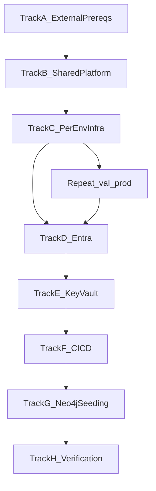

# LEO CDS Installation Procedure

| Field | Value |
| ----- | ----- |
| Document ID | DC-INST-001 |
| Version | 1.0.1 |
| Status | Draft |
| Date | 2026-10-06 |
| Product | LEO Clinical Decision Support (LEO CDS) |
| Product ID | PROD-LEO-CLINICAL-DECISION-SUPPORT-20260515-118182E4 |
| Related documents | DC-DEP-001; SVP-LEO-CDS-001; infra/github-oidc/README.md |

---

## 1. Purpose

This procedure guides a Cloud Engineer through installing LEO CDS into a
**new Azure subscription** and **new Entra ID tenant** for environments
**dev**, **validation (val)**, and **production (prod)**.

Complete each track in order. Steps marked **BLOCKING** must pass before
the next track starts.

---

## 2. Prerequisites (workstation)

| Tool | Required version | Verify |
| ---- | ---------------- | ------ |
| Python | 3.12.x | `python3.12 --version` |
| Node.js | 20.x | `node --version` |
| Azure CLI | >= 2.20 | `az --version` |
| PowerShell 7 | 7.x | `pwsh --version` |
| Docker Compose V2 | >= 2.x | `docker compose version` |

**Mac/Linux:** use `./scripts/start_leo-ai-core.sh` for local dev.
Infra deploy scripts (`infra/scripts/deploy.ps1`, `deploy-redis.ps1`,
`deploy-openai.ps1`, `migrate-secrets.ps1`) require
`pwsh`. Equivalent raw `az deployment group create` commands are listed below.

**Gotchas:**

- Python 3.11 may import but `medspacy==1.3.1` requires **3.12**.
- Use `docker compose` (space), not legacy `docker-compose` (V1).
- Node must be **20.x** (`services/ui/package.json` engines: `>=20 <21`).

---

## 3. Neo4j topology

| Graph | Dev | Validation | Production |
| ----- | --- | ---------- | ---------- |
| Patient graph | Own Aura instance | Own Aura instance | Own Aura instance |
| Knowledge graph | Own Aura instance (recommended) | Shared production KG | Shared production KG |

Production and validation share the knowledge graph at
`neo4j+s://ecca11a1.databases.neo4j.io` (configure per environment Key Vault).

**Change control (BLOCKING for val/prod):** the knowledge graph is **not
read-only**. Validation writes (guideline ingest, terminology writeback,
training labels, prompt edits) affect production when graphs are shared.
Treat all validation KG changes as production changes.

Key Vault secrets per environment (see DC-DEP-001 Section 5.1):

- `neo4j-patient-uri` / `neo4j-patient-password`
- `neo4j-knowledge-uri` / `neo4j-knowledge-password`

URIs must use `neo4j+s://` or `bolt+s://`. Usernames are plain Bicep params
(usually `neo4j`).

Bicep sets `LEO_DEPLOYMENT_ENVIRONMENT` and `KNOWLEDGE_GRAPH_ENVIRONMENT`.
`core-api` logs a startup warning when they differ (validation sharing prod KG).

---

## Track A -- External prerequisites (BLOCKING)

Complete before any Azure deployment.

### A.1 Neo4j Aura

1. Provision **one patient graph Aura instance per environment** (dev, val, prod).
2. Provision **one knowledge graph** for production (shared by val + prod).
3. Provision a **separate dev knowledge graph** (recommended).
4. Confirm Aura **5.x**, **apoc-core** enabled (runtime uses `apoc.convert.*` only).
5. If Pathway Explorer is in scope, confirm **GDS** on patient graph instances.
6. Record Bolt URIs and passwords for Track E.

### A.2 Azure OpenAI

1. Deploy the shared account in Track B.3 (`deploy-openai.ps1`).
2. Deploy models matching Bicep params (`gpt-5.4`, `gpt-5-mini` or your
   equivalents).
3. Record API key for Track E (`azureOpenAiEndpoint` is synced into bicepparam
   files automatically).

### A.3 AWS Bedrock (if using AWS pipeline provider)

1. Create IAM credentials with Bedrock invoke access.
2. Record access key, secret, region (`eu-west-2`), and model ARNs for
   `aws-big-model`, `aws-small-model`, `aws-max-model` Key Vault secrets.

### A.4 Terminology API keys

Obtain and record for Track E:

- `SNOMED_API_KEY` (prod: NHS terminology server)
- `NHS_TRUD_API_KEY`, `UMLS_API_KEY`, `NICE_API_KEY`

Download TRUD releases into `external_content/` before Track G seeding.

### A.5 DNS and edge (optional Cloudflare)

Per DC-DEP-001 Section 3: proxied DNS, Full (Strict) SSL, WAF, rate limits.
Allow inbound HTTPS on the origin NSG or firewall only from the Cloudflare
ranges in DC-DEP-001 Section 3.4. Re-fetch those ranges from
cloudflare.com/ips before you apply the rule.
Record per-environment UI hostnames for Bicep `frontendUrl` and Entra redirect URIs.

### A.6 GitHub repository

Fork or clone the repo into the target GitHub organisation. You will configure
OIDC in Track F.

---

## Track B -- Shared Azure platform (once per subscription)

### B.1 Register providers

```bash
az provider register --namespace Microsoft.App
az provider register --namespace Microsoft.Cache
az provider register --namespace Microsoft.ServiceBus
az provider register --namespace Microsoft.KeyVault
az provider register --namespace Microsoft.ContainerRegistry
az provider register --namespace Microsoft.CognitiveServices
az provider register --namespace Microsoft.OperationalInsights
```

### B.2 Shared resource group and ACR

```powershell
pwsh ./infra/scripts/deploy.ps1 -Environment shared -SubscriptionId <sub-id>
```

Creates resource group `leo-ai` and ACR `leoaicr` (name is globally unique;
override in Bicep if taken).

### B.3 Shared Azure OpenAI

```powershell
pwsh ./infra/scripts/deploy-openai.ps1 -SubscriptionName 'Multi Tenanted - LEO Production'
```

Creates shared account `mizaic-cds-oai` in `leo-prod-rg`. The deploy script
runs `sync-openai-endpoint.ps1`, which writes `azureOpenAiEndpoint` into
`infra/bicep/parameters/{dev,val,prod}.bicepparam`. Deploy model deployments
in Azure AI Foundry / portal after the account exists.

### B.4 Model storage account

```bash
az storage account create \
  --name leoaimodels \
  --resource-group leo-ai \
  --location uksouth \
  --sku Standard_LRS \
  --kind StorageV2
```

Create blob container `ner-models` for NER model artifacts.

---

## Track C -- Per-environment Azure infrastructure

Repeat for **dev**, then **val**, then **prod**.

### C.1 Deploy Redis (BLOCKING -- run before main stack)

Redis is deployed separately from the Container Apps stack:

```powershell
pwsh ./infra/scripts/deploy-redis.ps1 -Environment dev -SubscriptionId <sub-id>
```

Equivalent CLI:

```bash
az group create -n leo-ai-dev -l uksouth
az deployment group create \
  --resource-group leo-ai-dev \
  --template-file infra/bicep/redis.bicep \
  --parameters infra/bicep/parameters/redis/dev.bicepparam
```

First create takes 20-30 min. Name must be `mizaicai-{env}-redis`
(e.g. `mizaicai-dev-redis`). Record the TLS connection string as
`rediss://...` for Key Vault `redis-url`.

All environments share the Azure OpenAI account from Track B.3. Push the
API key via `migrate-secrets.ps1` per environment (`azureOpenAiEndpoint` is
set in bicepparam files by `deploy-openai.ps1`).

### C.2 Widget CDN (BLOCKING -- run before main stack)

Deploy the widget Static Website origin first. The script writes
`widgetPublicHost` and the widget `https://` origin into
`allowedOrigins` in `infra/bicep/parameters/{env}.bicepparam`.

```powershell
pwsh ./infra/scripts/deploy-widget-cdn.ps1 -Environment dev
```

Before first deploy, set `githubActionsPrincipalId` in
`infra/widget-cdn/parameters/{env}.bicepparam` (see Track F).

Equivalent CLI (then run `sync-widget-cdn-params.ps1` manually):

```bash
az group create -n leo-widget-cdn-dev -l uksouth
az deployment group create \
  --resource-group leo-widget-cdn-dev \
  --template-file infra/widget-cdn/widget-cdn.bicep \
  --parameters infra/widget-cdn/parameters/dev.bicepparam
```

Static website hosting and parameter sync are handled by
`deploy-widget-cdn.ps1` (`index.html` / `404.html`, RBAC auth).

### C.3 Customise Bicep parameters (BLOCKING for greenfield)

Edit `infra/bicep/parameters/{env}.bicepparam`:

| Parameter | Action |
| --------- | ------ |
| `frontendUrl` | Set to your UI hostname (HTTPS, no trailing slash) |
| `allowedOrigins` | Review comma-separated CORS origins (widget origin added by C.2; add UI hostnames; no `*` in prod/val) |
| `widgetPublicHost` | Auto-populated by C.2 -- do not edit unless re-syncing |
| `mailFromAddress` | `@mizaic.com` mailbox SMTP; must match MAIL_GRAPH_* tenant |
| `azureOpenAiEndpoint` | Auto-populated by Track B.3 (`deploy-openai.ps1`) -- do not edit unless re-syncing |
| `snomedTerminologyServer` | NHS prod URL in prod; blank in dev/val if using TRUD |
| `knowledgeGraphEnvironment` | `prod` for val+prod when sharing KG; default for dev |

### C.4 Deploy environment stack

Container Apps reference Key Vault secrets at deploy time. On **first**
deploy, use bootstrap (infra -> Entra service apps -> secrets -> apps) or
run the four steps manually:

```powershell
# Greenfield (recommended): requires secrets/.env (D.1 user-login, D.1a mail, etc.)
# and Entra admin rights for phase 2 (internal service apps).
pwsh ./infra/scripts/deploy.ps1 -Environment dev -Bootstrap -SourceFile secrets\.env

# Manual equivalent
pwsh ./infra/scripts/deploy.ps1 -Environment dev -InfrastructureOnly
pwsh ./scripts/entra_setup.ps1 -Environment dev
pwsh ./infra/scripts/migrate-secrets.ps1 -Environment dev -SourceFile secrets\.env
pwsh ./infra/scripts/deploy.ps1 -Environment dev -ImageTag placeholder
```

Subsequent redeploys (CD, image updates) use a single deploy; secrets already
exist in Key Vault.

```powershell
pwsh ./infra/scripts/deploy.ps1 -Environment dev -ImageTag placeholder
```

Equivalent CLI (phase 1 only):

```bash
az group create -n leo-ai-dev -l uksouth
az deployment group create \
  --resource-group leo-ai-dev \
  --template-file infra/bicep/main.bicep \
  --parameters infra/bicep/parameters/dev.bicepparam \
  --parameters imageTag=placeholder deployContainerApps=false
```

Then `migrate-secrets.ps1`, then redeploy with `deployContainerApps=true`
(default).

Creates per environment: Key Vault, Service Bus (5 queues), managed identity.
With `-Bootstrap` or `-InfrastructureOnly`, Container Apps are deferred until
Key Vault secrets exist (Track E).

Service Bus queues created by Bicep:

- `pipeline-jobs`, `analysis-jobs`, `coding-jobs` (legacy)
- `audit-jobs`, `referral-assessments-output`

Repeat C.1-C.4 for **val** and **prod**.

---

## Track D -- Entra configuration (per environment)

### D.1 User-login app registration

Per DC-DEP-001 Section 2. Automated setup (idempotent):

```powershell
pwsh ./scripts/entra_user_login_setup.ps1 -Environment val -WriteKv
```

```bash
ENVIRONMENT=val ./scripts/entra_user_login_setup.sh --write-kv
```

Reads `frontendUrl` from `infra/bicep/parameters/{env}.bicepparam` and sets
redirect URI to `{frontendUrl}/auth/callback`. Creates or updates:

| Property | Value |
| -------- | ----- |
| `signInAudience` | `AzureADMultipleOrgs` |
| `accessTokenAcceptedVersion` | `2` |
| Implicit grant | **disabled** |
| Manifest | `"groupMembershipClaims": "SecurityGroup"` |
| Redirect URI (Web) | `{frontendUrl}/auth/callback` |
| API identifier | `api://{client-id}` (for `api://.../.default` scope) |

Creates client secret (`{env}-api` display name). With `-WriteKv` / `--write-kv`,
writes `azure-ad-client-id`, `azure-ad-client-secret`, `azure-ad-tenant-id` to
the env Key Vault. Otherwise copy printed values into `secrets/.env` and run
`migrate-secrets.ps1`.

Dev only: add `-IncludeLocalhost` / `--include-localhost` for
`http://localhost:3000/auth/callback`.

Manual portal steps are still valid if you prefer; script matches DC-DEP-001.

### D.1a Mail Graph app (corporate tenant, BLOCKING for invites/support mail)

LEO user login (`AZURE_AD_*`) lives in the **deployment** tenant. Transactional
mail uses a **separate** app registration in the **corporate** tenant that
owns the `@mizaic.com` mailbox.

1. In the corporate Entra tenant, create app registration (e.g. `LEO Mail Service`).
2. Create licensed mailbox `leo.support@mizaic.com` (or per-env address).
3. Grant Graph application permissions:

```bash
MAIL_GRAPH_APP_ID=<client-id> ./scripts/entra_mail_graph_perms.sh
```

4. Admin-consent in the corporate tenant; create client secret.
5. Set in `secrets/.env` and push via Track E:

| Env var | Key Vault secret | Source |
| ------- | ---------------- | ------ |
| `MAIL_GRAPH_TENANT_ID` | `mail-graph-tenant-id` | Corporate Entra tenant ID |
| `MAIL_GRAPH_CLIENT_ID` | `mail-graph-client-id` | Mail app client ID |
| `MAIL_GRAPH_CLIENT_SECRET` | `mail-graph-client-secret` | Mail app client secret |

6. Set `mailFromAddress` in `infra/bicep/parameters/{env}.bicepparam` to the
   mailbox SMTP address (plain config, not a secret).

### D.2 Internal service apps (automated)

`deploy.ps1 -Bootstrap` runs this after phase-1 Bicep (Key Vault + managed
identity exist). Or run manually after `-InfrastructureOnly`:

```powershell
pwsh ./scripts/entra_setup.ps1 -Environment dev
```

Creates four single-tenant apps, grants **Call** app roles to the env managed
identity, and writes app IDs to Key Vault:
`terminology-api-app-id`, `model-inference-app-id`, `fhir-api-app-id`,
`analytics-api-app-id`. You do **not** need these four values in `secrets/.env`
when bootstrap runs `entra_setup` (phase 2) before `migrate-secrets` (phase 3).

Requires Entra admin (`Application.ReadWrite.All` or equivalent) and Key Vault
Secrets Officer on the env vault.

Repeat for val and prod. Use `-SkipEntraSetup` on bootstrap if apps already exist.

### D.3 Security groups and Neo4j role catalogue

1. Tenant admin creates Entra security groups (out of band).
2. Copy `data/identity/entra-group-bindings.example.yaml` to
   `entra-group-bindings.yaml` with real group object IDs.
3. After Track G patient graph is reachable, run:

```bash
python -m scripts.seed_roles_and_groups \
  --bindings data/identity/entra-group-bindings.yaml
```

### D.4 Optional: admin portal Graph permissions

```bash
USER_LOGIN_APP_ID=<client-id> \
REDIRECT_URI=https://<your-domain>/auth/callback \
./scripts/entra_user_login_graph_perms.sh
```

Customer tenant admins must grant consent via the printed URL.

---

## Track E -- Secrets and Key Vault (BLOCKING before Container Apps)

Populate `secrets/.env` **before** the first full stack deploy (Track C.4
`-Bootstrap`, or between `-InfrastructureOnly` and the second deploy).

### E.1 Populate secrets/.env

Copy `.env.example` to `secrets/.env`. Fill all values from DC-DEP-001
Section 5.1 (30+ secrets). Minimum for ACA startup:

- All Neo4j, Redis, Entra (user login + mail Graph), Azure OpenAI, AWS, Service Bus secrets
- `auth-secret` and `service-auth-secret` (auto-generated by `migrate-secrets.ps1` if blank)
- Inter-service app IDs (from `entra_setup.ps1` during bootstrap; optional in `.env`)

### E.2 Push to Key Vault

```powershell
pwsh ./infra/scripts/migrate-secrets.ps1 -Environment dev -SourceFile secrets\.env
```

Repeat per environment. Script auto-generates `auth-secret` and
`service-auth-secret` if absent from the source file.

### E.3 Verify Service Bus queues

```bash
python scripts/setup_service_bus.py
```

Requires `AZURE_SERVICE_BUS_CONNECTION_STRING` in `secrets/.env`.
Idempotent; aligns queue settings with Bicep.

---

## Track F -- CI/CD wiring (GitHub Actions)

### F.1 Edit federated credential templates

Update `subject` in all four `.federated-cred-*.json` files if org/repo
differs from `Healthcare-Copilot/LEO-AI-CORE`.

### F.2 Create CI/CD Entra app

1. App registration for GitHub Actions OIDC.
2. Role assignments: **Contributor** on `leo-ai`, `leo-ai-dev`, `leo-ai-val`,
   `leo-ai-prod`, widget RGs; **AcrPush** on `leoaicr`.
3. Apply four federated credentials (see `infra/github-oidc/README.md`).

### F.3 GitHub environments and secrets

Create environments: `dev`, `validation`, `production` (names must match
federated credential subjects exactly).

| Secret | Scope |
| ------ | ----- |
| `AZURE_CLIENT_ID`, `AZURE_TENANT_ID`, `AZURE_SUBSCRIPTION_ID` | Repository + each environment |
| `HF_TOKEN` | Repository (terminology image build) |
| `AZURE_WIDGET_STORAGE_ACCOUNT`, `WIDGET_PUBLIC_HOST` | dev, validation, production |

Configure required reviewers on `validation` and `production`.

### F.4 First deploy

1. Push to `main` -> CI builds 9 images tagged `sha-<commit>`.
2. CD auto-deploys **dev** on CI success.
3. Promote to val/prod: run **CD - Deploy** manually with
   `environment=val|prod` and `image_tag=sha-<commit>`.

Widget: **Widget release** workflow uses environments `dev`, `validation`,
`production` (aligned with CD).

---

## Track G -- Neo4j seeding

### G.1 Shared knowledge graph (once for prod KG, or per dev KG)

Run from a machine with `KNOWLEDGE_GRAPH_*` env pointed at the target graph.

| Step | Command |
| ---- | ------- |
| 1. SNOMED + dm+d load | `python -m services.terminology.scripts.loaders --external-content external_content` |
| 2. Term embeddings | `python scripts/backfill_term_embeddings.py` |
| 3. Surface-form embeddings | `python scripts/backfill_surface_form_embeddings.py` |
| 4. Read-to-SNOMED map | `python scripts/import_read_to_snomed_source_map.py --apply` |
| 5. FHIR baseline | `python scripts/seed_fhir_config.py` |
| 6. Devices + presets | `python scripts/seed_devices.py` && `python scripts/seed_presets.py` |
| 7. Plan definitions | `python -m scripts.seed_plan_definitions` |
| 8. Post-processor rules | `python scripts/seed_post_processor_rules.py` |
| 9. Lab result config | `python -m scripts.seed_lab_result_config` |
| 10. Guidance pathway | `python -m scripts.seed_guidance_pathway` |
| 11. NICE NG12 ingest | `POST /nice/ingest` (requires `NICE_API_KEY`, core-api running) |
| 12. Bitmap compile | `POST /terminology/guidelines/bitmap/compile` (writes Redis) |

**Auto-seeded on first core-api start** (no manual step if deploy succeeds):
patient schema, tenant defaults, model/service configs, prompts (if missing),
extraction scenarios, lab result config (if missing).

### G.2 Per-environment patient graph

| Step | Command / trigger |
| ---- | ----------------- |
| Schema + tenant | Automatic on first `core-api` start |
| Roles + Entra bindings | `python -m scripts.seed_roles_and_groups --bindings ...` |
| Practitioners (dev only) | `python -m scripts.seed_practitioners` |

---

## Track H -- Post-deploy verification (BLOCKING sign-off)

### H.1 Infrastructure security

```bash
pytest tests/test_infra_security.py -v --no-coverage
```

Run against each environment's Bicep parameter file.

### H.2 Application smoke tests

- [ ] `GET https://<ui-host>/` loads
- [ ] Login redirects to Entra v2.0; callback succeeds
- [ ] `GET /auth/session` returns user claims after login
- [ ] Entra groups map to Neo4j roles
- [ ] Session cookie has `Secure`, `HttpOnly`, `SameSite=Lax`
- [ ] Pipeline job enqueues on `pipeline-jobs` and completes
- [ ] CORS rejects unlisted origins
- [ ] `core-api` startup log shows KG warning if val shares prod KG (expected)

### H.3 Widget (if in scope)

- [ ] Widget release gate passes (4 disclosure VTs)
- [ ] Public widget URL smoke check passes

### H.4 Record Installation Record

Per SVP-LEO-CDS-001 Section 6.2, create an Installation Record within
2 business days of go-live.

---

## 4. Deployment flow summary



---

## 5. Known gaps and manual steps

| Item | Notes |
| ---- | ----- |
| Redis | `deploy-redis.ps1` before main stack |
| Azure OpenAI | `deploy-openai.ps1` in Track B.3 (shared account) |
| User-login Entra app | No automation script; manual portal setup |
| Widget static website | Enable via CLI after widget Bicep |
| ODS sync job | Bicep module exists but not wired into `main.bicep` |
| NHS e-RS | Onboarding per LEO-UM-ERS-001 (external QMS doc) |

---

## 6. Revision history

| Version | Date | Author | Changes |
| ------- | ---- | ------ | ------- |
| 1.0.1 | 2026-10-06 | Platform team | Point Track A.5 at the Cloudflare origin allowlist in DC-DEP-001 Section 3.4 |
| 1.0.0 | 2026-06-12 | Platform team | Initial greenfield installation procedure |

---

*Cross-reference: security parameters and secret inventory in DC-DEP-001;
service planning in SVP-LEO-CDS-001; OIDC details in infra/github-oidc/README.md.*
