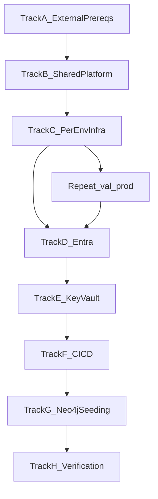

# LEO CDS Installation Procedure

| Field | Value |
| ----- | ----- |
| Document ID | DC-INST-001 |
| Version | 1.0.0 |
| Status | Draft |
| Date | 2026-06-12 |
| Product | LEO Clinical Decision Support (LEO CDS) |
| Product ID | PROD-LEO-CORE-AI-20260415-6AE8A23B |
| Related documents | DC-DEP-001; SVP-LEO-CDS-001; infra/github-oidc/README.md |

---

## 1. Purpose

This procedure guides a Cloud Engineer through installing LEO CDS into a
**new Azure subscription** and **new Entra ID tenant** for environments
**dev**, **validation (val)**, and **production (prod)**.

Complete each track in order. Steps marked **BLOCKING** must pass before
the next track starts.

---

## 2. Prerequisites (workstation)

| Tool | Required version | Verify |
| ---- | ---------------- | ------ |
| Python | 3.12.x | `python3.12 --version` |
| Node.js | 20.x | `node --version` |
| Azure CLI | >= 2.20 | `az --version` |
| PowerShell 7 | 7.x | `pwsh --version` |
| Docker Compose V2 | >= 2.x | `docker compose version` |

**Mac/Linux:** use `./scripts/start_leo-ai-core.sh` for local dev.
Infra deploy scripts (`infra/scripts/deploy.ps1`, `migrate-secrets.ps1`) require
`pwsh`. Equivalent raw `az deployment group create` commands are listed below.

**Gotchas:**

- Python 3.11 may import but `medspacy==1.3.1` requires **3.12**.
- Use `docker compose` (space), not legacy `docker-compose` (V1).
- Node must be **20.x** (`services/ui/package.json` engines: `>=20 <21`).

---

## 3. Neo4j topology

| Graph | Dev | Validation | Production |
| ----- | --- | ---------- | ---------- |
| Patient graph | Own Aura instance | Own Aura instance | Own Aura instance |
| Knowledge graph | Own Aura instance (recommended) | Shared production KG | Shared production KG |

Production and validation share the knowledge graph at
`neo4j+s://ecca11a1.databases.neo4j.io` (configure per environment Key Vault).

**Change control (BLOCKING for val/prod):** the knowledge graph is **not
read-only**. Validation writes (guideline ingest, terminology writeback,
training labels, prompt edits) affect production when graphs are shared.
Treat all validation KG changes as production changes.

Key Vault secrets per environment (see DC-DEP-001 Section 5.1):

- `neo4j-patient-uri` / `neo4j-patient-password`
- `neo4j-knowledge-uri` / `neo4j-knowledge-password`

URIs must use `neo4j+s://` or `bolt+s://`. Usernames are plain Bicep params
(usually `neo4j`).

Bicep sets `LEO_DEPLOYMENT_ENVIRONMENT` and `KNOWLEDGE_GRAPH_ENVIRONMENT`.
`core-api` logs a startup warning when they differ (validation sharing prod KG).

---

## Track A -- External prerequisites (BLOCKING)

Complete before any Azure deployment.

### A.1 Neo4j Aura

1. Provision **one patient graph Aura instance per environment** (dev, val, prod).
2. Provision **one knowledge graph** for production (shared by val + prod).
3. Provision a **separate dev knowledge graph** (recommended).
4. Confirm Aura **5.x**, **apoc-core** enabled (runtime uses `apoc.convert.*` only).
5. If Pathway Explorer is in scope, confirm **GDS** on patient graph instances.
6. Record Bolt URIs and passwords for Track E.

### A.2 Azure OpenAI

1. Create an Azure OpenAI resource in the target region (EU recommended).
2. Deploy models matching Bicep params (`gpt-5.2-chat`, `gpt-5-mini` or your
   equivalents).
3. Record endpoint URL and API key for Track E.

### A.3 AWS Bedrock (if using AWS pipeline provider)

1. Create IAM credentials with Bedrock invoke access.
2. Record access key, secret, region (`eu-west-2`), and model ARNs for
   `aws-big-model`, `aws-small-model`, `aws-max-model` Key Vault secrets.

### A.4 Terminology API keys

Obtain and record for Track E:

- `SNOMED_API_KEY` (prod: NHS terminology server)
- `NHS_TRUD_API_KEY`, `UMLS_API_KEY`, `NICE_API_KEY`

Download TRUD releases into `external_content/` before Track G seeding.

### A.5 DNS and edge (optional Cloudflare)

Per DC-DEP-001 Section 3: proxied DNS, Full (Strict) SSL, WAF, rate limits.
Record per-environment UI hostnames for Bicep `frontendUrl` and Entra redirect URIs.

### A.6 GitHub repository

Fork or clone the repo into the target GitHub organisation. You will configure
OIDC in Track F.

---

## Track B -- Shared Azure platform (once per subscription)

### B.1 Register providers

```bash
az provider register --namespace Microsoft.App
az provider register --namespace Microsoft.Cache
az provider register --namespace Microsoft.ServiceBus
az provider register --namespace Microsoft.KeyVault
az provider register --namespace Microsoft.ContainerRegistry
az provider register --namespace Microsoft.OperationalInsights
```

### B.2 Shared resource group and ACR

```powershell
pwsh ./infra/scripts/deploy.ps1 -Environment shared -SubscriptionId <sub-id>
```

Creates resource group `leo-ai` and ACR `leoaicr` (name is globally unique;
override in Bicep if taken).

### B.3 Model storage account

```bash
az storage account create \
  --name leoaimodels \
  --resource-group leo-ai \
  --location uksouth \
  --sku Standard_LRS \
  --kind StorageV2
```

Create blob container `ner-models` for NER model artifacts.

---

## Track C -- Per-environment Azure infrastructure

Repeat for **dev**, then **val**, then **prod**.

### C.1 Pre-create Redis (BLOCKING -- Bicep references existing resource)

Bicep does **not** create Redis. Provision before deploy:

```bash
# Example: Azure Managed Redis via portal or CLI
# Name must be: leoai-{env}-redis  (e.g. leoai-dev-redis)
```

Record the TLS connection string as `rediss://...` for Key Vault `redis-url`.

### C.2 Customise Bicep parameters (BLOCKING for greenfield)

Edit `infra/bicep/parameters/{env}.bicepparam`:

| Parameter | Action |
| --------- | ------ |
| `frontendUrl` | Set to your UI hostname (HTTPS, no trailing slash) |
| `allowedOrigins` | Comma-separated CORS origins (no `*` in prod/val) |
| `widgetPublicHost` | Azure Static Website hostname for widget CDN |
| `mailFromAddress` | Licensed Graph API sender mailbox |
| `azureOpenAiEndpoint` | Your Azure OpenAI endpoint |
| `snomedTerminologyServer` | NHS prod URL in prod; blank in dev/val if using TRUD |
| `knowledgeGraphEnvironment` | `prod` for val+prod when sharing KG; default for dev |

Edit `infra/widget-cdn/parameters/{env}.bicepparam`:

- Set `widgetPublicHost` to match Bicep above.
- Set `githubActionsPrincipalId` to your GitHub OIDC SP object ID (see Track F).

### C.3 Deploy environment stack

```powershell
pwsh ./infra/scripts/deploy.ps1 -Environment dev -ImageTag placeholder
```

Equivalent CLI:

```bash
az group create -n leo-ai-dev -l uksouth
az deployment group create \
  --resource-group leo-ai-dev \
  --template-file infra/bicep/main.bicep \
  --parameters infra/bicep/parameters/dev.bicepparam \
  --parameters imageTag=placeholder
```

Creates per environment: Key Vault, Service Bus (5 queues), Container Apps
Environment, 9 Container Apps, managed identity.

Service Bus queues created by Bicep:

- `pipeline-jobs`, `analysis-jobs`, `coding-jobs` (legacy)
- `audit-jobs`, `referral-assessments-output`

### C.4 Widget CDN (separate resource group)

```bash
az group create -n leo-widget-cdn-dev -l uksouth
az deployment group create \
  --resource-group leo-widget-cdn-dev \
  --template-file infra/widget-cdn/widget-cdn.bicep \
  --parameters infra/widget-cdn/parameters/dev.bicepparam
```

Enable static website (not in Bicep):

```bash
az storage blob service-properties update \
  --account-name leoaiwidgetcdndev \
  --static-website \
  --404-document index.html \
  --index-document index.html
```

Repeat C.1-C.4 for **val** and **prod**.

---

## Track D -- Entra configuration (per environment)

### D.1 User-login app registration (manual, BLOCKING)

Per DC-DEP-001 Section 2. Create **one app per environment** (or separate
redirect URI sets):

| Property | Value |
| -------- | ----- |
| `signInAudience` | `AzureADMultipleOrgs` |
| `accessTokenAcceptedVersion` | `2` |
| Implicit grant | **disabled** |
| Manifest | `"groupMembershipClaims": "SecurityGroup"` |
| Redirect URI (Web) | `{frontendUrl}/auth/callback` |

Create client secret; store in Key Vault as `azure-ad-client-secret`.
Store client ID and tenant ID as `azure-ad-client-id`, `azure-ad-tenant-id`.

`core-api` builds OAuth scope from `AZURE_AD_CLIENT_ID` when `AZURE_AD_SCOPE`
is unset. Optionally set `AZURE_AD_SCOPE` explicitly in secrets.

### D.2 Internal service apps (automated)

After Bicep deploy:

```bash
ENVIRONMENT=dev ./scripts/entra_setup.sh
```

Creates four single-tenant apps and writes app IDs to Key Vault:
`terminology-api-app-id`, `model-inference-app-id`, `fhir-api-app-id`,
`analytics-api-app-id`.

Repeat for val and prod.

### D.3 Security groups and Neo4j role catalogue

1. Tenant admin creates Entra security groups (out of band).
2. Copy `data/identity/entra-group-bindings.example.yaml` to
   `entra-group-bindings.yaml` with real group object IDs.
3. After Track G patient graph is reachable, run:

```bash
python -m scripts.seed_roles_and_groups \
  --bindings data/identity/entra-group-bindings.yaml
```

### D.4 Optional: admin portal Graph permissions

```bash
USER_LOGIN_APP_ID=<client-id> \
REDIRECT_URI=https://<your-domain>/auth/callback \
./scripts/entra_user_login_graph_perms.sh
```

Customer tenant admins must grant consent via the printed URL.

---

## Track E -- Secrets and Key Vault (BLOCKING)

### E.1 Populate secrets/.env

Copy `.env.example` to `secrets/.env`. Fill all values from DC-DEP-001
Section 5.1 (30+ secrets). Minimum for ACA startup:

- All Neo4j, Redis, Entra, Azure OpenAI, AWS, Service Bus, storage secrets
- `auth-secret`, `service-auth-secret`
- Inter-service app IDs (from `entra_setup.sh`)

### E.2 Push to Key Vault

```powershell
pwsh ./infra/scripts/migrate-secrets.ps1 -Environment dev -SourceFile secrets\.env
```

Repeat per environment. Script auto-generates `service-auth-secret` if absent.

### E.3 Verify Service Bus queues

```bash
python scripts/setup_service_bus.py
```

Requires `AZURE_SERVICE_BUS_CONNECTION_STRING` in `secrets/.env`.
Idempotent; aligns queue settings with Bicep.

---

## Track F -- CI/CD wiring (GitHub Actions)

### F.1 Edit federated credential templates

Update `subject` in all four `.federated-cred-*.json` files if org/repo
differs from `Healthcare-Copilot/LEO-AI-CORE`.

### F.2 Create CI/CD Entra app

1. App registration for GitHub Actions OIDC.
2. Role assignments: **Contributor** on `leo-ai`, `leo-ai-dev`, `leo-ai-val`,
   `leo-ai-prod`, widget RGs; **AcrPush** on `leoaicr`.
3. Apply four federated credentials (see `infra/github-oidc/README.md`).

### F.3 GitHub environments and secrets

Create environments: `dev`, `validation`, `production` (names must match
federated credential subjects exactly).

| Secret | Scope |
| ------ | ----- |
| `AZURE_CLIENT_ID`, `AZURE_TENANT_ID`, `AZURE_SUBSCRIPTION_ID` | Repository + each environment |
| `HF_TOKEN` | Repository (terminology image build) |
| `AZURE_WIDGET_STORAGE_ACCOUNT`, `WIDGET_PUBLIC_HOST` | dev, validation, production |

Configure required reviewers on `validation` and `production`.

### F.4 First deploy

1. Push to `main` -> CI builds 9 images tagged `sha-<commit>`.
2. CD auto-deploys **dev** on CI success.
3. Promote to val/prod: run **CD - Deploy** manually with
   `environment=val|prod` and `image_tag=sha-<commit>`.

Widget: **Widget release** workflow uses environments `dev`, `validation`,
`production` (aligned with CD).

---

## Track G -- Neo4j seeding

### G.1 Shared knowledge graph (once for prod KG, or per dev KG)

Run from a machine with `KNOWLEDGE_GRAPH_*` env pointed at the target graph.

| Step | Command |
| ---- | ------- |
| 1. SNOMED + dm+d load | `python -m services.terminology.scripts.loaders --external-content external_content` |
| 2. Term embeddings | `python scripts/backfill_term_embeddings.py` |
| 3. Surface-form embeddings | `python scripts/backfill_surface_form_embeddings.py` |
| 4. Read-to-SNOMED map | `python scripts/import_read_to_snomed_source_map.py --apply` |
| 5. FHIR baseline | `python scripts/seed_fhir_config.py` |
| 6. Devices + presets | `python scripts/seed_devices.py` && `python scripts/seed_presets.py` |
| 7. Plan definitions | `python -m scripts.seed_plan_definitions` |
| 8. Post-processor rules | `python scripts/seed_post_processor_rules.py` |
| 9. Lab result config | `python -m scripts.seed_lab_result_config` |
| 10. Guidance pathway | `python -m scripts.seed_guidance_pathway` |
| 11. NICE NG12 ingest | `POST /nice/ingest` (requires `NICE_API_KEY`, core-api running) |
| 12. Bitmap compile | `POST /terminology/guidelines/bitmap/compile` (writes Redis) |

**Auto-seeded on first core-api start** (no manual step if deploy succeeds):
patient schema, tenant defaults, model/service configs, prompts (if missing),
extraction scenarios, lab result config (if missing).

### G.2 Per-environment patient graph

| Step | Command / trigger |
| ---- | ----------------- |
| Schema + tenant | Automatic on first `core-api` start |
| Roles + Entra bindings | `python -m scripts.seed_roles_and_groups --bindings ...` |
| Practitioners (dev only) | `python -m scripts.seed_practitioners` |

---

## Track H -- Post-deploy verification (BLOCKING sign-off)

### H.1 Infrastructure security

```bash
pytest tests/test_infra_security.py -v --no-coverage
```

Run against each environment's Bicep parameter file.

### H.2 Application smoke tests

- [ ] `GET https://<ui-host>/` loads
- [ ] Login redirects to Entra v2.0; callback succeeds
- [ ] `GET /auth/session` returns user claims after login
- [ ] Entra groups map to Neo4j roles
- [ ] Session cookie has `Secure`, `HttpOnly`, `SameSite=Lax`
- [ ] Pipeline job enqueues on `pipeline-jobs` and completes
- [ ] CORS rejects unlisted origins
- [ ] `core-api` startup log shows KG warning if val shares prod KG (expected)

### H.3 Widget (if in scope)

- [ ] Widget release gate passes (4 disclosure VTs)
- [ ] Public widget URL smoke check passes

### H.4 Record Installation Record

Per SVP-LEO-CDS-001 Section 6.2, create an Installation Record within
2 business days of go-live.

---

## 4. Deployment flow summary



---

## 5. Known gaps and manual steps

| Item | Notes |
| ---- | ----- |
| Redis | Pre-create `leoai-{env}-redis` before Bicep |
| Azure OpenAI | Not created by Bicep |
| User-login Entra app | No automation script; manual portal setup |
| Widget static website | Enable via CLI after widget Bicep |
| ODS sync job | Bicep module exists but not wired into `main.bicep` |
| NHS e-RS | Onboarding per LEO-UM-ERS-001 (external QMS doc) |

---

## 6. Revision history

| Version | Date | Author | Changes |
| ------- | ---- | ------ | ------- |
| 1.0.0 | 2026-06-12 | Platform team | Initial greenfield installation procedure |

---

*Cross-reference: security parameters and secret inventory in DC-DEP-001;
service planning in SVP-LEO-CDS-001; OIDC details in infra/github-oidc/README.md.*
