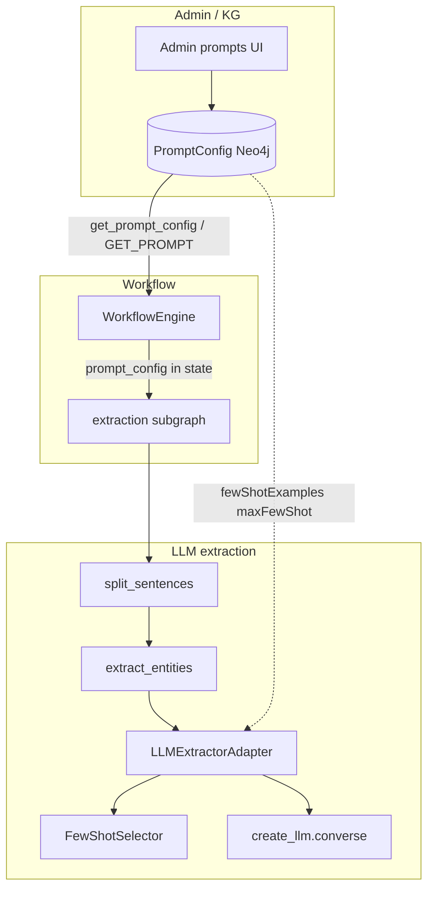
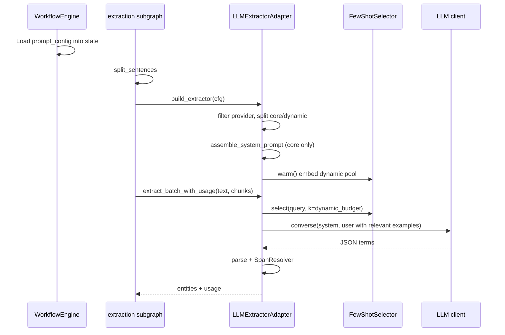

# Software Detailed Design -- Extraction Prompt Configuration and Few-Shot Injection

| Field | Value |
| ----- | ----- |
| Document type | TECHDOC -- Software Detailed Design (SDD) |
| Document ID | SDD-LEO-EXTRACTION-PROMPT-001 |
| Version | 1.0.3 |
| Status | Draft |
| Date | 2026-06-02 |
| Product | LEO Clinical Decision Support (PROD-LEO-CORE-AI-20260415-6AE8A23B) |
| Software item | extraction-prompt-runtime |
| Safety class | B (IEC 62304) |
| Standards | IEC 62304:2006+AMD1:2015 Section 5.4; ISO/IEC 25010:2011 |
| Parent documents | Software Architecture Document (Atlas SAD); NLP pipeline SDD (NLP-PIPELINE-DD-001) |
| Related Atlas (code stamps) | DI-B954388C, DI-48AD06E5, DI-A0C90595, DI-F298AE65; DO-83EBEE2C, DO-0289F3A5, DO-54397CCD |

**Document sections (TECHDOC layout)**

| Section | Title |
| ------- | ----- |
| 1 | Document purpose and scope |
| 2 | Detailed component design |
| 3 | Interfaces and dynamic behaviour |
| 4 | Risk, safety, cybersecurity, and privacy controls |
| 5 | Review outcome, approval, and document control |

---

## Section 1 -- Document purpose and scope

### 1.1 Why this document exists

This Software Detailed Design (SDD) describes how LEO Core AI **selects**, **assembles**, and **injects** prompts for **LLM-based clinical entity extraction** in the unified pipeline. It sits below the Software Architecture Document (subsystem boundaries, human review gate, dual-path post-processing) and above module-level code comments.

The design satisfies **IEC 62304:2006+AMD1:2015 Section 5.4** (detailed design for software items) by specifying:

- Data stored in Neo4j `PromptConfig` and passed through pipeline state.
- Component-level design (Section 2) for workflow engine, registry, adapter, few-shot selector, and extraction subgraph.
- Interface contracts and dynamic behaviour (Section 3): when configuration loads, when prompts are built, and when the LLM is invoked.
- Deterministic fallbacks when optional embedding infrastructure is unavailable.
- Audit fields written with each extraction call.

### 1.2 Intended audience and use

| Stakeholder | Use of this SDD |
| ----------- | ----------------- |
| Engineering | Implement, review, and refactor extraction prompt behaviour without re-deriving flow from code. |
| Quality / RA | Confirm design implements Atlas design inputs and supports verification tests. |
| Clinical safety | Assess whether prompt drift, example poisoning, or wrong-model examples could affect proposals before human review. |
| Operations | Configure `PromptConfig`, environment variables, and Bedrock prompt caching. |

### 1.3 Scope boundary

**In scope**

- Runtime extraction prompt for PlanDefinition action `extraction` (and equivalent callers using the same adapter).
- `PromptConfig` fields: `systemPrompt`, `outputSchema`, `fewShotExamples`, `maxFewShot`.
- `LLMExtractorAdapter` prompt assembly and single `llm.converse` call per encounter.
- `FewShotSelector` domain routing and semantic ranking.
- Admin UI persistence path (`/admin/prompts`) and registry load path.
- Telemetry: `prompt_hash`, `few_shot_example_ids`, LLM usage on pipeline state.

**Out of scope**

- Post-processing layers (`run_post_processing()`), disorder gate, ConText (covered by dual-path SDD / SAD).
- Encounter **classification** few-shot (`few_shot_builder.py` -- voted Neo4j examples, different prompt family).
- Guidance rule extraction v2 (static few-shot block in subgraph; same `PromptConfig` model but different assembly).
- Training label verifier and Ask LEO escalation prompts.
- NER / spaCy extraction path (`model_mode` `ner` or successful `auto` NER branch).

### 1.4 ISO/IEC 25010 alignment (design quality goals)

| Characteristic | How this design supports it |
| -------------- | ---------------------------- |
| Functional suitability | Separates instructions, schema, and examples; core vs dynamic few-shot targets encounter shape. |
| Performance efficiency | Static system prefix + Bedrock `cachePoint`; one LLM call per encounter for all sentences. |
| Compatibility | Provider-aware `model_scope`; shared adapter for pipeline worker and pipeline graph. |
| Usability (admin) | PromptConfig editable without deploy; seed script restores factory defaults. |
| Reliability | Registry fails loud if Neo4j missing; selector falls back to ordered categories if embeddings fail. |
| Security | Examples expected de-identified; clinical text in user message (prompt injection controls tracked separately). |
| Maintainability | Three-part prompt model matches Admin UI sections and `assemble_system_prompt()`. |
| Portability | `PIPELINE_MODEL_PROVIDER` switches aws/azure example sets without code change. |

### 1.5 Safety and regulatory context

LEO is Class **B** software with a **mandatory human review gate** before AI proposals reach the patient record. Incorrect extraction can produce wrong **review queue** items; it does not autonomously write to the EHR. This SDD therefore treats prompt misconfiguration as a **data integrity / usability** hazard mitigated by review, monitoring, and PromptConfig governance -- not as an autonomous clinical actuation path.

---

## Section 2 -- Detailed component design

This section specifies the **internal structure** of each software unit in the
extraction-prompt-runtime item: responsibilities, key algorithms, and module-level
logic. External contracts are in Section 3.1; time-ordered behaviour is in Section 3.2.

### 2.1 Software item decomposition



**Software items (implementation map)**

| Logical item | Primary modules |
| ------------ | ---------------- |
| Prompt registry | `libs/prompts/registry.py` |
| Prompt persistence | `libs/cypher/prompt_config_queries.py`, `services/api/app/routers/prompts.py` |
| Workflow injection | `libs/workflow/engine.py` (`_prepare_subgraph_state`, `_load_prompt_config`) |
| Extraction subgraph | `libs/pipeline_graph/subgraphs/extraction.py` |
| LLM adapter | `libs/pipeline_graph/subgraphs/_extractor.py` |
| Few-shot ranker | `libs/prompts/few_shot_selector.py` |
| Example library (seed) | `libs/prompts/extraction_examples.py`, `scripts/seed_prompt_configs.py` |
| LLM transport | `libs/llm_client/factory.py` (Bedrock `cachePoint`) |
| Legacy worker path | `services/coding_worker/app/pipeline/llm_extractor.py` (same adapter pattern) |

### 2.2 WorkflowEngine (`libs/workflow/engine.py`)

| Responsibility | Detail |
| -------------- | ------ |
| State merge | Merges PlanDefinition action `config` and `params` into pipeline state before subgraph invoke. |
| Prompt load | `_prepare_subgraph_state` populates `prompt_config` when missing. |
| Id-based load | `_load_prompt_config(config_id)` runs `GET_PROMPT`, then `_normalise_prompt_config_row()`. |
| Name-based load | Delegates to `get_prompt_config(name, version)` (same normaliser). |

No prompt assembly occurs in WorkflowEngine; it only passes the normalised dict downstream.

### 2.3 Prompt registry (`libs/prompts/registry.py`)

| Function | Internal behaviour |
| -------- | ------------------ |
| `_neo4j_fetch` | Loads raw row from Knowledge Graph. |
| `_normalise_prompt_config_row` | Parses `fewShotExamples` JSON; sets `maxFewShot` (default 20); composes annotation guidelines into `systemPrompt` for target families. |
| `get_prompt_config` | Fetch by name/version + normalise. Fail-loud `RuntimeError` if missing. |

### 2.4 LLMExtractorAdapter (`libs/pipeline_graph/subgraphs/_extractor.py`)

**Initialisation**

- Filter `few_shot_examples` by `model_scope` vs `PIPELINE_MODEL_PROVIDER`.
- Split `core` vs non-core; cap core at `max_few_shot`; compute `dynamic_budget`.
- Construct `FewShotSelector(dynamic_pool)` and call `warm()`.
- Build static system string via `assemble_system_prompt()`; store SHA-256 as `prompt_hash`.

**Static system assembly (`assemble_system_prompt`)**

| Step | Block | Source |
| ---- | ----- | ------ |
| 1 | Instructions | `systemPrompt` after `compose_prompt_with_annotation_guidelines` |
| 2 | Output format | `format_output_schema_block(outputSchema)` |
| 3 | Core few-shot | `_build_few_shot_block(core_examples, provider)` -> `## Examples` |

**Core example selection (adapter init):**

```
applicable = filter(few_shot_examples, model_scope in {any, provider})
core, dynamic = split(applicable, by core flag)
max_core = min(len(core), max_few_shot)
core_examples = core[:max_core]
dynamic_pool = all non-core applicable
dynamic_budget = max(0, max_few_shot - len(core_examples))
```

**Prompt hash:** `SHA-256` of final system string stored on adapter for audit correlation.

**Per-encounter LLM call (`_run_llm`)**

| Step | Block | Condition |
| ---- | ----- | --------- |
| 1 | `## Relevant examples` | `dynamic_budget > 0` and pool non-empty |
| 2 | `Encounter text:\n{encounter_text}` | Always |
| 3 | `Sentences to process:\n[sN] text...` | Always |

**Query text for selection:**

```
query_text = encounter_text + "\n\n" + sentence_block
```

**Selection:** `FewShotSelector.select(query_text, k=dynamic_budget)` (pool warmed at init).

**Factory entry:** `build_extractor()` wires registry fallback for missing `system_prompt` and returns configured adapter.

### 2.5 FewShotSelector (`libs/prompts/few_shot_selector.py`)

**Embedder:** Process-wide singleton `_LazySentenceEmbedder`; model from `VECTOR_MODEL`. If unset or load fails, semantic path skipped.

**Domain routing (`_route_pool_for_query`):**

| Query bucket | Trigger (regex on query) | Example category bucket |
| ------------ | ------------------------ | ------------------------ |
| `labs` | HbA1c, eGFR, FBC, units, etc. | category contains lab / observable / haematology |
| `oncology` | stage, TNM, metastatic, etc. | oncology / staging / cancer |
| `referral_admin` | referral, 2ww, appointment, etc. | referral / admin / pathway |
| `medication` | dose, tablet, prescribed, etc. | medication / drug / substance |
| `generic` | no match | full pool |

If routed subset has **fewer than 3** examples, pool = routed + remainder (preserves recall).

**Ranking:**

1. If full-pool embeddings cached and routed pool equals full pool: cosine similarity vs query embedding, top-k.
2. Else if routed subset: embed routed texts only, top-k.
3. Else **fallback:** sort by `_fallback_priority(category)` then `description`, take first k.

**Fallback category priority (abbreviated):** `assertion:absent`, `negation:compound`, `assertion:family`, `assertion:historical`, `observable`, `multi-entity`, ...

### 2.6 Extraction subgraph (`libs/pipeline_graph/subgraphs/extraction.py`)

| Node | Role |
| ---- | ---- |
| `split_sentences` | Produce `SentenceChunk` list in state. |
| `extract_entities` | Resolve `model_mode`; call `_run_llm_extraction` or NER path; optional blood-panel merge. |
| `merge_results` | Emit entities and extraction metadata for downstream subgraphs. |

`_run_llm_extraction` reads `prompt_config` from state, calls `build_extractor`, runs `extract_batch_with_usage`, returns entities and `llm_tokens`.

---

## Section 3 -- Interfaces and dynamic behaviour

This section provides **interface contracts** (Section 3.1) and **time-ordered behaviour**
(Section 3.2) for the software items defined in Section 2. Configuration, verification,
and design rationale are in Sections 3.3-3.5.

### 3.1 Interface specifications

#### 3.1.1 Persistent data model -- PromptConfig

**Graph:** Knowledge Graph (`KnowledgeGraphClient`).

**Node label:** `PromptConfig`

| Property (Neo4j) | API / state key | Type | Purpose |
| ---------------- | --------------- | ---- | ------- |
| `id` | `id` | string (UUID) | Stable reference from PlanDefinition action |
| `name` | `name` | string | Logical prompt family (e.g. `extraction`) |
| `version` | `version` | int | Versioned prompt line |
| `system_prompt` | `systemPrompt` | string | Instructions only (no examples) |
| `output_schema` | `outputSchema` | string (JSON) | Machine-readable response schema |
| `few_shot_examples` | `fewShotExamples` | string (JSON array) | Example library |
| `max_few_shot` | `maxFewShot` | int | Cap on total examples (core + dynamic) |
| `source` | -- | `seed` \| `user` | Seed rows overwritten on re-seed; user edits preserved |
| `verification` | `verification` | string | Admin metadata (optional) |

**Few-shot example object (array element)**

| Field | Type | Required | Description |
| ----- | ---- | -------- | ----------- |
| `input` | string | Yes | De-identified clinical snippet, usually `[sN]` prefixed sentences |
| `output` | string | Yes | Expected JSON matching output schema |
| `category` | string | Yes | Taxonomy for routing and fallback ordering |
| `description` | string | No | Admin label |
| `model_scope` | string | No | `any` (default), `aws`, or `azure` |
| `core` | bool | No | If true, included in static system prompt |
| `id` | string | No | Stable id for audit (`few_shot_example_ids`) |

Category taxonomy is documented in `libs/prompts/extraction_examples.py` (assertion types, observables, staging, etc.).

#### 3.1.2 WorkflowEngine to extraction subgraph state

**Trigger:** Each PlanDefinition action invoking subgraph `extraction`.

**State keys written before subgraph compile:**

| Key | Source | Notes |
| --- | ------ | ----- |
| `prompt_config_id` | Action `promptConfigId` | Preferred when UI binds a specific row |
| `prompt_config_name` | Action `promptConfigName` | Alternative |
| `prompt_config_version` | Action `promptConfigVersion` | Default 1 |
| `prompt_config` | Loaded dict | Populated if absent |

**Load precedence (`_prepare_subgraph_state`):**

1. If `prompt_config` already in merged state, use as-is.
2. Else if `prompt_config_id` set, `_load_prompt_config(id)` via `GET_PROMPT`.
3. Else if `prompt_config_name` set, `get_prompt_config(name, version)`.
4. On failure, log warning; subgraph may fall back to registry for `systemPrompt` only.

Steps 2 and 3 both return the same normalised dict via
`registry._normalise_prompt_config_row()` (including `maxFewShot`, parsed
`fewShotExamples`, and annotation guidelines on `systemPrompt`).

**Other relevant state keys:** `encounter_text`, `sentences` (after split), `model_mode` / `requested_model_mode`, `model_tier`.

#### 3.1.3 Registry programmatic interface

| Function | Returns | Failure mode |
| -------- | ------- | ------------ |
| `get_prompt(name, version)` | `systemPrompt` (+ annotation guidelines for target families) | `RuntimeError` if Neo4j missing |
| `get_prompt_with_few_shot(name, version)` | `(systemPrompt, examples[])` | Same |
| `get_prompt_config(name, version)` | Full normalised dict | Same |

**Annotation guidelines:** For `extraction`, `compose_prompt_with_annotation_guidelines()` appends the `annotation_guidelines` prompt body when not already present.

#### 3.1.4 LLMExtractorAdapter interface

**Constructor inputs:** `system_prompt`, `output_schema_json`, `few_shot_examples`, `max_few_shot`, `tier`, `provider`, `prompt_name`, `prompt_version`.

**Outputs used by subgraph:** `extract_batch_with_usage()` -> `(list[ExtractionItem], usage_dict)`.

**Usage dict keys (audit):** `prompt_name`, `prompt_version`, `prompt_hash`, `provider`, `model_tier`, `few_shot_example_ids`, token counts, `cost_usd`.

#### 3.1.5 LLM provider interface

**Call:** `create_llm(tier).converse(system=..., messages=[{role:user, content:...}], max_tokens=4096, temperature=0.0, agent_task="v3_pipeline_extractor")`.

**Bedrock caching:** When `BEDROCK_PROMPT_CACHING` is `auto` or `on`, system content is sent as `[{text: system}, {cachePoint: {type: default}}]`. Dynamic user content is **not** cached.

#### 3.1.6 Admin HTTP API

`services/api/app/routers/prompts.py` exposes CRUD aligned with `UPDATE_PROMPT` / `CREATE_PROMPT`. UI: `services/ui/src/app/admin/prompts/[id]/`. Changes set `source=user` and update `few_shot_examples` / `max_few_shot` without redeploy.

### 3.2 Dynamic behaviour

#### 3.2.1 End-to-end sequence (LLM path)



#### 3.2.2 Timing and cache boundaries

| Phase | Frequency | Cached (Bedrock) |
| ----- | --------- | ---------------- |
| Load PromptConfig | Once per workflow action (if not preloaded) | N/A |
| Build adapter / system prompt | Once per `extract_entities` LLM invocation | Yes (system prefix) |
| Few-shot warm | Once per adapter | Embeddings in memory |
| Few-shot select | Once per encounter LLM call | No |
| LLM converse | Once per encounter | User message not cached |

**Model mode branching (`extract_entities`):**

- `llm`: always `_run_llm_extraction`.
- `ner`: spaCy path; no PromptConfig few-shot.
- `auto`: NER if enabled and returns entities; else same as `llm`.

#### 3.2.3 Extraction subgraph control flow

```
START
  -> split_sentences
  -> extract_entities
  -> merge_results
END
```

- **`split_sentences`:** `SentenceSplitter` + header filtering -> `state.sentences`.
- **`extract_entities`:** Produces `entities`, `extraction_route`, `llm_tokens` (if LLM), model metadata.
- **`merge_results`:** Pass-through merge for downstream subgraphs.
- **Post-step:** `_enrich_with_blood_panel_entities()` may append deterministic table rows without a second LLM call.

#### 3.2.4 Response handling lifecycle

1. `parse_extraction_terms_response(raw)` -> `terms[]` or failure.
2. Each term: normalise assertion and confidence; `SpanResolver` maps text to char spans via `sentence_id`.
3. Map to `ExtractionItem` -> pipeline `entities` dicts.

Invalid JSON: log warning, return empty entities (usage still recorded). Downstream validation and human review treat as low/evidence gap.

### 3.3 Configuration parameters (environment)

| Variable | Default | Effect on this design |
| -------- | ------- | --------------------- |
| `PIPELINE_MODEL_PROVIDER` | `aws` | Few-shot `model_scope` filter |
| `PIPELINE_MODEL_TIER` | `small` | LLM size / cost |
| `VECTOR_MODEL` | empty | Enables semantic few-shot; empty -> fallback sort only |
| `VECTOR_DEVICE` | `auto` | Embedder device selection |
| `BEDROCK_PROMPT_CACHING` | `auto` | System prompt cachePoint |
| `MODEL_MODE_NER_ENABLED` | env-specific | Skips LLM path when NER succeeds in `auto` |
| `HF_HUB_OFFLINE` | `0` | Local-only embedder weights when `1` |

### 3.4 Verification evidence (tests)

| Test module | What it verifies |
| ----------- | ---------------- |
| `tests/test_extractor_rag_prompt_flow.py` | Core examples in system; dynamic in user `## Relevant examples` |
| `tests/test_few_shot_selector_routing.py` | Lab query routes to lab categories; semantic rank order |
| `tests/test_prompt_registry_config.py` | Neo4j PromptConfig normalisation |
| `tests/test_llm_extractor.py` | Worker adapter parity (where applicable) |
| `tests/test_workflow_prompt_config_load.py` | Id-based `_load_prompt_config` matches registry normalisation including `maxFewShot` |

Atlas verification tests should be confirmed in Atlas (`VT-*` linked to DI-B954388C and related DIs) before baselining this SDD.

### 3.5 Design decisions and rationale

| Decision | Rationale | Alternative rejected |
| -------- | --------- | ------------------- |
| Split core (system) vs dynamic (user) | Maximises Bedrock prefix cache hit rate; keeps stable instructions + schema + anchor examples cached. | All examples in user message (cache miss every time). |
| One LLM call per encounter | Latency and cost; sentences share document context. | Per-sentence calls (N x cost). |
| Neo4j-only registry | Runtime tuning without release; single source for Admin UI and pipeline. | Python fallback constants (drift risk). |
| Domain routing before embedding | Reduces wrong-pattern examples (e.g. lab vs oncology). | Pure semantic only (no clinical bucket guard). |
| Deterministic category fallback | Predictable behaviour in CI and when VECTOR_MODEL absent. | Random or no few-shot (unstable quality). |
| Single normaliser for PromptConfig load | Id- and name-based paths produce identical `prompt_config` dicts. | Duplicate parsing in WorkflowEngine (drift on `maxFewShot`). |

---

## Section 4 -- Risk, safety, cybersecurity, and privacy controls

This section does **not** introduce new Atlas risks. It records how the
**extraction-prompt-runtime** software item contributes hazardous situations to
**existing** risks in the LEO Core AI risk register (`PROD-LEO-CORE-AI-20260415-6AE8A23B`).
Confirm titles, scores, and `MITIGATES` links in Atlas before baseline (see OI-1).

Legacy IDs (e.g. `R-LEO-AI-001`) are cited from migration evidence where Atlas
nodes were remapped; the **Atlas `dcId`** is authoritative for traceability.

### 4.1 Atlas risks and subsystem hazardous situations (sources)

Each row is an **existing Atlas risk**. The column **Subsystem hazardous situation
(source)** is how this SDD scope materialises that risk -- it is not a separate
risk ID.

| Atlas risk | Legacy ID (migration) | Risk title (Atlas / YAML source) | Subsystem hazardous situation (source) | Harm (if unmitigated) | Typical severity |
| ---------- | --------------------- | -------------------------------- | -------------------------------------- | --------------------- | ---------------- |
| **R-72C9B609** | R-LEO-AI-001 | Incorrect SNOMED CT coding from NLP extraction | Wrong or misleading few-shot examples (core or dynamic) cause systematic bias in extracted entities | Incorrect coding proposals in review queue; pathway/analytics distortion | Serious (human review dependent) |
| **R-72C9B609** | R-LEO-AI-001 | (same) | `FewShotSelector` falls back to category ordering when `VECTOR_MODEL` is absent or embedding fails, yielding suboptimal or inconsistent examples | Same as above; quality drift harder to detect per encounter | Minor-Serious |
| **R-E1546339** | R-LEO-AI-009 | Protected health information not removed before processing | Patient-identifiable data stored in `fewShotExamples` and sent in the static system or dynamic user prompt | Confidentiality breach via LLM provider logs or admin exports | Critical / Serious |
| **R-8CE8CBBE** | R-LEO-AI-032 | Clinical text (PHI) exposed to external LLM providers | Encounter text plus selected few-shot snippets transmitted to Bedrock/Azure on each `llm.converse` | GDPR special-category breach; processor non-compliance | Critical |
| **R-036E176B** | R-LEO-AI-030, R-LEO-AI-014, R-LEO-AI-184 | Hidden / adversarial instructions in clinical text (YAML: prompt injection) | Instruction-like content in `encounter_text` in the extraction user message causes the model to ignore schema or emit spurious entities | Garbage or missing entities; incorrect review workload | Minor-Critical (context dependent) |
| **R-64E80574** | R-LEO-AI-025 | Incorrect pipeline or programme configuration | Wrong `promptConfigId`, name/version, or `maxFewShot`; stale seed vs user PromptConfig drift | Out-of-spec extraction until detected in review or monitoring | Serious |
| **R-6632BB66** | R-LEO-AI-118 | AI interpretation inaccurate or misleading | Misleading few-shot `output` JSON teaches incorrect assertion or entity patterns | Reviewer trust in AI suggestions reduced; subtle systematic errors | Minor-Serious |

**Design input linkage (gap):** **DI-B954388C** (PromptConfig, smart few-shot, caching) implements
controls for this subsystem. Gap remediation (2026-04-20) flagged **DI_NO_RISK**. Before
baseline, QA/RA should add `MITIGATES` edges from **DI-B954388C** to the risks above
(at minimum **R-72C9B609**, **R-E1546339**, **R-8CE8CBBE**, **R-036E176B**, **R-64E80574**).

### 4.2 Design controls mapped to Atlas risks

| Control | Mitigates Atlas risk(s) | Implementation (this subsystem) | Verification |
| ------- | ---------------------- | --------------------------------- | ------------ |
| Human review gate (external) | R-72C9B609, R-6632BB66 | No autonomous EHR write; extraction output is proposals only | SAD / process DI |
| PromptConfig governance | R-64E80574 | Admin role; `source` seed vs user; change control on production edits | Admin API tests; procedural control |
| De-identified few-shot library | R-E1546339, R-8CE8CBBE | Authoring practice; seed `extraction_examples.py`; no PHI in examples | Inspection; de-id utilities on related paths |
| Provider `model_scope` | R-72C9B609 | `aws` / `azure` / `any` filtering in adapter init | Unit tests; provider filter |
| Fail-loud prompt registry | R-64E80574 | Missing Neo4j prompt -> `RuntimeError` with seed instructions | `test_prompt_registry_config` |
| Unified PromptConfig normalisation | R-64E80574 | Id- and name-based load via `_normalise_prompt_config_row()` (incl. `maxFewShot`) | `test_workflow_prompt_config_load` |
| Audit trail | R-72C9B609, R-64E80574 | `prompt_hash`, `few_shot_example_ids`, LLM usage on state / AuditEvent | Pipeline telemetry tests |
| Domain routing + semantic few-shot | R-72C9B609 | `FewShotSelector` buckets + `VECTOR_MODEL` ranking | `test_few_shot_selector_routing` |
| Deterministic selector fallback | R-72C9B609 | Category priority when embeddings unavailable | `test_few_shot_selector_routing` |
| Prompt injection hygiene (partial) | R-036E176B | `INJECTION_GUARD` / `sanitise_for_prompt` on LLM surfaces; **gap on extraction** (OI-2) | Security review; align with escalation/verify paths |

### 4.3 Residual risk acceptance (draft)

With the human review gate operational, residual risk from extraction prompt and
few-shot behaviour is **conditionally acceptable** against the Atlas risks in
Section 4.1, provided:

- **DI-B954388C** is linked to those risks in Atlas with `MITIGATES` (not only training-data risks).
- PromptConfig production changes follow QA/RA change control.
- Monitoring includes extraction empty-rate, reviewer override rate, and `prompt_hash` drift per release.
- **OI-2** (`INJECTION_GUARD` on `_extractor`) is closed or explicitly waived by the CSO.

### 4.4 Privacy

- **Encounter text** is sent to the LLM in the user message (necessary for extraction). Processing must follow DPA/DPIA and tenant BAA.
- **Few-shot library** must not contain patient-identifiable data; examples are curated synthetic or de-identified snippets.
- **Telemetry** records example ids and prompt hash, not full prompt text, in standard pipeline usage fields.

### 4.5 Cybersecurity

- Admin prompt API requires authorised roles (see `prompts.py` router dependencies).
- No secrets in PromptConfig nodes.
- LLM calls use tenant-configured Bedrock / Azure endpoints (factory), not ad-hoc clients.

---

## Section 5 -- Review outcome, approval, and document control

### 5.1 Review outcome (initial draft)

| Field | Value |
| ----- | ----- |
| Review type | Technical design review (draft) |
| Review date | Not yet held |
| Outcome | **Pending** -- document issued for review |
| Participants | TBD (Engineering lead, QA/RA, Clinical Safety Officer as needed) |

### 5.2 Review checklist (to complete at review)

- [ ] Section 2 component design matches implemented modules (`engine`, `registry`, `_extractor`, `few_shot_selector`, `extraction`).
- [ ] Section 3 interfaces and dynamic behaviour match `tests/test_extractor_rag_prompt_flow.py` and `tests/test_few_shot_selector_routing.py`.
- [ ] Scope matches Atlas design inputs for PromptConfig and smart few-shot (see code stamps in header).
- [ ] Section 4.1 Atlas risk IDs and subsystem sources reviewed; DI-B954388C `MITIGATES` links added in Atlas.
- [ ] Risk controls in Section 4.2 are implemented or explicitly deferred with waiver reference.
- [ ] No Class C autonomous behaviour introduced.
- [ ] ASCII-only examples in stored few-shot library (operational practice).

### 5.3 Open issues

| ID | Issue | Owner | Target resolution |
| -- | ----- | ----- | ----------------- |
| OI-1 | Atlas MCP unavailable during SDD authoring -- confirm live DI/DO/Risk text in Atlas before baseline. | QA/RA | Next Atlas sync |
| OI-2 | Extraction path does not yet prepend `INJECTION_GUARD` in `_extractor` -- align with `llm-security.mdc` if required for this surface. | Engineering / CSO | Security review |

### 5.4 Conditions for re-review

Re-review is required when any of the following change:

- Few-shot selection algorithm (routing buckets, embedding model, or budget rules).
- Prompt assembly order (system vs user split, caching boundary).
- `PromptConfig` schema or default seed content for `extraction`.
- LLM provider contract (`converse` / cachePoint behaviour).

### 5.5 Approval record (to be completed)

| Role | Name | Signature / date | Decision |
| ---- | ---- | ---------------- | -------- |
| Engineering lead | | | Approve / Reject |
| QA/RA lead | | | Approve / Reject |
| Clinical Safety Officer | | | Approve / Reject / N/A |

**Baseline decision:** [ ] Baseline for release ______  [ ] Rejected -- rework required

### 5.6 Document history

| Version | Date | Author | Change summary |
| ------- | ---- | ------ | -------------- |
| 1.0.0 | 2026-06-02 | Engineering (AI-assisted draft) | Initial SDD for extraction PromptConfig and few-shot injection |
| 1.0.1 | 2026-06-02 | Engineering | Section 3 split into interfaces / dynamic behaviour / component design; OI-2 fixed in code |
| 1.0.2 | 2026-06-02 | Engineering | TECHDOC alignment: Section 2 = Detailed component design; review moved to Section 5 |
| 1.0.3 | 2026-06-02 | Engineering | Section 4: Atlas risks with subsystem hazardous situations as sources; DI-B954388C linkage note |

### 5.7 Traceability matrix (draft)

| SDD section | Atlas / repo artefact |
| ----------- | --------------------- |
| 2.2 WorkflowEngine | DO-7B357FD6 (`engine.py`) |
| 2.3 Registry | DO-54397CCD (`registry.py`) |
| 2.4 LLMExtractorAdapter | DO-0289F3A5 (`_extractor.py`) |
| 2.5 FewShotSelector | DO-83EBEE2C (`few_shot_selector.py`) |
| 2.6 Extraction subgraph | `extraction.py` |
| 3.1.1 PromptConfig | `libs/cypher/prompt_config_queries.py`; DI-B954388C |
| 3.2 Dynamic behaviour | `extraction.py`, `_extractor.py` |
| 3.4 Verification | `tests/test_extractor_rag_prompt_flow.py`, `tests/test_workflow_prompt_config_load.py` |
| 4.1 R-72C9B609, R-64E80574 | Few-shot / PromptConfig hazards |
| 4.1 R-E1546339, R-8CE8CBBE | PHI in prompts / LLM transit |
| 4.1 R-036E176B | Prompt injection on extraction path |
| 4.2 DI-B954388C | `MITIGATES` to be confirmed in Atlas |
| 4.2 Review gate | SAD architecture_overview; human review DIs |

### 5.8 Related documents

| Document | Relationship |
| -------- | -------------- |
| NLP-PIPELINE-DD-001 | Parent pipeline data models and APIs |
| Atlas SAD (`get_software_architecture_document`) | System context and safety classification |
| `compliance/atlas-migration-evidence/sbar-context-witness-protocol.md` | Example of subsystem evidence style |
| `.cursor/projects/.../canvases/extraction-prompt-injection.canvas.tsx` | Visual companion to Section 3.2 |

### 5.9 Post-baseline monitoring

| Metric | Intent |
| ------ | ------ |
| `few_shot_example_ids` distribution | Detect accidental library collapse or always-same dynamic set |
| `prompt_hash` changes per release | Confirm intended prompt rollout |
| LLM empty / parse failure rate | Detect schema or instruction drift |
| Reviewer correction rate on extraction-sourced entities | Clinical validation signal (VAL if required) |

---

*End of document SDD-LEO-EXTRACTION-PROMPT-001*
