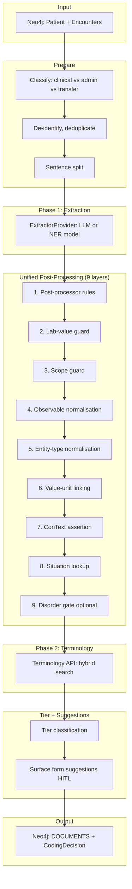

# Unified Pipeline — Plain English Summary

## What It Does

The unified pipeline turns **raw clinical notes** (e.g. GP encounter text) into **structured, coded medical terms** linked to SNOMED codes. It runs in two main phases: first it finds the medical words, then it matches them to official codes.

---

## End-to-End Flow (Plain English)

### 1. Get the Notes

The pipeline fetches patient encounters from the database (Neo4j). Each encounter is a chunk of clinical text (e.g. a consultation note).

### 2. Sort the Notes

Before processing, encounters are classified as **clinical** (needs coding), **admin only**, or **document transfer**. Only clinical notes go through the pipeline. Admin and transfer notes are skipped.

### 3. Prepare the Text

The encounter text is de-identified (removes patient identifiers), deduplicated, and split into sentences. Each sentence is given an ID so results can be tied back to the right bit of text.

### 4. Phase 1 — Find the Medical Words (Extraction)

An AI extractor reads each sentence and picks out clinical terms: disorders, findings, procedures, lab values, medications, etc. It also notes:
- Where in the text each term appears (start/end position)
- What type of thing it is (disorder, finding, procedure, etc.)
- Whether it’s present, absent, historical, hypothetical, etc. (assertion)
- For lab values: the numeric value, unit, and reference range

The extractor can be:
- **LLM** (large language model) — powerful, always available
- **Trained NER model** — faster, cheaper, trained on human-reviewed examples
- **Auto mode** — tries the trained model first, falls back to the LLM if needed

### 5. Tidy Up (Unified Post-Processing — 9 Layers)

The raw extracted terms go through a shared “tidy up” stack. Both the runtime pipeline and the training/label verification use the same logic, so there’s no mismatch between what’s trained and what’s used in production.

| Layer | What it does |
|-------|--------------|
| **1. Post-processor rules** | DB-driven text/label rewrites (e.g. fix common mislabels) |
| **2. Lab-value guard** | Suppresses disorders wrongly inferred from lab results (e.g. “creatinine 120” → don’t code as disorder) |
| **3. Scope guard** | Reclassifies assertions in safety-netting or hedged text (e.g. “consider diabetes” → hypothetical) |
| **4. Observable normalisation** | Cleans lab/measurement spans, attaches value, unit, reference range |
| **5. Entity-type normalisation** | Fixes label mistakes (e.g. smoking status → finding, bare analytes near observables → suppress) |
| **6. Value-unit linking** | Attaches nearby numeric values to observable entities (e.g. “glucose 5.2 mmol/L”) |
| **7. ConText assertion detection** | Uses MedSpaCy-style rules for negation, historical, family history |
| **8. Situation lookup** | Normalises situation text for terminology lookup |
| **9. Disorder gate** (optional) | LLM checks if a disorder is real vs informational/historical/refuted |

### 6. Phase 2 — Match to Codes (Terminology Resolution)

Each cleaned term is sent to the Terminology API, which looks up SNOMED (and Read codes) using hybrid search (exact match, fulltext, vector). The API returns the best matching concept(s) with a confidence score.

### 7. Decide What to Code (Tier Classification)

For each term, the system decides:
- **Coded** — high confidence, can be auto-coded
- **Not coded** — low confidence or blocked assertion (e.g. absent, hypothetical)
- **Coded with flag** — coded but needs human review

This depends on assertion, terminology score, and coding mode (human-in-the-loop vs autonomous).

### 8. Surface Form Suggestions (HITL mode only)

If a term has low or no terminology match, the system may suggest a better surface form via an LLM escalation call. High-confidence suggestions are stored for human review.

### 9. Save to the Database

The final coded terms are written to the patient graph as `DOCUMENTS` relationships: Encounter → Sentence → Term (with SNOMED concept, assertion, provenance). In autonomous mode, `CodingDecision` audit nodes are also written.

---

## Diagram

### Mermaid (renders in GitHub, GitLab, many docs viewers)



### ASCII

```
┌─────────────────────────────────────────────────────────────────────────────────────────┐
│                        UNIFIED PIPELINE — END TO END                                     │
└─────────────────────────────────────────────────────────────────────────────────────────┘

  ┌──────────────┐
  │   Neo4j      │
  │  Patient +   │
  │  Encounters  │
  └──────┬───────┘
         │ encounter text
         ▼
  ┌──────────────────────────────────────────────────────────────────────────────────────┐
  │  PREPARE                                                                               │
  │  • Classify (clinical vs admin vs transfer)                                           │
  │  • De-identify, deduplicate                                                            │
  │  • Sentence split                                                                      │
  └──────┬───────────────────────────────────────────────────────────────────────────────┘
         │ sentences
         ▼
  ┌──────────────────────────────────────────────────────────────────────────────────────┐
  │  PHASE 1 — EXTRACTION                                                                  │
  │  • ExtractorProvider (LLM or trained NER model)                                        │
  │  • Extracts: text, label, span, assertion, value/unit, confidence                     │
  └──────┬───────────────────────────────────────────────────────────────────────────────┘
         │ raw entities
         ▼
  ┌──────────────────────────────────────────────────────────────────────────────────────┐
  │  UNIFIED POST-PROCESSING (9 layers)                                                    │
  │  1. Post-processor rules    2. Lab-value guard    3. Scope guard                      │
  │  4. Observable norm.        5. Entity-type norm.  6. Value-unit linking               │
  │  7. ConText assertion       8. Situation lookup   9. Disorder gate (optional)         │
  └──────┬───────────────────────────────────────────────────────────────────────────────┘
         │ cleaned entities
         ▼
  ┌──────────────────────────────────────────────────────────────────────────────────────┐
  │  PHASE 2 — TERMINOLOGY RESOLUTION                                                     │
  │  • Terminology API (hybrid search: exact + fulltext + vector)                          │
  │  • Returns SNOMED concept_id, Read code, score                                        │
  └──────┬───────────────────────────────────────────────────────────────────────────────┘
         │ terms + codes
         ▼
  ┌──────────────────────────────────────────────────────────────────────────────────────┐
  │  TIER CLASSIFICATION + SURFACE FORM SUGGESTIONS (HITL)                                │
  │  • classify_tier(assertion, terminology_score, surface_form_status)                  │
  │  • coded / not_coded / coded_with_flag                                                │
  │  • Low-confidence terms → escalate_coding → CodingSuggestion                          │
  └──────┬───────────────────────────────────────────────────────────────────────────────┘
         │ final payload
         ▼
  ┌──────────────────────────────────────────────────────────────────────────────────────┐
  │  PERSISTENCE                                                                            │
  │  • write_documents_from_sentences_payload → DOCUMENTS relationships                    │
  │  • Autonomous mode: UPSERT_CODING_DECISION audit nodes                                │
  └──────┬───────────────────────────────────────────────────────────────────────────────┘
         │
         ▼
  ┌──────────────┐
  │   Neo4j      │
  │  Patient     │
  │  DOCUMENTS   │
  └──────────────┘
```

---

## Key Files

| Purpose | File |
|---------|------|
| Runtime pipeline orchestration | `services/coding_worker/app/pipeline/pipeline_service.py` |
| Unified post-processing (9 layers) | `libs/pipeline/post_processing.py` |
| Extractor (LLM / NER / auto) | `services/coding_worker/app/pipeline/extractor_registry.py` |
| Training label verifier (same post-processing) | `services/api/app/services/label_verifier.py` |
| Terminology resolution | External `TERMINOLOGY_API_URL` |

---

## Dual Paths

The **unified post-processing** is shared by:
- **Runtime pipeline** — when coding encounters in production
- **Training / label verifier** — when validating labels for the training corpus

This keeps training and inference aligned (no train/serve skew).

A separate path, **Ask LEO** (review UI), handles escalation when a reviewer clicks “Ask LEO”. It uses its own prompts and logic but shares the same assertion vocabulary and disorder verifier.
