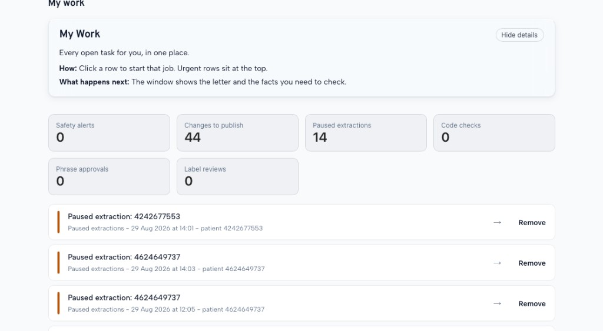
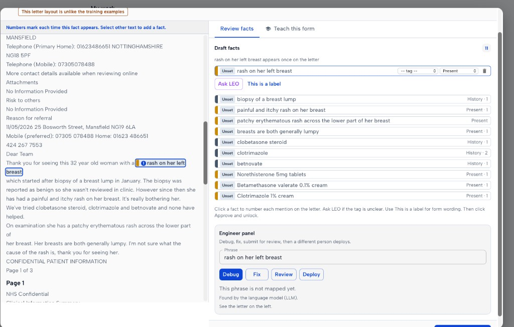
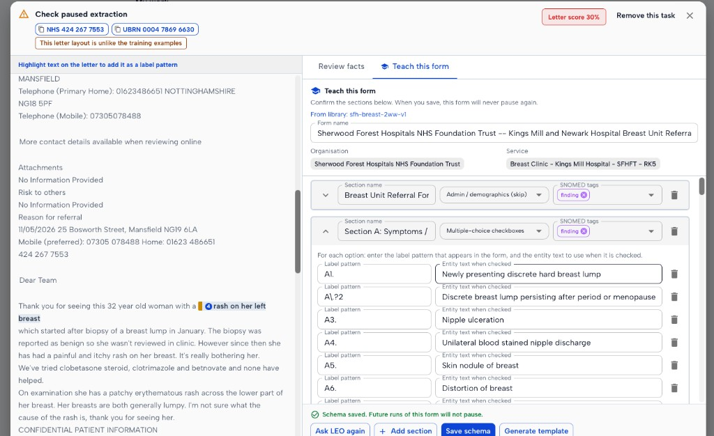

# User manual: paused extractions and Teach this form

**Audience:** knowledge-base authors and referral supervisors.
**Screen:** My Work.
**Goal:** clear one paused letter, and teach LEO how to read that form so later letters of the same type do not pause.

This guide uses the product screens. It does not ask you to write to the graph by hand.

---

## 1. What a paused extraction is

LEO reads a referral letter and tries to pull clinical facts.
Sometimes it stops and asks a person to check.

That stop is a **paused extraction**.
The referral does not finish until someone acts.

Typical reasons you will see on the brown banner:

| Banner text | What it usually means |
| --- | --- |
| This letter layout is unlike the training examples | The layout is new or unusual. Teach the form. |
| This form is not one we have seen before | No taught form is bound to this organisation and service. |
| Too many form lines could not be read | A form exists, but many lines did not match. Improve the sections. |
| The letter looks like a wrapper, not the clinical form | You may be looking at a cover sheet, not the 2WW form. |
| The letter scored poorly for extraction | Check the facts before you unlock. |
| No facts were found on the letter | Check the letter. Then teach or add facts. |
| Someone paused this for a check | A person asked for a review. |

The **letter score** (for example 30%) says how well this letter matched known forms.
A low score means check before you continue.

---

## 2. Find the work

1. Open **My Work**.
2. Look at the **Paused extractions** card. That is the count.
3. Click a row that starts with **Paused extraction**.
4. Urgent rows sit at the top.

**Remove** on the list only takes the task off your list.
It does **not** teach the form.
It does **not** unlock the letter.
Use Remove only for a duplicate or a task created by mistake.

---

## 3. Decide which tab you need

The window has two tabs.

| Tab | Use it when | What it changes |
| --- | --- | --- |
| **Review facts** | This one letter needs a check. The form is already taught, or the letter is free text. | This letter only. Then **Approve and unlock**. |
| **Teach this form** | This is a structured form LEO has not learned, or the taught form is wrong. | This organisation + service. Later letters of this form should not pause. |

Do both when the form is new **and** this letter still needs a person to approve the facts.

### Quick rule

- Tick-box hospital form (Section A, Section B, ECOG, blood table) -> start on **Teach this form**.
- Free-text GP summary or Clinical Information Summary -> stay on **Review facts**. Do not force a tick-box schema onto it.
- Cover sheet plus a form in one bundle -> teach the **clinical form**, and mark the cover sheet as skip (see section 6).

---

## 4. Review facts (this letter)

Use this tab to check what LEO already found.

1. Click a draft fact on the right.
2. Numbers on the letter show each mention of that fact.
3. Set the **tag** (finding, procedure, observable, and so on).
4. Set whether it is **Present**, **Historical**, **Not present**, **Uncertain**, **Planned**, **Family history**, or **Declined**.
5. Click **Ask LEO** if the tag is unclear.
6. Click **This is a label** if the text is form wording, not a patient fact.
7. Select other text on the letter to add a missing fact.
8. Delete junk facts (guidance text, cover-sheet contract lines, denied symptoms).
9. Click **Approve and unlock** when the list is safe.

The Engineer panel at the bottom is for a later mapping fix (Debug, Fix, Review, Deploy).
You do not need it to unlock this letter.

**Do not unlock** if Unset facts still look like real clinical findings you have not checked.

---

## 5. Teach this form (this form from now on)

The screen says: "When you save, this form will never pause again."
That is true for later runs that bind to this organisation and service.
So check the sections before you save.

### 5.1 What the screen already filled in

- **Form name** -- edit if the title is truncated or wrong.
- **Organisation** and **Service** -- usually locked from the referral. Leave them.
- **From library** -- shown only when the organisation/service library fingerprint is **different** from this letter's hash (for example `sfh-breast-2ww-v1`). You are editing that library copy, not starting from nothing.
- If this letter's hash already is the library form, the badge is hidden. The sections still load from the saved schema.

If the library copy is for a different form (same clinic, different letter type), stop and ask before you overwrite it.

### 5.2 Confirm every section

For each section:

1. Click the section so the letter jumps to the matching heading.
2. Check the **section name** matches the heading on the letter.
3. Set the **section type** (see the table below).
4. Set **SNOMED tags** if the default is wrong.
5. For tick-box sections, check every **label pattern** and **entity text when checked**.

To add a row from the letter:

1. Click the section card on the right first.
2. Highlight the printed label on the letter.
3. LEO adds a row. Both **label pattern** and **entity text** start as the same cleaned words (it strips `B1.` and trailing `(please tick)`).
4. Edit the entity text into a clinical sentence.

If no section is selected, and the highlight does not match a heading or existing pattern, you will see: "Select a section card on the right first, then highlight text."

### 5.3 Section types

| Type you pick | What LEO does | Use for |
| --- | --- | --- |
| Multiple-choice checkboxes | Each ticked box becomes the entity text. Unticked boxes are sealed. | Section A / B symptom lists. |
| Single-choice checkboxes | Same, but only one option should be true. | Site lists (Cervix / Ovary / Vulva). |
| Yes / No pairs | Reads a Yes box and a No box on the same item. | Packed Yes [ ] No [ ] rows. |
| Free-text narrative (extract as-is) | Keeps the lines after the heading until the next section. | History, examination, GP comments. |
| Ordinal scale | Ticked score becomes the entity text. | ECOG, Clinical Frailty Scale. |
| Tests ordered (no results yet) | Records the battery, not a result. | Bloods requested today. |
| Measured value (BMI, BP, HR) | Reads the number. | Observations. |
| Admin / demographics (skip) | Marks the block so it is not extracted. | Name, address, NHS number, header. |
| Template guidance text (skip) | Marks the block so it is not extracted. | "Points to remember", mastalgia advice, NICE reminder boxes. |

Changing the section type **clears the items** in that section.
Set the type first, then add the items.

### 5.4 Label pattern vs entity text

Two different jobs.

- **Label pattern** -- how the box appears on the letter. This is a match.
- **Entity text when checked** -- the clinical sentence LEO should store if that box is ticked.

Example from the Kings Mill breast form:

| Label pattern | Entity text when checked |
| --- | --- |
| `A1.` | Newly presenting discrete hard breast lump |
| `A\.?2` | Discrete breast lump persisting after period or menopause |
| `A5.` | Skin nodule of breast |

The pattern `A\.?2` matches both `A2` and `A.2`.
Printed forms often drop or add the full stop. Teach both.

Write entity text as a clear clinical sentence, not as "A1" or "box 2".
Downstream coding and completeness use that sentence.

### 5.5 Completeness rules

The tab **fills these rules for you** from Section A, Section B, bloods, blood pressure, heart rate, and performance status.

Search SNOMED and attach real codes to each rule.
A rule with **no codes** can score as met even when nothing was found.
That is how a letter with no Section A tick was once marked "2WW criterion complete".

Do not assume the seeded list is safe. Site names such as "Cervix" or "A1." often have **no code** until you add one.
If you are not ready to wire codes, delete those empty rules before you save.
Empty is safer than a vacant rule that always passes.

### 5.6 Buttons

| Button | What it does |
| --- | --- |
| **Ask LEO again** | Replaces **every** section with a fresh detect. This wipes a library copy you were editing. Use it only when the list is empty or clearly wrong. |
| **Add section** | Adds a blank section. Use this when detect missed a heading. |
| **Save schema** | Writes the form through `PUT /api/form-schemas/{fingerprint}` with organisation, service, and completeness. On My Work this then **re-runs extraction** and closes the window. You do not go back to Review facts. |
| **Generate template** | Appears only after a successful save. Shows the cleaned letter and stores it on the schema. On My Work the window may close before you can use it. Use Settings -> form schemas if you need to inspect the template. |
| **Approve and unlock** (Review facts tab) | Finishes **this** letter without teaching. Use this when the form is already taught, or the letter is free text. |

A taught form sets `known_schema=True`. The quality gate then scores 1.0 and does not pause later letters that bind to that schema.

---

## 6. Things to watch for

These came from teaching Sherwood Forest Hospitals (SFH) breast and gynae 2WW forms on live letters.
They will happen again on the next trust.

### 6.1 Always mark guidance text as skip

The gynae form ends with **Points to remember**:

> Think of possible ovarian cancer in a post-menopausal woman with new onset bloating, constipation, abdominal pain, urinary symptoms...

If that block is not **Template guidance text (skip)**, those words become patient facts.
Guidelines then fire on planted symptoms (ovarian tests, FIT, even a prostate rule).

Do the same for:

- mastalgia / self-care advice on breast forms
- NICE reminder boxes
- "must not be rejected" / contract lines on a cover sheet
- Jess's Rule and other campaign banners

### 6.2 Teach the clinical form, not the wrapper

Some bundles start with **Generic Referral Cover Sheet**.
The pause reason may say the letter looks like a wrapper.

Mark the cover sheet **Admin / demographics (skip)** or **Template guidance text (skip)**.
Teach Section A onwards as the real form.

If the bundle is only a cover sheet and a free-text summary, do not invent missing 2WW boxes.

### 6.3 One clinic can send more than one letter type

The breast clinic uses:

- the Kings Mill Breast Unit 2WW tick-box form
- a Clinical Information Summary (free text)
- a cover sheet only

A schema bound to organisation + service will attach to **all** of those.
That is coarse.

Do not teach tick-box Section A from a free-text rash letter.
On a free-text letter, use **Review facts** and leave the library form as the 2WW template.

### 6.4 Packed boxes on one line

Section A often prints several Yes boxes on one row (A3 to A6, or ECOG 0 to 4).

Check **Generate template** after save:

- each ticked box must become **its own** entity text
- a tick on A5 must not become A3
- an ECOG "0" tick must not match the section heading "Performance status"

If a number is too short (`0`, `1`), make the pattern longer (`0` plus "Fully active").

### 6.5 Unticked boxes and blank tables must stay silent

A blank blood table is not a result.
An unticked "nipple ulceration" box is not a finding.

If **Generate template** still shows those sentences, the pattern is matching the wrong line.

### 6.6 Denied text is not a present fact

On Review facts, delete or set **Not present** when the letter says:

- "no known family history"
- "no bleeding noted"
- "denies abdominal pain"

Do not click Approve while those still show as Present.

### 6.7 Do not save an empty or skip-only schema

Save needs at least one section with a start pattern.
A schema that is only Admin / skip sections will not teach the clinical form.
LEO will keep pausing, or later letters will bind to a hollow form.

### 6.8 Changing section type wipes items

If you switch "Multiple-choice checkboxes" to "Admin / demographics (skip)", the label rows go.
Confirm the type before you type a long list.

### 6.9 After save, check the next letter of the same form

Saving stops the pause for that form fingerprint / organisation / service.
It does not prove the ticks became the right facts.

Open a second paused row for the same clinic (or wait for the next run) and confirm:

- ticked boxes appear as draft facts with the entity text you wrote
- guidance text does not appear as facts
- completeness does not say "complete" when no criterion box was ticked

---

## 7. Worked example: Kings Mill breast 2WW

This is the form in the screenshots (`From library: sfh-breast-2ww-v1`).

1. Open the paused extraction. Note NHS number and UBRN chips so you have the right letter.
2. Read the banner. "Unlike the training examples" plus a low letter score means teach, then review.
3. Open **Teach this form**.
4. Keep organisation **Sherwood Forest Hospitals NHS Foundation Trust** and service **Breast Clinic - Kings Mill Hospital**.
5. Confirm Section 1 is **Admin / demographics (skip)** (the "Breast Unit Referral For" header).
6. Confirm Section A is **Multiple-choice checkboxes**.
7. Check each A-row: pattern matches the printed code (`A1.`, `A\.?2`, `A3.` ...), entity text is the full criterion.
8. Add **Template guidance text (skip)** for any mastalgia / self-care block.
9. Add **Free-text narrative** for history and examination boxes.
10. Add **Ordinal scale** for ECOG, with long patterns so "0" does not hit the heading.
11. Add **Tests ordered** or skip for a blank blood table.
12. Check completeness rules and add SNOMED codes, or delete empty rules.
13. Click **Save schema**. On My Work, LEO re-runs this letter and the window closes.
14. If you need to inspect the cleaned template, open the same form under Settings after save.

---

## 8. If something looks wrong

| You see | Try this |
| --- | --- |
| No sections, empty teach tab | Click **Add section**, or **Ask LEO again**. Then teach by hand from the letter. |
| "You are not allowed to auto-detect" | You can still add sections and save. Ask an admin if detect should be allowed. |
| "We could not identify this form" | Reload the letter. Do not save against fingerprint `unknown`. |
| Library name is a gynae form on a breast letter | Stop. Wrong bind. Do not overwrite. |
| Save succeeds but the next letter still pauses | The next letter may be a different layout (CIS vs 2WW). Teach only if it is the same form. |
| Ticks still do not become facts | Patterns are too tight or too loose. Check `A.2` vs `A2`. Use Generate template. |
| Guidelines mention symptoms not in the history | Guidance text leaked. Add a skip section and save again. |

---

## 9. What the product saves (for trainers)

You do not need this to do the job. It is here so trainers know the safe path.

| Action on screen | Product call |
| --- | --- |
| Open the paused row | `GET /api/operations/extraction-reviews/{task_id}` |
| Load My Work | `GET /api/work/tasks` |
| Load a library form | `GET /api/form-schemas?organization_id=&service_id=` then `GET /api/form-schemas/{fingerprint}` |
| Save schema | `PUT /api/form-schemas/{fingerprint}` |
| Generate template | `POST /api/form-schemas/{fingerprint}/template` |
| Approve and unlock | complete extraction-review on `/api/operations/extraction-reviews` |
| Remove task | `POST /api/operations/extraction-reviews/cancel` |

Those routes write the graph for you. They also keep organisation and service scope.

---

## 10. How an earlier session taught the breast form (do not copy this for routine work)

A previous review session did **not** use Teach this form.

- It **read** live letters with Neo4j Cypher through the `user-neo4j-mcp` tool. That was investigation only.
- It **wrote** the breast schema with `scripts/seed_sfh_breast_2ww_template.py --write-graph`. That writes the graph directly. It is for engineers and fixtures, not for day-to-day teaching.

Use **My Work -> Teach this form -> Save schema** for new hospital forms.
Use a seed script only when you are adding a versioned fixture and tests in the repo.

That session is also why the watch-list in section 6 exists:

- `A.2` vs `A2` on the same printed row
- several Yes boxes on one line (A3 to A6, ECOG)
- "Points to remember" becoming ovarian symptoms
- cover-sheet contract text becoming the SBAR headline
- org/service bind attaching a 2WW schema to a free-text summary
- completeness rules with no SNOMED codes scoring as complete
- "no known family history" stored as present

If you teach the skip blocks, the patterns, and the entity text with care, you prevent those failures on the next trust.
